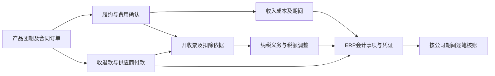

# 参团游真实ERP验收准备11：税票与凭证

2026-11-07。承接[范围与规则](测试目录.md)、[第九组外币](09-外币与精度-20261107.md)及[第十组财务确认](10-结算与财务确认-20261107.md)。本步整理二十六组场景、二十二节点连续样板、逐事件会计分录预期及第十组价税桥接。目标是将真实采购、履约、收退付和调整形成的金额核到ERP凭证，不把发票任务“完成”或凭证“平衡”当作验收结束。

**当前交付是验收准备底稿，未执行真实ERP、开票、支付、并发、审批或凭证测试。** 下列税务分支须先核公司资格、交易实质、有效政策和合规凭据，再锁定预期；凯撒正式科目编码、税码、辅助核算及生效版本仍待确认。国家规定不是可任意选择的测试参数，公司的适用事实与内部办理规则尚待补据，不能按系统实际结果反选政策。NC按用户确认分期，本期核ERP凭证及导出承接，不测试真实NC接收。

## 一、业务链路及现行证据

销售维护真实买方及开票申请，产品计调核服务完成、采购费用和调整责任；资金岗位核实际收退付；税务岗位核税务处理、票据及扣除资格；核算岗位确认收入成本、期间和凭证；复核人审金额、科目及辅助核算。辅助核算是凭证中用于分清客户、供应商、部门或团期的明细归属。开票和资金都可能早于或晚于履约，不能强制八个按钮顺次完成才承认经济事实。

| 业务要求 | 当前代码与对应文档 | 已有能力／现状 | 真实验收缺口及本步处理 |
|---|---|---|---|
| 找到实际税票与核算入口 | `shared/nav-merchant.js`；财务流程03 | 财务有发票管理、NC推送；数据中心有核算核对。报表是只读核对 | 在真实环境找ERP凭证生成入口；不能因原型入口名为NC而将本期ERP凭证漏验 |
| 客户开票与供应商收票分工 | `merchant/finance/finance-invoice.html`；财务流程03第七、八部分 | 有开票、收票、核验、异常和红冲抽屉，展示来源及金额；普通任务可选择“开票成功”，按任务号拼出票号／凭证号 | 这是原型结果登记，不能证明税务受理、验真、用途确认或会计分录真实形成；真实回执与账务来源必须查询 |
| 补票不得再确认整笔应付 | `shared/supplier-finance-model.js`；财务流程02及03 | 模型区分账单、应付、付款和发票，并有票面补正与核验 | 核实际费用、暂估、应付与发票的逐笔对应；收票只补证或按资格调税，不再次造采购成本和欠款 |
| 同票多单、多款及红冲历史 | `shared/finance-invoice-report-model.js`；[发票收付款原型记录](发票与收付款核对原型验收记录-20260914.md) | 已有四类票款差额、分配、原票红票重开、生效日与资料截止；缺来源可显示待核对 | 不沿用早期“没有票款分配模型”的判断；现有独立示例仍不是从真实订单生成的历史 |
| 区分未拆税范围与财务金额 | `shared/return-finance-model.js`；财务流程03 | 有收入成本、税额与依据、期间及调整模型；10,600／10,000／600只是算例 | 原型6%不能替公司批准；收入、销项税、成本、进项税、差额抵减分别核 |
| 凭证不能只核借贷总数 | `shared/finance-accounting-model.js`；[会计事项工作稿](业财底座04-会计事项与NC凭证规则.md) | 模型能识别旧NC示例借贷不平及来源／返回金额不符，但资料固定 | 核每行责任公司、科目、借贷、币种、汇率、期间、往来及团期；平衡而错公司、错科目或重复也失败 |
| 普通参团与其他产品边界 | `merchant/finance/finance-nc.html`；现行会奖税务／航服核算扩展 | 页面还有会奖、航服专用脚本和核算准备能力 | 专用能力不能证明参团已接通，也不把其税率、履约和凭证规则套给参团；本步不改任何业务页面 |
| 红票、业务调整、会计冲销各有事实 | `merchant/finance/finance-settlement-adjustment.html`；财务流程03、底座04第十三部分 | 已有调整与原单承接方向 | 退价先明确业务责任；票据红冲与凭证冲销分别留原单关系；旧工作稿“一律开放期间”不能替代第十组差错／日后事项判断 |

总对照增补验筹18；[决策表](待确认问题决策表.md)新增参验-13，并沿用P0-14／15、P1-12、RPT-10／17／22及参验-04，不重开已确认范围。

## 二、先确定税务分支，再准备数据

2026年起适用新的[增值税法](https://shanghai.chinatax.gov.cn/zcfw/zcfgk/zzs/202412/t474694.html)及[实施条例](https://shanghai.chinatax.gov.cn/zzzb/zcwj/202601/t478908.html)。本稿以2026-11-07检索的现行官方资料补充验收条件，不能只沿2016版营改增标签编脚本。税务申报整表、实际缴税和企业所得税汇算不在本步扩建范围，但ERP金额需要能解释到税务依据；新增附加税等事项如属本期ERP责任，应另补正式参数后纳入，未提供不能写成0。

| 必须锁定的事实 | 用什么证据判断 | 对自动验收的影响 |
|---|---|---|
| 谁是纳税人，谁是开票方、收票方和账簿责任人 | 法人及分支机构登记、一般／小规模资格、汇总申报批准、有效日期 | 集团不同公司不能因同一品牌互抵进销项；同法人门店不自动等于另一个纳税人；也不能仅凭同法人忽略分支申报规定 |
| 主责销售还是代理服务 | 合同、定价与履约责任、原第一组规则 | 会计总额／净额与增值税全额／差额不是同一维度。会计净额收入不意味着拿“团费减所有成本”作为佣金税基 |
| 国内旅游服务是否采用合规差额扣除 | 费用性质、实际支付、合法凭据、开票方式、适用期间 | 可扣范围需逐项证明；没有依据不得把全部团成本自动扣除 |
| 境外旅游免税还是境内应税／其他处理 | 服务提供地点、合同服务范围、申报及留存证据、是否放弃优惠 | “出境游”名称、外币结算或境外供应商不自动证明全额免税；免税与零税率分开 |
| 每笔采购如何处理税额 | 发票项目及税额、真实性与用途确认、应税／免税用途、是否已差额扣除 | 取得专票不等于已经可抵扣，查验通过也不等于用途确认完成；同一费用不得重复享受两类扣税 |
| 业务、会计、税务、票据各在哪一天成立 | 合同付款日、实际履约、收款、开票、扣除凭据、确认及会计期间 | 预收、未开票收入、先开票、跨月补票和红字分别检验，不能统一使用开票日或操作日 |
| 税额怎样舍入和分摊 | 税务平台有效票面、批准的分项／逐票规则、尾差归属 | 保留每张原票和红票金额；不能用最终净额重新拆税覆盖原来一分钱的差异 |
| 哪个事项形成什么凭证 | 各公司科目表、必填辅助核算、凭证汇总、复核／记账职责、生效版本 | 无正式映射只能完成条件算例；允许记作待配置，不能自动选“其他应收／应付”凑平 |

旅游服务差额政策在2026—2027年继续适用，列举住宿、餐饮、交通、签证、门票及接团旅游费用；要求有效凭据，并限制扣除部分的专票开具及重复进项抵扣。详见[2026年第10号公告第四条](https://shanghai.chinatax.gov.cn/zzzb/zcwj/202602/t479283.html)。这不等于每项成本都符合，也不等于凭采购预算即可扣除。会计处理参考[财政部增值税会计处理规定](https://www.mof.gov.cn/zcsjtsgb/gfxwj/201612/t20161203_3583467.htm)：符合条件的差额抵减与成本调整分别体现。正式科目和具体取得时点仍须由税务、核算共同落表。

## 三、条件主样板：从新建团到票、税、凭证和余额

### 税01：国内主责自营参团，预收预付、分次收票、客户退价与供应商返价

**测试设定，不是已批准的公司政策。** 测试甲为境内一般纳税人、人民币账簿，向客户承担旅游主责；本例旅游服务6%，采用合规差额扣除。新建国内产品、20人团期、酒店H及地接L，两个十人订单分别53,000，成人单价5,300，总收费106,000。H住宿合同31,800，L接团服务合同31,800；资料证明均为实际履约、向客户收取并已支付、可扣范围，分别取得合规票据。本例无其他收入成本、无期初余额、不缴税、不转结税额至其他明细、无附加税及部门费用，不称公司净利润或整期应纳税申报额。

主线采用经批准的时点履约测试分支：出行前收到第一单53,000是合同负债，即尚欠客户服务；未先开票，尚未触发本例纳税义务。另付H预款10,600。完成服务时两个订单收入条件及剩余无条件收款权成立，确认收入100,000、销项6,000，原预款不再当收入；业务订单应收与会计应收不能机械复制。真实日期按测试环境允许的会计期间安排，不能由AI擅自改服务器时间或回填过去履约结果。

AI必须先以产品、供应商、销售、资金、计调、税务和核算岗位正常建单办理；合规票据测试资料从已创建的采购和订单生成，号码来自测试开票服务或可验证的测试回执。不得直接写数据库补最终财务余额。本地复算中的“记分录”是预期，不是绕过源业务直接给ERP录凭证。

下表“成本价款”是未拆税业务费用；“财务成本”已按本例合法扣除调整；“销项抵减”是费用符合差额条件后减少的销项税，**不是进项税**。客户净票、供应商净票只统计有效蓝字减红字价税合计；不是税额也不是收付。分次票面及扣除在下一张到达前不能提前完成。

| 节点 | 收费 | 成本价款 | 财务收入 | 财务成本 | 销项 | 销项抵减 | 客户净票 | 供应商净票 |
|---|---|---|---|---|---|---|---|---|
| 01 新建主数据产品团期 | 0 | 0 | 0 | 0 | 0 | 0 | 0 | 0 |
| 02 确认两张十人订单 | 106,000 | 0 | 0 | 0 | 0 | 0 | 0 | 0 |
| 03 客户预付53000 | 106,000 | 0 | 0 | 0 | 0 | 0 | 0 | 0 |
| 04 酒店预付10600 | 106,000 | 0 | 0 | 0 | 0 | 0 | 0 | 0 |
| 05 履约与收入税额确认 | 106,000 | 0 | 100,000 | 0 | 6,000 | 0 | 0 | 0 |
| 06 酒店成本确认 | 106,000 | 31,800 | 100,000 | 31,800 | 6,000 | 0 | 0 | 0 |
| 07 地接成本确认 | 106,000 | 63,600 | 100,000 | 63,600 | 6,000 | 0 | 0 | 0 |
| 08 酒店预付冲抵 | 106,000 | 63,600 | 100,000 | 63,600 | 6,000 | 0 | 0 | 0 |
| 09 酒店尾款支付 | 106,000 | 63,600 | 100,000 | 63,600 | 6,000 | 0 | 0 | 0 |
| 10 地接款支付 | 106,000 | 63,600 | 100,000 | 63,600 | 6,000 | 0 | 0 | 0 |
| 11 酒店收票及扣除确认 | 106,000 | 63,600 | 100,000 | 61,800 | 6,000 | 1,800 | 0 | 31,800 |
| 12 地接首票及扣除确认 | 106,000 | 63,600 | 100,000 | 60,600 | 6,000 | 3,000 | 0 | 53,000 |
| 13 地接尾票及扣除确认 | 106,000 | 63,600 | 100,000 | 60,000 | 6,000 | 3,600 | 0 | 63,600 |
| 14 客户尾款到账 | 106,000 | 63,600 | 100,000 | 60,000 | 6,000 | 3,600 | 0 | 63,600 |
| 15 客户首票53000 | 106,000 | 63,600 | 100,000 | 60,000 | 6,000 | 3,600 | 53,000 | 63,600 |
| 16 客户尾票53000 | 106,000 | 63,600 | 100,000 | 60,000 | 6,000 | 3,600 | 106,000 | 63,600 |
| 17 生成凭证及重复请求核对 | 106,000 | 63,600 | 100,000 | 60,000 | 6,000 | 3,600 | 106,000 | 63,600 |
| 18 客户让价及有效红票 | 95,400 | 63,600 | 90,000 | 60,000 | 5,400 | 3,600 | 95,400 | 63,600 |
| 19 客户退款支付 | 95,400 | 63,600 | 90,000 | 60,000 | 5,400 | 3,600 | 95,400 | 63,600 |
| 20 酒店返价及扣除更正 | 95,400 | 57,240 | 90,000 | 54,000 | 5,400 | 3,240 | 95,400 | 57,240 |
| 21 酒店返款到账 | 95,400 | 57,240 | 90,000 | 54,000 | 5,400 | 3,240 | 95,400 | 57,240 |
| 22 二次结算及凭证复核 | 95,400 | 57,240 | 90,000 | 54,000 | 5,400 | 3,240 | 95,400 | 57,240 |

以下余额从同一事件序列独立推导。成本未齐阶段只表示已确认金额，不能提前发布完整毛利。H与L不能互相抵销，客户应退与供应商应返也不能净额抹掉。银行列为本组累计净现金，阶段性负数表示本例经营流出高于流入，不要求真实银行账户透支；执行前应提供足够测试资金，另行记录开场资金并从本例差额排除。

| 节点 | 净现金 | 客户应收 | 合同负债 | 预付H | 应付H | 应付L | 客户应退 | 供应商应返 |
|---|---|---|---|---|---|---|---|---|
| 01 | 0 | 0 | 0 | 0 | 0 | 0 | 0 | 0 |
| 02 | 0 | 0 | 0 | 0 | 0 | 0 | 0 | 0 |
| 03 | 53,000 | 0 | 53,000 | 0 | 0 | 0 | 0 | 0 |
| 04 | 42,400 | 0 | 53,000 | 10,600 | 0 | 0 | 0 | 0 |
| 05 | 42,400 | 53,000 | 0 | 10,600 | 0 | 0 | 0 | 0 |
| 06 | 42,400 | 53,000 | 0 | 10,600 | 31,800 | 0 | 0 | 0 |
| 07 | 42,400 | 53,000 | 0 | 10,600 | 31,800 | 31,800 | 0 | 0 |
| 08 | 42,400 | 53,000 | 0 | 0 | 21,200 | 31,800 | 0 | 0 |
| 09 | 21,200 | 53,000 | 0 | 0 | 0 | 31,800 | 0 | 0 |
| 10 | -10,600 | 53,000 | 0 | 0 | 0 | 0 | 0 | 0 |
| 11 | -10,600 | 53,000 | 0 | 0 | 0 | 0 | 0 | 0 |
| 12 | -10,600 | 53,000 | 0 | 0 | 0 | 0 | 0 | 0 |
| 13 | -10,600 | 53,000 | 0 | 0 | 0 | 0 | 0 | 0 |
| 14 | 42,400 | 0 | 0 | 0 | 0 | 0 | 0 | 0 |
| 15 | 42,400 | 0 | 0 | 0 | 0 | 0 | 0 | 0 |
| 16 | 42,400 | 0 | 0 | 0 | 0 | 0 | 0 | 0 |
| 17 | 42,400 | 0 | 0 | 0 | 0 | 0 | 0 | 0 |
| 18 | 42,400 | 0 | 0 | 0 | 0 | 0 | 10,600 | 0 |
| 19 | 31,800 | 0 | 0 | 0 | 0 | 0 | 0 | 0 |
| 20 | 31,800 | 0 | 0 | 0 | 0 | 0 | 0 | 6,360 |
| 21 | 38,160 | 0 | 0 | 0 | 0 | 0 | 0 | 0 |
| 22 | 38,160 | 0 | 0 | 0 | 0 | 0 | 0 | 0 |

每一节点核：**净现金＋客户应收＋供应商预付＋供应商应返－合同负债－供应商应付－客户应退－本例税额余额＝已确认收入－已确认成本**。该式只适用本例列全的余额，不能省略待转税、其他资产或费用后推广给所有团。

核心分录采用业务可读科目名称；实际科目编码、税码及辅助核算待参验-04／13映射。逐事件借贷明细保存在[独立复算结果](evidence/group-tour-tax-voucher-20261107/calculation-checks.json)的技术附录数据中。每张真实凭证可以按已批准规则合并／拆分，但必须还原到同一来源金额，不能以本表行数要求固定凭证张数。

| 事件 | 借方预期 | 贷方预期 | 核对重点 |
|---|---|---|---|
| 预收客户53,000 | 银行53,000 | 合同负债53,000 | 不确认收入；客户与订单分配保留 |
| 预付H10,600 | 预付H10,600 | 银行10,600 | 不确认服务成本 |
| 履约完成确认106,000 | 合同负债53,000、客户应收53,000 | 收入100,000、销项税额6,000 | 原预收只冲一次；已具纳税义务，后来开票不再加税 |
| H及L服务费用各31,800 | 成本各31,800 | 应付H及L各31,800 | 两方各有来源；补票不再造63,600应付 |
| H预付冲抵与付款 | 应付H10,600；应付H21,200 | 预付H10,600；银行21,200 | 冲抵不是现金支付 |
| L付款31,800 | 应付L31,800 | 银行31,800 | 最终两家应付均0 |
| 三份合格扣除凭据 | 销项税额抵减1,800／1,200／600 | 成本1,800／1,200／600 | 收票本身与扣除条件成立分别留证，不做进项再抵扣 |
| 客户尾款53,000 | 银行53,000 | 客户应收53,000 | 已开未收与真正应收分别核 |
| 客户让价10,600，红冲减税条件同期满足 | 收入10,000、销项税额600 | 客户应退10,600 | 条件不同的先后顺序另跑税10；不因退款执行再减收入 |
| 客户退款执行 | 客户应退10,600 | 银行10,600 | 应退清零且保留原实际收款 |
| H返价6,360，扣除基础同步减少 | 供应商应返6,360；成本360 | 成本6,360；销项税额抵减360 | 净成本减6,000；已获税额抵减要恢复360 |
| H实际返款 | 银行6,360 | 供应商应返6,360 | 不再减成本 |

最终业务收费95,400、成本价款57,240、未拆税差额38,160；会计收入90,000、成本54,000、毛利36,000；销项5,400减差额抵减3,240＝本例税额余额2,160。净现金38,160＝毛利36,000＋尚未缴纳的本例税额2,160。只核现金38,160便宣称财务利润38,160应判失败。

### 税02：同样现金，另一独立的全额计税与进项抵扣分支

另建产品和采购，事先确认采用全额计税，H与L均提供符合抵扣条件的6%专票，已依法确认用途，费用不参加差额扣除。106,000销售拆收入100,000、销项6,000；63,600采购拆成本60,000、进项3,600，净税额2,400。之后相同退价、返价得到收入90,000、成本54,000、进项3,240、销项5,400。与税01最终金额可相同，但税额路径不同，不能混用同一批凭据；若又扣差额3,600，会少计税3,600。校验税务台账分类和凭证行，而非只比最后毛利。

### 税03：差额扣除资格与证据不齐

从税01节点10分叉：H已付且票齐，L未取得合规凭据，只准本例H抵减1,800，税额余额4,200；L首票21,200生效后累计抵减3,000，余600不得提前扣。另建“已收票未付款”“已付款未收票”“错误公司抬头”“境外凭据缺提供方”“同一费用已进项抵扣”“费用仅预算未履约”六支，逐项保持待核，不能整团标已扣。另把63,600中的10,600明确改成员工个人消费／非代客户收付费用，不自动作为旅游差额扣除；可扣基础53,000对应抵减3,000。领队服务性质不因“人员费”三个字一律排除或放行，应查合同。

### 税04：四类票款差额及一票多单

分别新建四个不同责任对象：客户单甲收53,000开31,800→已收未开21,200；客户单乙开53,000收31,800→已开未收21,200；H付31,800收票21,200→已付未收票10,600；L收票31,800付10,600→已收票未付21,200。先核每一对象再汇总，不能把甲乙正反差额互抵。票款分配要按合同客户／供应商、公司和币种；未分配另列，未到约定开票／付款日不直接判逾期。票款差额不代替应收应付和收入成本。

### 税05：信息更正、部分红冲及重复申请

对原53,000发票只更正同一真实买方的错误资料：红53,000后重开53,000，净票额仍53,000；不改合同价、不退钱、不重记收入。买方换成另一家公司须先核实际交易，不能冒充普通抬头更正。另对两票共106,000部分红10,600，净票95,400；连续申请累计不能超过对应原票可红余额。数电票已用途／入账确认与未确认采用不同流程，已抵扣收到红字确认单还涉及进项转出时点，不能等现金退回。依据[税务总局2024年第11号公告](https://fgk.chinatax.gov.cn/zcfgk/c100012/c5236067/content.html)；红冲申请、对方确认、红票开具、ERP回执分别留状态，失败和超时不冒充已红。

### 税06：先开票，但还未满足收入确认

从新团收到53,000预款后分叉，依法先开票53,000且开票已触发纳税义务：本例销项3,000，预收中尚未履约的不含税部分50,000，收入仍0。示例分录为借合同负债3,000／贷销项3,000；实际公司若采用其他过渡科目，须有批准对应并保持同一责任金额。履约时确认收入100,000，仅补销项3,000，不能再次确认全部6,000。对照未开票的出行前预收分支，按合同付款权与交易进度判断税点，不能概括为“收预款一定不纳税”。纳税义务与收入分离依据见[增值税法第二十八条](https://shanghai.chinatax.gov.cn/zcfw/zcfgk/zzs/202412/t474694.html)及[实施条例第三十九条](https://shanghai.chinatax.gov.cn/zzzb/zcwj/202601/t478908.html)。

### 税07：已履约未开票与后补开票

完成106,000服务且税点成立，客户未索票：收入100,000、销项6,000与未开票应税记录均有依据。次月开票要将对应未开票申报基础承接到已开票，不能把同笔6,000税额和100,000收入再加一次。若收入先成立、税点未到，需单独的待转税额及随后转出分录；不得把本主线“同时成立”固化为所有合同规则。核原履约日、税点、开票日和会计期间四种日期。

### 税08：票面税额、查验、用途确认及可抵扣金额

全额计税分支采购10,600、票面税600。先登记／查验、后用途确认；确认前不能冒称已抵扣600。满足条件时净成本10,000、可抵扣600；明确不得抵扣时成本10,600。对晚票沿原暂估转实际，不先暂估600进项；已取得且未来可抵扣但未确认用途的过渡科目由正式政策确定，不用“资料未知”直接当不得抵扣。作废、异常、税号不符、已全额红冲或用途改变分别验；个人消费与旅游服务购入再销售不能仅因项目叫“餐饮”一刀切。

### 税09：票据多团分配、唯一性与跨公司误用

一张31,800票分两个团21,200和10,600，扣除／成本只在原票总额内分配，未分配余额为0。再给第三团分1元应拒绝，不能反向加大原票。重复上传同一票不产生第二次扣除；同号内容冲突要待核。合并开票须买方身份和业务关系一致，客户不同不能为凑金额合票。另一公司上传同票不能共享甲公司的进项；对跨公司代付保留资金清算关系，不以付款账户决定税额归属。

### 税10：退价、红票、实际退款不在同一天

税01让价10,600的主线假定减税条件同期齐备。另做业务让价获准但税务红冲未完成、先退款后红票、先红票后退款三支：应退10,600、收入减少10,000和税额待处理600要分别解释；在依法可扣减前不能提前减少应交税。600暂挂何种过渡科目、何时转入销项调整由正式会计规则确定，不强填标准科目。已有专票但未合法红冲时尤其不能只按售后审批减销项。退款执行只冲应退与银行，红票只结清对应税务差异，不再减整笔收入。见[实施条例第三十八条](https://shanghai.chinatax.gov.cn/zzzb/zcwj/202601/t478908.html)。

### 税11：供应商返价与红字进项转出

差额分支H减价6,360，已扣除基础必须减少，恢复原抵减360；不能一边拿回钱一边保留全部扣除。全额抵扣分支则冲采购净成本6,000和对应进项360，不写成销项抵减；已经申报抵扣的发票按红字确认单处理转出，再收红票不第二次转出。供应商尚未返款留6,360应返，回款后仅冲往来；只更正票面信息后重开同额的分支不产生采购返价。

### 税12：价税合计、分项税率和一分钱尾差

专门新建三张各含税0.10的合法最小金额测试票，6%逐票税额各0.01，合计0.03；把0.30合并拆税为0.02，差0.01。真实平台若不允许该最小金额，改用能复现同等尾差的合法金额并先重算。分配只能把实际票面0.03分出去，不静默改票面为0.02。酒店、交通等采购可能税率不同，不用旅游销售6%统一拆所有供应商成本；票面零税额、免税、不征税、未知税额分别保存，缺值不补0。

### 税13：境外旅游免税分支及不可抵扣成本

对第九组出境团先补境外旅游服务及适用免税的合同、履约和申报依据，符合条件才以240,000为免税收入，不生成6%销项。若专用于该免税业务的国内采购10,600包含税600且依法不得抵扣，成本仍10,600，不能拆成10,000虚增毛利。未符合条件、服务含境内独立项目、已放弃优惠、证据逾期等另跑并标适用待核，不能全用0%。境外旅游免税与零税率不是同一种政策，依据[2026年第11号公告第六条](https://shanghai.chinatax.gov.cn/zzzb/zcwj/202602/t479284.html)。境外供应商在境外现场提供服务也不能仅因我方付款就套国内代扣增值税，需核[实施条例第四条](https://shanghai.chinatax.gov.cn/zzzb/zcwj/202601/t478908.html)的境内消费判断。

### 税14：同一出境团包含不同税务责任

条件分支设总价106,000：经税务明确可分别核算的境外旅游服务95,400免税、境内独立应税服务10,600适用6%，则收入105,400、销项600。不能仅为省税按机票／酒店成本比例人为拆售价；若法律判断是一项主附交易或不能单独核算，改用该批准分支，不可选择本算例。供应商成本按对应用途归集；共同费用不能任意全部放入可抵扣的境内部分。混合业务分类与兼营优惠核算依据见[增值税法第十三、二十六条](https://shanghai.chinatax.gov.cn/zcfw/zcfgk/zzs/202412/t474694.html)。

### 税15：外采参团，主责转售与代理佣金

同产品分别建两种合同。主责转售按税01或税02适用规则核全额对客收入。代理分支经确认，甲代收客户106,000，主责方对客开票；甲含税佣金10,600，收入10,000、销项600，代收待转95,400不做甲的旅游收入或成本。转给主责方60,000后仍欠35,400，不能称“已结清”。核佣金发票的真实购买方和代收款排除税基条件，不能只看到会计净额便自动免税。以委托方名义开票代收款的税基规则见[实施条例第十五条](https://shanghai.chinatax.gov.cn/zzzb/zcwj/202601/t478908.html)。

### 税16：集团内采购转售及代销都验，税额不得集团净抵

另建全额计税且专票可抵扣的条件样板：A对客106,000，向B采购84,800，B向外采购63,600。A收入100,000、成本80,000、毛利20,000；B收入80,000、成本60,000、毛利20,000；内部80,000收入成本核对抵销后对外毛利40,000，税额仍分A、B各自台账，不把集团财务看得见理解成可跨纳税人抵扣。两方内部含税应收应付均84,800，代收与货款不能混写。

代销另建：B主责对客收入100,000、成本60,000；A向B提供代理服务含税10,600，A收入10,000／销项600；B在允许抵扣条件下佣金成本10,000、进项600，经营差额30,000。两公司对外合计40,000，只统计一份客户成交；同法人门店不生成一张虚构的跨法人佣金票。此为管理核对样板，不宣称已做法定合并。

### 税17：优惠、门店分润、平台净额与开票金额

三个分支分别建单：本公司对客折扣10,600且开票按合法折扣方式表达，最终收费95,400、6%税5,400；平台代收原价106,000、扣服务费10,600后汇入95,400，客户成交及开票依据仍106,000，平台费另核6%合格专票成本10,000、进项600；第三方补贴／供应商承担另核合同责任，不自动从客户税基扣除。直营门店内部贡献、加盟佣金及客户折扣不能混成一种“优惠”。退团同步核优惠资格、分润追回、各自红票，但不按客户退款比例猜所有税额。

### 税18：第十组160,000／115,000到158,000／116,000的真实价税桥接

原第十组保留其未拆税金额，不改旧底稿。新增条件：该团境内主责旅游、6%差额、所列交通／住宿／餐门／地接费用均经证明可扣；10月已付且凭据齐的40,000、30,000、10,000可扣，25,000暂估和另未付10,000尚不可扣。11月补付10,000、地接实际27,000并取得凭据；客户A让价2,000、酒店返价1,000及税务更正同期满足。仍按第十组估计变更和新让价的当前期间分支，不借补税票改成旧年差错政策。

逐票规则固定：原两个订单各80,000分别算税4,528.30；A红2,000的税113.21；不是最终158,000一次拆税。三份10月扣除分别2,264.15、1,698.11、566.04；11月扣除新增566.04、1,528.30，返价扣除冲回56.60。

| 期间 | 收费变化 | 成本价款变化 | 销项变化 | 抵减变化 | 收入变化 | 财务成本变化 | 毛利变化 | 本例税额变化 |
|---|---|---|---|---|---|---|---|---|
| 10月 | 160,000 | 115,000 | 9,056.60 | 4,528.30 | 150,943.40 | 110,471.70 | 40,471.70 | 4,528.30 |
| 11月 | -2,000 | 1,000 | -113.21 | 2,037.74 | -1,886.79 | -1,037.74 | -849.05 | -2,150.95 |
| 累计 | 158,000 | 116,000 | 8,943.39 | 6,566.04 | 149,056.61 | 109,433.96 | 39,622.65 | 2,377.35 |

10月净现金70,000＋应收10,000－应付35,000－本例税额4,528.30＝毛利40,471.70；最后现金42,000－税额2,377.35＝毛利39,622.65。11月业务成本增加1,000，但差额抵减净增加2,037.74，故财务成本本期减少1,037.74；有原始扣除证据才能这样解释。最终含税净额158,000统一拆税会得8,943.40，比逐原票和红票8,943.39多0.01，不准覆盖历史凭证。跨期扣除的会计期间若正式政策不同，必须锁定替代预期，不以本算例批准。

### 税19：外币服务、税务折合率与付款汇差分别核

接第九组EUR20,000服务账面成本156,000、三次本金159,350、费用557，汇损3,350；若已取得境外免税及成本含不可抵扣税的依据，收入240,000、业务成本206,000、汇差及费用后差额30,093仍成立。补票不能把服务成本改成159,907。另建销售EUR1,000，税务折合7.90、会计折合7.80的合规条件分支，人民币基础差100要有调节表，不能用实际结汇价覆盖税基。[实施条例第十七条](https://shanghai.chinatax.gov.cn/zzzb/zcwj/202601/t478908.html)对税务折合率选择及期间稳定性有要求，不能把第九组会计汇率直接当税务汇率。

### 税20：员工费用、共同费用、退团违约金及其他税费

接第八组借款10,000，以合规报销8,400＋退回1,600结清；逐张证明是否为本公司经营、是否可抵扣／差额、是否已在供应商票据中归集，不对借款本金计成本或税。无法划分的一般服务共同进项600，条件样板免税收入占20%时不得抵扣120、可抵扣480；正式适用基础和年度清算按规定确认，不能以人数替代法定分配基础。见[实施条例第二十三条](https://shanghai.chinatax.gov.cn/zzzb/zcwj/202601/t478908.html)。

未履行合同且未发生应税交易，已收10,600按成立的违约责任留2,000、退8,600，与已实际提供签证／预订服务后收费分开；不能统一按“退团扣款”6%开票。[2026年第25号公告](https://fgk.chinatax.gov.cn/zcfgk/c102416/c5252024/content.html)补充此类非应税交易的相关处理。真正赔付、成本价款减免、供应商返点分别核性质；领队个人所得税代扣、附加税等若ERP本期负责，需补纳税资格、税基和参数后验，资料未提供不计通过、不造零税。

### 税21：小规模及资格生效边界（公司范围适用才执行）

新建经确认的小规模测试公司，采用1%且月度纳税的适用分支；合规差额后含税余额101,000，不含税100,000，达到起征点时本例税1,000，不能只对“超过部分”计税。前后各差0.01及跨月、季度另验；同公司当月别团90,000＋20,000须合计110,000，不能单团低于起征点即全部免税。专票放弃免税／减税、资格变更当期与历史原票红冲分别按有效版本办理，不复制旧“不超过”免税判断。依据[税务总局2026年第4号公告](https://fgk.chinatax.gov.cn/zcfgk/c100012/c5247426/content.html)、[小规模旅游差额口径答复](https://www.chinatax.gov.cn/chinatax/n810356/n3255681/c5249007/content.html)及本稿前引增值税法。最终以实际纳税周期及全部业务范围核起征点，不用测试团局部额代替公司申报。

### 税22：凭证平衡但账错、重复及缺映射

对收入100,000的真实来源验六类：借贷不平；整体重复一次导致收入虚增100,000；平衡但错公司；平衡但收入记合同负债；错团期／客户；正确金额但错期间。都应发现，不能仅检查借贷差为0。科目、税码或必填辅助核算缺失停在待配置；草稿和被退回事项不得混入正式有效凭证。正常汇总凭证应展开到每个来源版本和金额，多个源重复出现也失败。

### 税23：冲销、更正、重生及关闭期间

原成本10,000，确认应为9,000：未生效草稿按流程作废重生；已生效时原10,000＋冲销-10,000＋正确9,000或批准的差额-1,000两条路径各自核，不同时做两遍。原凭证编号、原因、处理人、原期间和更正期间保留；税务红票尚未办理不等于会计调整可以丢失。已关账按第十组估计／差错／日后事项分类，不能一律覆盖原月或一律搬下月；重复提交、超时重试、审批退回均须保持最终有效一次。

### 税24：代收代付与账号切换后凭证归属

A替B收106,000，已转60,000，则A保留银行及对B清算余额46,000，不得确认B的收入或销项；B保留对A对应清算及自身收入税额。A、B双方各自平衡和对应余额都核。供应商代付同理，税票归真实采购纳税人，不随付款账户或当前登录组织改变。另一公司同名客户、相同业务单号、相同金额也必须分开；内部资金互转不是重复收入。

### 税25：真实岗位审批、并发与历史规则

税25主要核权限和执行证据，不用无关算术凑数。销售不得自行批准税务资格或更换已生效凭证公司；核算不能越公司取进项；同一票两会话并发分配、同一会计事项两次生成、复核与撤回并发必须按有效状态处理。异常结果不能只凭界面按钮禁用，必须在真实接口和持久记录检查。税率／科目／辅助归属变更有生效日；旧凭证保留原规则，重生须说明为何用新／旧版本。原型超级管理员规则不适用于真实ERP权限验收。

### 税26：外部税票能力缺失、回执未知及证据交接

税26主要核接入与证据。发票测试服务超时后先查申请结果，再决定重试；实际已开出但ERP未收到回执，要补同一票，不能再开第二张。客户取消与开票回执同时到达按原票红冲承接，不能丢票。若环境只有ERP模拟适配器，明确“ERP内部流程已测，外部开票／验真未测”，不得用手填税控成功计联调通过。测试资料均带运行批次，保留产品、团期、订单、服务、采购、收付、税额依据、票及凭证对应；未经批准不自动清空历史凭证或删除源单。

## 四、交给AI时应固定的执行与判定内容

每个场景先固定适用公司、交易责任、财务政策版本、日期、币种、税务分支及源数据；保存独立预期后才操作真实ERP。缺关键政策标“待规则”，缺真实能力标“未执行”，与“系统结果不符”分开。规则已明确、外部源数据正常且系统处理错误才列缺陷；不能由AI自行改变规则以跑绿。

1. **源头创建与身份链。** 产品→方案与团期→真实测试订单及游客→供应商费用／资源→合同及收付。记录系统生成的编号，禁止复制原型常量编号假冒真实生成。匿名模拟游客和客户资料必须通过真实业务办理。
2. **四套事实同时保留。** 业务收费及成本价款；银行实际款及各方往来；税票价税和扣除依据；收入成本与会计凭证。每次动作核应该变化和不应变化的列，不能只核最终合计。
3. **税务与会计期间分别核。** 每笔发票原始日期、收票、查验、用途、扣除、红冲与实际款分开。凭证按经济事项和确认期间；报表按统一截止取数，迟到资料不能抹掉此前已发布记录。
4. **凭证逐行验。** 公司／账簿、业务来源及版本、会计事项、借贷科目和金额、税额明细、币种及本位币、汇率、期间、客户／供应商／团期／部门、税务依据、复核状态、原凭证及冲销关系；汇总时必须可反查原行。表头显示“已生成”不证明有效凭证已落地。
5. **三处证据核同一范围。** 操作页面截图和回执，接口或只读查询的持久记录，ERP凭证／余额／票款导出。独立底稿重新计算到分；原币、本位币不混加，允许差异只能来自预先批准的明确规则。
6. **失败可复跑。** 从最后确认节点读取真实状态，先查未知结果，已有成功单据继续用原编号；新的独立分支使用新运行标识。补规则后重算受影响预期并标版本，不覆盖原失败证据。

技术执行附录：本组`docs/evidence/group-tour-tax-voucher-20261107/check_examples.py`只用Python十进制定点金额建立独立预期，输出连续金额、借贷分录和跨期桥接；它不访问真实ERP，也不是最终AI自动化执行器。正式映射至少记录业务含义对应的接口／只读字段、页面入口、账号角色、前置状态及证据位置。当前正式科目编码、真实税务服务、测试网址和账号映射未取得，不能标“可无人干预执行正式财务验收”。

## 五、本轮证据及下一步

[140项独立复算](evidence/group-tour-tax-voucher-20261107/calculation-checks.json)通过，覆盖22节点、17组会计分录预期及第十组两期价税桥接，不调用被测计算函数。23项[文档检查](evidence/group-tour-tax-voucher-20261107/document-checks.json)通过，含引用及源码存在、表格与场景编号、22节点十六列金额、17组分录借贷、两期价税桥接、原控制记录保护及当前断点；`git diff --check`通过。

原Node.js检查因缺少运行程序未成功，不记通过。未改业务页面；原财务8批／36项／6场景及原拍板记录保持。26组场景中税01—24有独立金额复算，税25和税26主要核权限、并发、外部能力及证据，仍需真实执行。

**唯一下一步：第十二组“权限、报表与历史”。** 汇总真实公司岗位矩阵、审批分离、各日期口径、历史截止、组织变更和最终业财核对；再将十二组组装为AI执行文档、源数据清单与真实环境映射。尚未完成正式政策批准、完整环境映射、最终执行器或真实系统验收，不以本组分录样板替代这些工作。
