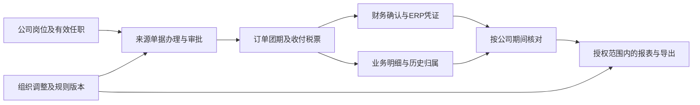

# 参团游真实ERP验收准备12：权限、报表与历史

2026-11-07。承接[范围与规则](测试目录.md)及前十一组。本步交付二十八组场景、跨公司九张订单样板、十一种数据范围的单据及金额预期、历史日期与财务期间对账方法。这里验的是：正确的人能办理正确的业务；无权的人不能读到或改变数据；同一来源的业务、资金、税票和凭证能按各自口径解释清楚；组织或规则变化后仍能复原历史。

**这是验收准备底稿，不是真实ERP权限、审批或报表测试结果。** 当前未取得真实环境入口、账号及接口映射。组织与岗位样板是建议配置，正式授权、审批阈值、发布和重述权限仍待确认。原型按用户要求统一超级管理员演示，不隐藏按钮或字段；不能把原型全部可见判为真实ERP权限缺陷，也不能拿它证明真实权限通过。

## 一、现行代码与业务证据

组织管理员维护公司、门店、部门、人员与任职；业务负责人核销售、履约和费用事实；资金岗位核真实收退付；核算岗位核财务期间与凭证；审批人按授权审核具体事项；集团财务汇总并核对公司报表。任职是员工在某公司、部门和岗位工作的有效关系。数据归属回答“这张单据计入谁的业务”，访问权限回答“现在谁可以看或操作”，两者必须分开。

| 要求 | 当前入口、代码及对应文档 | 当前判断与真实验收差距 |
|---|---|---|
| 公司组织、任职按日期生效 | `shared/nav-admin.js`、`shared/approval-org-workflow.js`、`shared/admin-employee-accounts.js`；[组织按期生效实施](组织变更受理与按期生效实施-20260924.md) | 已有组织受理、未来生效、依赖与原资料变更校验。早期“没有任职历史”不能当现状；原型审批方法可接收文字审批人，仍不能证明服务端实际身份授权 |
| 本次申请按哪项任职找审批人 | `shared/approval-config-model.js`、`shared/approval-rule-run.js`；[多级审批实施](审批组织与多级审批实施-20260924.md) | 已有逐级、会签／或签、转交、退回重提、暂停处理等试跑；试跑明确不写来源业务单据。真实身份、事项提交、岗位变化与来源回写需另验 |
| 发布版本与外部审批 | `shared/approval-zhiyuan.js`、`admin/approval-config.html`；[2026-10-21审批实施](审批配置系统与志远模板实施验收-20261021.md) | 草稿、发布与在途原版本已有表达，不能沿旧文档认定保存即生效；志远原型允许配置不全发布，不证明真实外部受理。按实际上线接入选择执行分支 |
| 业务改应收，财务核实收 | [应收与实收职责修订](应收业务审批与实收财务复核职责修订方案-20260926.md)；销售订单与财务收款入口 | 订单确认后的应收变更属于业务审批；财务核实际到款，不替业务决定成交价。具体审批人及阈值继续待定，不以金额小自动免审 |
| 结算价等字段授权 | `shared/price-field-permissions.js`、`admin/positions.html`、`merchant/sales/sales-product-quote.html`；[旧字段权限实施](结算价岗位字段权限第一步实施验收-20260925.md) | 配置模型仍有角色、公司、门店和任职有效期；旧文档所列销售专用权限脚本当前已不存在，不能引用当时测试数证明当前报价限制。更晚的原型超级管理员规则优先；真实ERP独立核字段、导出、接口 |
| 历史归属及已发布报表 | `shared/report-pages.js`、`shared/report-governance-model.js`、`shared/report-governance-view.js`、`shared/report-management-analysis.js`；[组织渠道核对旧稿](业财报表组织渠道与预算归属代码文档核对.md) | 当前已有发生时归属、原发布／更正副本、角色过滤和订阅草稿示例；早期缺口需结合后续代码修正。但这些是固定示例，未证明真实权限、发布或通知生效 |
| 查询与返回条件 | `shared/report-navigation-state.js`、`shared/finance-readonly-report.js`；原数据中心方案 | 当前有查询条件恢复与只读表格；真实报表要核查询条件、数据版本、访问人及导出结果，不能跨账号恢复上个人的数据 |
| 实际数据中心范围 | `shared/nav-merchant.js`；[执行清单](集团财务报表执行清单.md)门店专项记录 | 当前17个直接入口，包含后来新增的门店分润。原16入口是历史基线；本轮纳入第17入口，不重写原8批／36项／6场景，也不要求给只读报表增加点击下钻 |

权限验证方法参考[OWASP授权指南](https://cheatsheetseries.owasp.org/cheatsheets/Authorization_Cheat_Sheet.html)：权限应在实际请求处理处执行，直接访问对象或文件也应核验，不能仅靠界面隐藏。以下岗位、单据和金额场景由本项目的参团业务要求推导；该指南不决定凯撒谁可审批、谁可查看成本。

## 二、数据、身份和判定依据先准备齐

本组关联[决策表](待确认问题决策表.md)参验-14；原RPT-14等公司归属、参验-01交易责任、参验-03岗位审批矩阵、参验-04凭证、参验-06价格、参验-12期间、参验-13税票仍各归原编号。审批权限表至少包含公司、组织范围、岗位、动作、单据范围、字段、有效期、金额币种及阈值边界、委托方式、禁止兼任或自批条件、确认人及版本。缺某项时记录“规则待定”，不能用系统当前允许的结果反定规则。

### 1. 建议身份样板

为测试建立A、B、C三个独立公司；A下设D1、D2两部门、S1/S2两直营门店、CALL呼叫渠道，B/C各有自己的部门和门店。加盟F为独立渠道方，其在本例销售的A订单仍按合同归A，F只获得有关交易的限定视图，不因此获得A整本账。内部转售和代销另用第一组双方单据，不靠当前登录公司的名称改变合同责任。

| 账号代号／业务角色 | 建议正向权限 | 必须设置的反向样本 |
|---|---|---|
| U1销售、U2销售 | 各自获准的门店与订单；发起应收变更或售后 | U1请求S2/B订单、供应商银行明文、直接财务确认或自审自身申请 |
| S1经理、S2经理 | 本门店订单、经批准可见的贡献及审批动作 | 另一门店、加盟F全量客户、超出授权的付款或凭证操作 |
| A产品计调 | D1产品、团期、名单、履约与采购费用 | 不因可处理某团自动取得游客无关隐私、实际付款确认或B全部账务 |
| A业务审批人、备选审批人 | 分配到本人且版本有效的业务申请 | 冒用其他审批人、审批已撤回申请、自批、越金额或跨公司代批 |
| A资金经办、A资金复核 | 分别登记、复核实际收退付；查看办理所需账户字段 | 经办人复核自身付款、修改销售成交价、将A款认到B责任账户 |
| A核算、A凭证复核 | 确认收入成本、期间和凭证；分开配置复核 | 来源未批准、公司错配、已关期间、自己制单自己复核等未获准组合 |
| 集团财务只读、公司财务只读 | 集团或本公司的批准报表范围 | 集团可看不等于可替子公司付款、改原单、发布全部报表 |
| 加盟F用户 | F关联交易及获准字段、自己的结算结果 | A其他门店、其他加盟、公司总毛利、其他供应商底价和账户 |
| 组织管理员、技术运维 | 组织或系统配置职责，业务数据另授权 | 配置角色不自动获得业务明文、批准自己授予的财务权限 |
| 无业务授权用户、停用用户 | 按正式规则显示无可用业务或拒绝访问 | 猜单号、直接链接、旧会话、历史下载地址、后台任务继续读取 |

以上是需要业务确认的职责分离测试配置；不是宣称凯撒已批准所有禁配项。可以按正式制度允许同人兼任部分业务，但必须明确事项、限额及补偿复核，不能让AI临时给自己超级管理员权限绕过失败。只读核对账号用于观察证据，不能被AI拿来替办理账号读出敏感数据再展示给业务角色。

### 2. 九张独立新建订单与历史事件

每次运行用唯一批次前缀，新建产品、团期、供应商、测试游客及交易后记录真实编号。表内A1等是测试别名，不能直接当ERP单号。测试游客及收款人使用测试服务接受的虚构资料，不复制真实客户证件。金额均为人民币业务价款，不直接等于财务收入。A1/A2按第十组160,000主团另建相同条件的实例，财务核对用第十一组条件桥接；其他订单只用于本组范围与历史样板，不能把缺少的成本视为0。

| 别名 | 责任公司／部门 | 历史门店或渠道／销售 | 供给／地域 | 确认日 | 实际回团日 | 系统登记／资料可见日 | 原价款 |
|---|---|---|---|---|---|---|---|
| A1 | A／D1 | S1／U1 | 自营／国内 | 09-28 | 10-28 | 09-28 | 80,000 |
| A2 | A／D1 | S2／U2 | 自营／国内 | 10-02 | 10-28 | 10-02 | 80,000 |
| A3 | A／D2 | CALL／U3 | 外采／出境 | 10-30 | 11-10 | 10-30 | 60,000 |
| B1 | B／D3 | S3／U4 | 外采／国内 | 10-02 | 10-29 | 10-02 | 80,000 |
| C1 | C／D4 | S4／U5 | 自营／出境 | 10-03 | 11-10 | 10-03 | 40,000 |
| A4 | A／D1 | 加盟F／U6 | 外采／国内 | 10-03 | 10-30 | 10-03 | 30,000 |
| A5 | A／D1 | S1／U1 | 自营／国内 | 未确认草稿 | 未回团 | 10-31 | 5,000 |
| A6 | A／D1 | S2／U2 | 自营／国内 | 10-03 | 未回团 | 10-03 | 20,000 |
| A7 | A／D2 | CALL／U3 | 外采／国内 | 10-31 | 10-31 | 11-02后补 | 12,000 |

示例日期均为2026年。A6在10-15经批准全额取消，净价款0但原单、原确认及取消记录保留；A1在11-05经批准让价2,000，最新价款78,000。U1在11-01由S1调至S2，原A1归属不随调岗自动迁移。A7模拟有证据的晚到确认资料，业务有效日为10-31、系统登记可见为11-02，必须保留两日及补录理由，不伪造成10-31已经登记。

表中实际回团日表示推进到该日、完成真实办理后的目标结果；10-31时A3/C1实际回团字段应为空，不得提前登记11-10已回团。独立预期按截止投影当时已成立的记录，真实验收还须验证接口未提前返回未来履约事实。

真实执行先把日期整体映射到环境可用期间；跨期使用获准的测试时钟、期间流程或可审计补录入口。不能由AI改服务器时钟、倒改数据库日期或伪造已经发生的出行。不能支持某时间分支时标“环境受限”，不把预置静态记录当新建全链路通过。

### 3. 固定对账集合，而非只核总额

下表按“有效非零确认价款”列单据集合。A6在取消明细中保留0余额，A5在草稿中保留5,000，均不混入已确认有效价款。集合、数量和金额都须一致；列表是否展示0金额原单按报表定义核，不能将下表非零集合用作删除原记录的要求。

| 数据范围（须先获准） | 10-31业务日及资料截止集合 | 原截止金额 | 11-10业务日及资料截止集合 | 当前金额 |
|---|---|---|---|---|
| 集团 | A1,A2,A3,A4,B1,C1 | 370,000 | A1,A2,A3,A4,A7,B1,C1 | 380,000 |
| A公司 | A1,A2,A3,A4 | 250,000 | A1,A2,A3,A4,A7 | 260,000 |
| B公司 | B1 | 80,000 | B1 | 80,000 |
| C公司 | C1 | 40,000 | C1 | 40,000 |
| A产品一部D1 | A1,A2,A4 | 190,000 | A1,A2,A4 | 188,000 |
| A门店S1 | A1 | 80,000 | A1 | 78,000 |
| A门店S2 | A2 | 80,000 | A2 | 80,000 |
| A呼叫渠道 | A3 | 60,000 | A3,A7 | 72,000 |
| 加盟F受限交易 | A4 | 30,000 | A4 | 30,000 |
| A本人U1历史单 | A1 | 80,000 | A1 | 78,000 |
| 无业务授权 | 空 | 0 | 空 | 0 |

“本人历史单”只是一种待确认的数据范围，不能推出U1调岗后天然保留S1权限。正式制度若撤销历史单访问，U1应看不到A1；获准的S1经理仍按原归属核78,000。无业务授权的0表示独立预期没有可读金额，实际系统也可拒绝整个请求，不能泄露集团合计或单据是否存在。

## 三、二十八组业务场景与执行要求

所有场景共同保存：规则版本、办理人有效任职、源单号、动作前状态、请求结果、动作后状态、相关金额与关联单据、报表条件及查询时间、截图和脱敏接口／只读查询证据。拒绝场景同时核“未读出不该读的数据、未改变原单、未生成下游款或凭证”。正向与反向都做，不能把一律拒绝认作权限正确。

### 权01：集团、公司、部门、门店和本人范围

按上表先用实际角色创建和查询，再分别以集团只读、A/B/C财务、D1、S1/S2经理、加盟F和销售账号获取相同截止的报表。核单据集合及合计，核总计行、筛选候选和分页计数也不含无权数据；集团查询缩小到A时应为260,000，不能仍返380,000。不同角色的授权字段另核，不因总额正确自动通过。

### 权02：同金额、相同名称和直接单号越权

用A门店S2账号正常读A2，再请求同为80,000的B1详情、附件、审批单、凭证来源和接口；两单可故意使用同名测试游客。应依权限拒绝B1，不能因金额相同或集团客户共享而串单。重复返回A2两次也失败；单据集合和唯一数量能发现总额相同的替换错误，不能只看80,000。

### 权03：可报价不等于可看采购底价

分别配置可见公开价、可见渠道结算价、可见采购成本的账号。进入同团报价、订单详情、团期成本、报表、附件和导出，核响应原文、隐藏字段、总计及下载列是否携带无权金额。计算折扣或报价若需要后台成本，不应把成本原值发给无权前端。原型字段模型不是本场景执行结果。

### 权04：应收变更与实收复核不能互相替代

销售对已确认订单发起单房差1,800减到1,500，实际应收减300，经业务审批后生效；资金复核一笔实际到账1,500，只能确认钱到账与正确认款。分别尝试由资金岗改成交价、销售改银行到账、业务审批直接生成退款。核应收变化一次，实际收款不因审批自动减少，退款仍走第六组责任与执行流程。

### 权05：跨公司采购转售的两边办理人

用第一组A销售B供货实例，A负责其对客及内部采购，B负责其供货及对外采购。分别办理A应付B和B应收A，用第三公司C账号及A销售账号尝试改B的成本、收款或凭证。集团有查看权不能替代两公司各自审批；同额内部单分别保留正确公司、往来方和币种，不将A的付款据直接认成B对游客的收款。

### 权06：集团代销与加盟渠道的限定视图

用另一实例办理B主责、A佣金并代收100,000的场景，佣金10,000、已交付B60,000、尚应交付30,000分别核。A销售应看到办理所需交易和佣金，不因代收持有B所有资源底价；加盟F只能看其关联交易。佣金及可见字段先锁正式规则，不能把采购转售权限表原封不动套给代理。

### 权07：一人多岗、兼任与跨公司身份切换

同一员工配置A主职、B兼职且职责不同。分别以明确的本次办理身份发起团期采购、应收调整和报表查询；核选中的公司、部门、审批上级及下游责任，不按最近登录公司或默认主岗覆盖。切换身份后的待办、浏览器返回、导出队列与缓存不可混用，空身份或过期任职不能默认取得最宽范围。

### 权08：调岗、组织迁移和历史业绩

先生成A1和10月发布记录，再办理U1于11-01调至S2，查询S1/S2及集团历史、当前报表。原归属视图中A1仍属S1，当前78,000；S2为80,000。若管理上批准另一份按新组织重述的报表，另列S2为158,000、S1相关单为0，注明重述范围与依据，集团380,000不变；不得覆盖原发布或改凭证公司。当前访问由最新有效授权决定，不因曾经经办而永远可读。

### 权09：未来生效、延迟审批与过期原资料

提交未来调岗／部门迁移，生效前后分别查询和办理；已过拟生效日才批准时按正式生效规则核，不能静默倒签。申请等待期间再发生另一项获准调整，旧申请审批不得用旧资料覆盖新安排，应提示冲突并重新确认。核循环上级、跨公司误迁、仍有下属或未结业务的停用影响；组织调整不自动更换旧订单合同方。

### 权10：离职停用、撤权与运行中的下载

账号有一个已打开订单、一个未完成审批、一个排队导出和一个历史下载链接，再停用或撤销相关任职。按批准的生效和会话规则验证新请求、续页、审批提交、导出生成与下载；不得继续读取撤权后的数据。原办理记录保留经办人当时身份，不能因停用变“未知”。财务欠款及未结团不因离职消失，交接给有权人员。

### 权11：申请人、业务审批、资金和凭证复核分离

围绕同一退款／采购付款依次用申请、业务审批、资金经办、资金复核、核算、凭证复核账号办理。逐项按正式禁止组合尝试自批、跳级、批后改金额、经办后自行复核。业务通过不等于支付成功；支付成功也不等于凭证已复核。缺正式职责分离表时该分支为规则待定，不靠页面按钮是否显示判通过。

### 权12：审批阈值、币种和申请拆分

以待确认的50,000元含边界测试阈值演示49,999.99／50,000／50,000.01，按正式比较规则核节点；外币阈值先锁采用的币种、汇率日期和金额基础。对同一来源拆成两笔25,000、退回后改成50,000.01、付款含预付冲抵及手续费分别核。若制度需合并判断，不能通过拆单绕过；没有此制度不由AI擅自新增拒绝规则。

### 权13：会签、或签、多人重复与无可用审批人

分别用两人全部通过和任一人通过配置办理。会签只通过一人不得推进，或签第二次晚到决定不得再次形成应收或付款；同一人兼两岗是否能复用结果按规则核。上级为空、全部停用、申请人恰为审批人或越公司时，应进入可追踪的异常处理，不能“找不到人就自动通过”。配置试跑与真实来源办理都需核。

### 权14：模板改版、退回重提、撤回与并发决定

用已发布V1提交A申请，另存V2草稿，再发布V2提交B申请。A须按其保留的适用版本办理；退回重提是否沿旧版或重取新版需明确，不盲套原型试跑规则。原型当前重提会保留克隆模板、开新轮次，这只是证据。审批与撤回同时到达、重复提交及超时重试都只能出现一个合法结果；旧轮次决定不得批准新金额，下游单据按有效来源只产生一次。

### 权15：委托转交和外部审批返回

设置明确公司、事项、限额与有效期的临时委托，核到期、跨公司、申请人转给自己、原审批人和接收人同时办理。若真实ERP接志远等外部审批，发出、受理、在审、退回、通过、未知结果分别取得测试回执并核来源；伪造审批人参数、过期流程号、重复／乱序返回不能改变有效结果。若本期未接外部，保留未测，不把原型登记成功计为外部通过。

### 权16：订单日、实际回团日、草稿和取消不是一个口径

原10-31截止：9月确认80,000、10月确认净额290,000，累计370,000；按10月实际回团归集270,000，尚未回团100,000。A5草稿5,000不能进有效确认价款，A6原确认20,000及取消-20,000在变动明细可追溯。计划回团日不代替实际回团，订单数、订单变动笔数和游客人次分别定义；不能将累计余额当本月发生额。

### 权17：同一业务截止、不同资料截止与更正发布

保留业务截至10-31、资料截至10-31的原发布370,000。获准补入A7后，仍看10-31业务日但资料截至11-10应为382,000；再看11-10当前业务余额，含A1让价则为380,000。原发布不得因刷新改写，后补影响12,000与后续让价-2,000分别解释。发布／更正记录必须有发起人、批准依据、范围和版本；数据缺口未处理不得假称完整发布。

### 权18：业务回团毛利、财务期间和税票桥接

只取A1/A2对应的160,000主团，沿第十组完成暂估、结算、后补费用、退价和返价，再按第十一组已明确的条件税务分支执行。以下不代表所有公司均适用，也不代表本组九张订单的总损益。

| 范围 | 收费 | 成本价款 | 财务收入 | 财务成本 | 毛利 | 本例税额余额／变动 |
|---|---|---|---|---|---|---|
| 10月 | 160,000 | 115,000 | 150,943.40 | 110,471.70 | 40,471.70 | 4,528.30 |
| 11月变动 | -2,000 | 1,000 | -1,886.79 | -1,037.74 | -849.05 | -2,150.95 |
| 累计 | 158,000 | 116,000 | 149,056.61 | 109,433.96 | 39,622.65 | 2,377.35 |

业务差额42,000不直接称财务毛利；本例最终净现金42,000＝毛利39,622.65＋税额2,377.35。已发布10月财务报表不因11月业务调整自动改写；会计期间按已批准的事实与规则判断，不能一律塞入次月。收入、成本、税额与凭证逐行相符，不能只核借贷平衡。逐票销项8,943.39与净价总额重算8,943.40差0.01须保留原因。

### 权19：集团内部销售与对外成交去重

用第一组单独实例：A对客100,000、向B购85,000、B向外采购70,000，公司A/B分别业务贡献15,000；集团对外成交100,000、贡献30,000，不能把100,000与内部85,000相加称集团对客成交。代理分支B贡献20,000、A佣金10,000另核，代收100,000不当A旅游收入。管理口径内部去重与正式合并财务抵销分开，正式合并报表不在本步擅自扩建。

### 权20：产品、渠道、门店贡献和未分配成本

接第八组独立实例，A团92,950、B团69,600、公共损失5,850共168,400，280,000收费对应业务差额111,600；只加两团会漏掉损失。接第四组实例，成交49,100减成本35,000得毛利14,100，再减佣金2,455才是本例贡献11,645，优惠不再扣第二次。接第九组外币实例，240,000减业务成本206,000，再计汇损3,350、费用557，结果30,093。三例不能相加伪造同一团利润；部门费用未齐不能称净利润。

### 权21：应收、应付、预款和净额掩盖

接第五组：客户净款99,200＝订单96,700＋预存2,500；门店净款79,500＝订单44,500＋余额30,000＋未分配5,000。接第十组某阶段：客户B应收10,000、客户A应退2,000，必须分别呈现，不能只报净应收8,000；核原币与本币分别平衡。第七组累计付111,000、收回9,000不能仅报一个付款102,000而丢退款及实际发生历史。

### 权22：报表更新失败、重复和乱序资料

用同一原款两次实际到账6,000与4,000，第二次回执重复一次；正确结果10,000，不能14,000，也不能按同一原款号去重而漏掉一次收款。再做订单取消晚到、退款先到原款后到、部分报表更新失败与重试。只有可追溯的有效业务事件入账一次；更新失败保留原已发布值、标出截止与缺口，不把部分新值装成同一完整版本。

### 权23：金额正确但明细、分母或覆盖率错误

故意制造漏A2加B1，汇总仍80,000但应失败；一团多游客、多付款、多票据关联后不得把同一订单乘倍。收入10,000成本12,000的毛利率为-20%；收入10,000毛利2,000与收入90,000毛利9,000汇总毛利率11%，不能平均两百分比。预算未设、预算为0、无数据、数据缺失和不适用分别表达；分母0显示无可算比率而非0%成功。两种缺字段名单有重叠时按唯一单据计算覆盖率，不简单累加缺口金额。

### 权24：查询、分页、导出及订阅的范围一致

先查A/S2，再编辑条件但不提交，按产品定义核导出使用“已执行查询”还是明确的新查询，不能表格和文件静默不一致。核分页首尾、排序后去重、列合计、全量导出与所选导出差异；修改导出任务号或下载链接不能拿到他人文件。订阅需核创建者及接收者实际授权交集、字段权限和运行时身份，不把集团报表发给门店。未授权发送消息，本步只生成待核草稿并验证测试收件端，不发送真实邮件或消息。

### 权25：审计能解释每次拒绝和每次账务变化

以A1让价、A7补录、U1调岗、审批版本切换、导出拒绝为样本，核原值、新值、原因、申请人、实际办理人、授权或审批依据、有效日期、记录时间、源单及关联凭证。业务备注不能修改审计中的实际身份。日志查看也需授权与脱敏，不把密码、令牌、整份证件或银行账户直接写入AI验收报告；正式证据受控保存，报告引用证据编号。

### 权26：历史归属缺失、停用主数据和获准更正

新建一个缺销售归属的异常订单分支，核缺失状态、待处理数量及其金额仍在完整性核对内，不能默默套当前登录人或从集团总数删除。产品、渠道、员工随后改名／停用，旧单仍可解释到当时有效资料；获准更正归属形成前后版本与影响清单。公司错记、凭证错账走原财务更正流程，不只改报表标签掩盖。

### 权27：预算与审批、报表规则各自生效

给产品部门和渠道设置有版本的预算、分润和审批规则，分别安排生效前后下单、改价、回团及退款。旧单按适用历史规则核，规则更新不能给已退单重新生成权益或抹掉原分润。预算完成率的分子必须与目标的公司、部门、含税或不含税、期间一致；正式预算未批准只报缺资料，不套演示目标。发布权限、业务审批权限和报表查看权限分别核，互不自动授予。

### 权28：最终AI执行的成功、失败和未测边界

按真实环境做一次完整正向：源头建产品团期、报价订单、供应商及成本、收退付、结算、审批、财务确认和凭证，再核本组权限及报表；另选跨公司、重复审批、历史后补各一反向分支。仅在有实际证据且预期匹配时记通过；业务差异记失败，环境不可用记环境受限，正式规则缺失记规则待定，未开始记未执行。本组准备完成不等于这四条真实链已经跑完，最后需汇总十二组的场景覆盖和未测清单。

## 四、17个当前报表入口怎样接前十一组

报表只读，不要求点击报表直接改业务。核对可以通过源单号在业务模块反查；没有下钻按钮不自动算缺陷。下面是参团范围内的最低核对路径，真实菜单名、接口及列映射在下一步落实。

| 当前入口 | 必须核的参团结果 | 主要来源 |
|---|---|---|
| 经营总览 | 对客成交、毛利、组织范围及完整性；不混内部供货或税前后金额 | 第一、十、十一组及权16—23 |
| 月度损益 | 会计期间收入成本与调整，费用不齐不能称完整净利润 | 第八至十一组、权18／20 |
| 产品分析 | 自营／外采、产品责任部门及归属历史，取消与重算 | 第一至三组、权08／16 |
| 渠道分析 | 渠道成交、优惠承担、佣金及贡献，不重复扣除 | 第四组、权20／27 |
| 门店分润 | 直营／加盟、适用比例、结算基础、退改冲回与有效版本 | 第四至六组、权06／27 |
| 业务毛利 | 实际回团、暂估、实际成本和二次结算，与财务毛利区分 | 第八、十、十一组、权18 |
| 供应商分析 | 采购、实际付款、预付占用、应返及历史风险 | 第七至九组、权21 |
| 订单明细 | 确认日、订单变动、游客与订单粒度、公司和销售归属 | 第一至六组、权01／16／23 |
| 回团明细 | 实际回团与更正、团人数与订单数、历史资料截止 | 第八、十组、权16—18 |
| 收付明细 | 实际到账与支付、退款、退汇，原币与本币 | 第五至九组、权21／22 |
| 往来账龄 | 应收应付、预收预付、应退应返，各责任方及截止 | 第五至十组、权21 |
| 预款余额 | 同款占用、核销、退款、账户归属及原款余量 | 第五、七、九组、权21 |
| 资金分析 | 余额与发生额、币种、银行费用和汇率，未分配资金 | 第五、七、九组、权21 |
| 票款核对 | 净票额、红冲、票款分配、未票已确认及差异 | 第十一组、权18 |
| 核算核对 | 业务来源—财务事项—ERP凭证，科目辅助核算及期间 | 第十、十一组、权18；NC仅记录分期边界 |
| 任务预算 | 已批准版本、组织维度、分母与生效期，缺失不作0 | 第四、八组、权23／27 |
| 数据管理 | 查询截止、原发布与更正、完整性、访问与导出范围 | 本组全部，重点权17／22／24 |

## 五、供最终AI执行文档采用的技术约定

此节面向开发及测试。先按上文锁业务范围，再把接口、字段和状态映射进来。不得直接写数据库补最终财务余额、补权限“成功”或跳过审批。允许通过正式业务接口创建测试对象；页面办理用于验证岗位实际操作路径，读接口／只读数据库用于独立观察。已配置的基本组织可复用，但本次归属变更与业务交易要用独立对象，避免改其他测试批次。

每个场景需要机器可读记录：`case_id`场景编号、`rule_refs`已批准规则及版本、`required_identities`所需身份、`data_aliases`测试别名与真实单号、`actions`按角色的业务动作、`expected_records`预期可见单据集合、`expected_amounts`金额及币种、`expected_denials`应拒绝的访问或动作、`evidence_refs`实际证据、`result`结论。字段定义是交接约定，当前没有可用的真实接口地址或账号；不能把空映射填成演示地址后称可自动运行。

真实适配器应在每个财务关键动作后读取业务状态和关联来源，再比较独立预期；超时先查询该来源实际结果，不能直接重做收付款。分页必须收集全部页并去重，导出需按正式格式解析金额和单号。临时换账号应隔离会话，不把浏览器角色参数当身份。历史截止需要同时记录业务有效时间、资料录入／可见时间、会计期间和已发布版本，不能只保存“查询10月”。

完整性校验至少有三层：单据集合完全相同；逐笔责任、日期、币种及金额一致；聚合与差额桥接一致。接口断言不能直接调用被测业务函数生成期望。财务金额用十进制精确计算，按已批准规则舍入；不设置可吞掉真实差异的统一容差。外部支付、开票、合同或审批若使用模拟回执，分别标识“ERP后续处理已测／外部服务未测”，不能合并报全链路通过。

每次运行先登记本批前缀、规则、配置、源数据与预期版本。恢复执行先查已有单据和证据，已成功的支付／审批／凭证动作不重做；失败只重跑明确未生效的步骤。清理以测试环境的正式撤销／冲销和归档为准，已生成财务数据不能物理删除后抹掉证据。实际测试的并发量和更新等待时间由环境能力映射，不能把本地算术运行速度当ERP性能指标。
