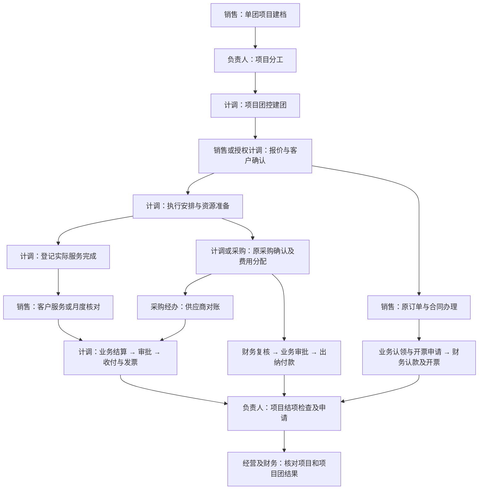

# 会奖项目全流程页面使用说明

> 本文与2026年10月9日最新页面名称同步：上层委托称“单团项目”，下面每次具体执行称“项目团”。项目详情和项目团控均可“新增项目团”，使用同一份记录；客户成交在“报价与合同”办理，使用“报价单”和“登记客户确认”等实际按钮名称。

修订日期：2026年10月9日。适用当前会奖业务原型。

本文按**接项目 → 分工建团 → 报价成交 → 合同 → 执行采购 → 款票办理 → 客户核对与业务结算 → 结项及经营检查**说明各岗位怎么使用系统。每项功能都回答：解决哪件业务事、谁来办、到哪里怎么操作、办完交给谁。可直接按最后的检查表核对产品是否承接了完整流程。

页面操作说明以当前代码为准；原型中的申请、审批和结果用于演示岗位协作，不代表已接通银行、电子合同、电子开票或财务核算系统。公司尚未确认的金额限制、税务、汇率和结项政策仍为待确认。

## 一、先看整个流程如何落在系统中

图中是职责与交接关系。订金、采购、签约、开票可以按实际约定穿插办理，供应商对账也不被这里规定为每笔请款的前置条件。

| 业务环节 | 在系统中落在哪里 | 这一环节办完，必须留下什么 |
|---|---|---|
| 接受客户整体委托 | 产品中心 → 自营产品 → 单团项目 | 唯一项目、客户与我方公司、服务范围、销售和负责人 |
| 把项目交给具体人员执行 | 项目详情“项目团”；履约中心 → 项目团 → 项目团控 | 人员分工及每团一条的记录，明确谁能建团、谁能报价 |
| 确认卖什么、收多少钱 | 项目详情“报价与合同”；项目团详情“客户款项” | 当前有效报价、客户确认及内部审核依据，对应原订单和收款阶段 |
| 安排并交付服务 | 项目团详情“执行安排” | 日程、名单或人数、资源安排，以及实际完成依据 |
| 确认花了什么钱、谁承担 | 项目团详情“费用采购”；项目采购 | 原采购、供应商、确认金额、付款条件、各团承担及项目承担费用 |
| 实际收钱、付钱和开票 | 业务申请入口及对应财务办理页 | 逐订单认款、原采购付款结果、开票结果；申请与成功结果分开 |
| 核实交付和金额能否收尾 | 客户对账、供应商对账、结算核对 | 客户认可、双方采购核对、本次业务结算范围及审批结果 |
| 关闭项目并看经营结果 | 结项检查、工作台、数据中心 | 结项决定、遗留款票责任，以及能回原业务核对的经营结果 |

**四种记录不能混成一件事：** 项目管整体委托，项目团管一次具体服务，订单管一份实际成交，采购管一笔真实支出。一个项目可有多个项目团；一份订单既可只覆盖一团，也可按客户确认的整包价格覆盖多团。

文中“应收”是客户应付给我方的钱，“应付”是我方应付给供应商的钱；“认款”是财务核实到账并确认归属订单。“业务结算”是对已交付范围、客户认可和承担费用的确认；“结项”是结束整项业务，二者都不代表款票已经清完。“业务差额／毛利”须按页面所列收入、费用和税额范围理解，不等于公司净利润。

## 二、各岗位每天主要在哪里工作

| 岗位 | 主要工作入口 | 高频任务及交接责任 |
|---|---|---|
| 销售 | 单团项目“报价与合同”、项目订单、合同管理 | 接需求、确认客户服务与价格、签约、认领客户款、申请开票、核对客户认可；把有效服务约定交计调，把款票申请交财务 |
| 项目负责人 | 单团项目详情四个页签 | 分工、分配与移交项目团、看整体费用及进展、登记成员、解决跨团问题、申请结项；确保每项遗留都有接手人 |
| 计调 | 项目团控 → 项目团详情五个页签 | 建团、准备日程名单与资源、维护采购、请款、登记完成、提交业务结算；有报价权限时可连续办理本人范围报价及款票申请 |
| 采购经办／资源协作 | 项目采购、项目团详情、供应商对账 | 维护原采购、共同费分配、付款条件和供应商核对，向计调及财务提供同一笔采购依据 |
| 审批人 | 审批 → 待我审批 → 项目事项 | 核当前版本、来源依据、金额与范围，批准或退回；批准结果交回来源岗位继续办理 |
| 收款／应收财务 | 到账流水、认款复核、应收管理 | 核真实到账、订单分配、剩余应收及收入相关税额；错误认领退回业务修正 |
| 应付／付款财务、出纳 | 应付管理、付款复核、付款管理 | 财务核采购、税额、付款条件与账户；出纳承接已批准申请并登记实际付款结果 |
| 开票／核算财务 | 发票管理、业务结算及后续核算入口 | 核开票资料与结果，承接已确认业务结算，按适用规则处理记账期间和核算 |
| 经营管理人员 | 项目费用总览、数据中心 | 看确认业务、费用与差额，区分未成交、未分配、未核定；发现问题交回原责任岗位 |

同一员工可以兼岗，但职责不合并。项目成员记录说明“参与了什么”，项目分工说明“在本项目允许办理什么”；财务付款与审批权不能靠新增项目成员获得。

## 三、接项目并组织人员：销售和负责人先把共同工作建立好

### 3.1 单团项目列表：建立整项委托的共同档案

**谁来用：销售建档，项目负责人核对。上游是客户需求、框架合作或已取得的委托，下一步交负责人组织项目团。**

| 功能解决什么问题 | 具体怎么操作 | 办完有什么结果、交给谁 |
|---|---|---|
| 查询已有项目，避免同一客户委托被重复拆建 | 进入“单团项目”，按客户／项目查找，再按期间、负责人或状态缩小范围，点“详情” | 找到同一项目后继续原记录；年度项目次月新增会议继续用原项目 |
| 新建、草稿、核对和启用 | 点“新建项目”，交代客户与我方公司、整体服务范围和期间，指定销售与负责人；保存草稿，补齐后“提交核对”，待确认记录点“核对 → 确认启用” | 项目进入进行中，交负责人分工；建档本身不形成成交或应收。当前首个项目团也要另行建立 |
| 复制相似项目，减少重复准备 | 原项目点“复制”，选择需复用的安排、预算参考或分工，重新核客户、日期和人员，再保存新草稿 | 复用准备资料；新项目仍须重新确认客户、报价、合同及款票，不继承原成交结果 |

线路详情、销售报价、意向订单、企业客户中的“新建单团项目”是同一建档工作的来源入口。已有来源时核带入需求，仍由此处完成共同资料，不能再建一套互不相关的项目。

### 3.2 项目详情“项目团”：负责人把活交给谁

**要解决的问题：销售只建立一次项目，负责人先给办理范围，计调可以自己建立和处理负责场次。**

| 功能 | 谁、怎么操作 | 在后续流程中的作用 |
|---|---|---|
| 新增／维护项目分工 | 负责人点“新增分工”，指定人员、负责期间／城市／服务，确定能否自主建团、只能准备报价还是可以确认报价；已有记录点“维护” | 给计调明确工作范围；业务计划金额、费用预算和有批准依据的硬性限额分别核对 |
| 结束分工 | 负责人点“结束”，说明原因及未完事项安排 | 结束新的授权范围，原项目团和历史经办保留；未完项目团另行移交 |
| 新增项目团／批量建团 | 负责人已在项目中统筹时，从本页建立项目团；建团方法与下一节相同，所属项目已确定 | 与计调自主建团使用同一份项目团清单，不能两边各录一遍 |
| 复制项目团 | 原项目团点“复制”，按需复用服务安排、预算参考或计调分工；重新填写日期、客户委托编号，核对所复制日程的日期，再保存草稿或提交核对 | 为同一项目下相似服务建新团；名单、资源、报价和客户确认重新办理，不把复制当成服务已经落实 |
| 分配计调／移交 | 勾选未完项目团，点“分配计调”或“移交”，确定接手人、生效日期及未完事项；核对跨页实际选中数量 | 接手人在项目团控继续原项目团，报价、采购、历史责任不靠重建记录迁移 |
| 查询进展／进入详情 | 按月份、城市、计调和项目团状态查项目团，点对应“详情”；需要时使用批量维护／报价 | 负责人知道哪些项目团已排、在执行、已完成；完成场数与结算场数分别判断 |

### 3.3 项目详情“项目资料”和“费用总览”：负责人管全局

| 页签及功能 | 谁、怎么操作 | 解决哪个问题 |
|---|---|---|
| 项目资料 → 新增成员／导出参与记录 | 负责人登记员工职责、参与期间和具体项目团；需要核人员投入时点“导出参与记录” | 留下谁参与了哪场、何时接手的依据，供管理核对；不自动算奖金 |
| 项目资料 → 维护结算期限 | 负责人按已有制度或约定登记实际完成后的结算期限和依据 | 服务完成后有明确结算到期依据，工作台才可据此提醒 |
| 项目资料 → 维护项目附件／查看办理记录 | 负责人保存项目公共材料，查分工及办理历史；单团交付材料放回本团 | 让接手人和审批人找到共同依据，不重复上传到每团充当不同确认 |
| 费用总览 → 核整体费用／查看采购 | 负责人比较原预算、最新预计、已确认费用及业务差额；发现问题从费用详情“查看采购”回履约处理 | 控制全项目成本，避免公共费用和各场分配重复加总；此处不重复录采购 |

## 四、建立项目团：计调从项目团控开始日常工作

**入口：履约中心 → 项目团 → 项目团控。主要使用人：计调、负责人。这里一行是一场会议或一次完整出行。**“项目团”下另有“项目采购”；团控中没有“负责项目”页签，也不从普通团期管控再建一份会奖项目团。

| 功能解决什么问题 | 计调具体怎么操作 | 结果和下一步 |
|---|---|---|
| 找本人负责项目团 | 按所属项目、计调、执行日期及状态查询，查看资料缺口，点“详情” | 进入本团工作区，继续准备、执行或结算；资料缺口用于判断卡点 |
| 单团新增 | 点“新增项目团”，搜索并选所属项目，填本次服务、日期地点、人数和主责，必要时补客户委托编号及预算，点“保存草稿” | 新增一个项目团草稿；计调继续补执行依据，销售或授权人员另行确认报价 |
| 批量建团 | 点“批量建团”，选项目，填批量默认资料；按客户清单选择手动添加、按日期生成或导入表格，逐行核差异，点“核对项目团”，全部通过后“保存N团草稿” | 一次建立多个项目团，仍是项目团草稿，不等于批量成交或生成应付 |
| 按日期生成项目团 | 选择周期规则或手动选日期，核日期、排除停办日，点“生成项目团”；在清单继续调整、复制、删除或补场 | 把已知排期变成可核对清单；生成后仍须核对并保存，不依赖自动识别节假日 |
| 导入项目团清单 | 下载模板，选择逗号或制表符分隔文件，或粘贴表格；读取后逐行纠错，再核对保存 | 减少百场会议重复录入；当前不直接读取Excel工作簿 |
| 批量维护 | 限定一个项目后勾选项目团，点“批量维护”，应用统一填写的内容并核各场差异，核对后保存有效项目团 | 仅草稿项目团可批量补齐；无效行未修改，已执行项目团的改期走变更 |
| 批量报价 | 选本人可办理场次，点“批量报价”，准备每团价格和确认依据，核对后仅办理有效报价 | 适用于每团独立成交；客户只接受一份整包价时回项目“报价与合同”办理 |
| 确认建团 | 草稿编辑保存不推进；从“确认建团”核覆盖本团的已确认报价或有效订单、委托凭据及服务资料 | 直接进入进行中，计调继续准备和交付；无第二次开始执行，不替代报价确认、不重复生成订单 |

批量建团必须整批通过再保存；批量维护、批量报价可以只办理有效行。交接时说清实际成功数和未办数，不能把勾选数量当完成数量。更换所属项目会清除未保存准备资料，保存前必须核准客户和项目。

## 五、把客户要求变成可履约、可收款的成交：销售或授权计调办理

### 5.1 项目详情“报价与合同”：框架、报价和成交各有作用

**上游是客户需求及项目团范围；下游是订单、合同、执行依据和财务应收。**计调也可从本团“客户款项 → 新增报价”处理本人授权范围。

| 功能解决什么问题 | 谁、怎么操作 | 办完交给谁 |
|---|---|---|
| 登记框架合同：确定长期合作边界 | 销售点“登记框架合同”，保存合同范围、有效期、签署依据及金额性质；已有记录从“查看”继续核资料，需要签约时点“合同办理” | 后续报价引用框架；框架上限或预估额不作为已成交金额，不为签框架虚构订单 |
| 准备报价：明确本次卖什么、怎么收费 | 销售或授权计调点“新增报价”，选择覆盖项目团，采用“固定总价”“数量单价”或“按实际数量结算”；安排收款阶段并留客户依据 | “保存报价草稿”供继续准备；“登记已报价”表示已提出本版报价，尚不代表客户同意 |
| 客户确认与内部审核：确定有效成交 | 有确认权的人核当前版本、服务范围、金额、客户确认及适用审核依据，点“登记客户确认”；需审批的交审批中心 | 有效确认后由同一报价承接一个订单。计调按已确认服务执行，财务按原订单核应收 |
| 关联已有订单，避免同一成交建两遍 | 已有相应订单时，在报价办理中选择“关联已有订单”，核客户、公司、币种、金额及覆盖项目团完全一致 | 确认后沿用已有订单；不符合条件回原单核对，不另建同额订单凑数 |
| 排定收款阶段，安排订金与尾款 | 在报价“收款计划”用“增加收款阶段”补齐金额／比例、到期日或实际收款条件，核合计后确认 | 财务和销售按同一计划认款；按实际数量结算而总额未定的订单，最终金额及收款安排另核，不能把预计额当已确认应收 |
| 框架／人员金额核对：控制授权范围 | 报价时核已确认、审批中及可用范围；超出硬限制按已批准制度处理，参考计划单独看 | 避免未确认报价被算成成交，或通过拆批报价规避限额 |
| 查看版本／下载报价单 | 从原报价查看历史及当前版本，点“下载报价单”；客户提出变化时按当前状态修订或走原订单变更 | 客户、计调和审批人核同一版本；当前报价下载为网页文件，不等于签署合同 |
| 税费测算 | 在报价或本团“税费测算”按已有依据登记预计税率／税额，未知保持待核对 | 支持报价和差额判断；最终税额由财务核定，业务预计不当作财务结果 |

**订单数量跟客户确认的报价走，不跟项目团数量机械对应。**五团各自确认报价，就是五份报价、五个订单；一个总价覆盖五团，就是一份报价、一个订单。客户未确认各团价格时不能把总价平均分到各团收入。批量报价中的“登记客户已确认报价”同样要核授权和客户依据。

### 5.2 订单管理与订单详情：销售围绕原成交继续办事

入口为“销售中心 → 订单管理 → 项目订单”，也可从报价单或本团“查看订单”进入。按订单／项目／客户查找，确认覆盖项目团后打开详情。

| 订单详情功能 | 谁来用、怎么用 | 在全流程中的作用 |
|---|---|---|
| 订单概览 | 销售、负责人核原报价版本、客户、服务及覆盖项目团；需要看执行时进入对应项目团 | 保证对客成交和执行范围是同一件业务 |
| 游客信息 | 销售查看各场名单完整度；需补名单点“查看项目团”交计调处理 | 销售能核履约准备，不另维护第二份名单 |
| 合同资料 | 销售查看合同状态，点“合同办理”继续原合同 | 原成交与签署文件对应 |
| 应收收款 | 销售核各收款阶段已认款和剩余，发起收款认领／开票申请，查看原申请结果 | 收款计划有依据；到期不会自动变成已收 |
| 售后变更 | 销售在“订单改价”区点“申请改价”，登记本次增减、原因与客户依据，提交适用审批 | 追加或减价留在原订单，后续款票按批准结果处理 |
| 收付与发票 | 销售、财务核应收、认款、开票及关联入口 | 交给对应财务岗位，业务页不替代付款或记账 |
| 操作日志 | 销售、负责人查办理历史并核对应来源 | 追查谁在何时变更了什么；当前展示含同项目记录，须辨别本单 |

### 5.3 合同管理：让约定有可核查的签署文件

**谁来用：销售、合同经办、审核岗位。**从框架或订单的“合同办理”进入，核来源、签约双方、授权代表、服务范围及本版金额；框架合同和具体服务合同分别按真实约定办理。

- 线下已签：准备签署文件和双方盖章／授权依据，保存草稿或提交归档审核；审核后按权限“归档确认”，再核归档结果和文件。
- 采用在线签署：按当前公司和模板可用方式编辑、预览、提交审核、发起签署、查询各方结果，完成后查文件。
- 被退回：从原合同补正；已签内容变化走原合同适用的变更或解除处理，不能覆盖原签署文件。

本页解决“谁同意了哪一版服务约定”。合同签好交计调执行、交财务作为核对依据；签署成功不代表已收款，内部审批通过也不等于客户已经签署。

## 六、把服务真正执行出来：计调使用项目团详情

**入口：项目团控 → 详情。五个页签为执行安排、费用采购、客户款项、结算核对、资料记录。**计调围绕本团连续工作；负责人看进度，销售看报价单和交付依据，财务通过原单据核金额。

### 6.1 “执行安排”：从确认要求到实际交付

| 功能解决什么问题 | 计调怎么操作 | 给后续留下什么 |
|---|---|---|
| 调整服务 | 点“调整服务”，按实际确认会议、旅游或混合服务及名单要求，保留变更依据 | 显示本团真正需要的准备内容；已存在实名资源不能靠改成人数交付绕过 |
| 日程／行程安排 | 点“新增日程”或原行“编辑”，排好日期、议程／行程、场地和负责人，引用适用资源；旅游服务补相应用餐、住宿、交通等安排 | 现场可按安排执行，完成时能核哪些服务已交付 |
| 名单维护、导入、查询与导出 | 实名服务新增或导入人员并纠错，按到离批次、房间、车辆分组核对；按人数交付的纯会议核实际人数，无需造虚假证件 | 服务人数及实名要求有依据。名单导入可保存有效行；现有导出不含完整证件列，不能当完整出票文件 |
| 资源新增／编辑与确认 | 点“新增资源”，安排供应商、日期、数量和具体服务；有确认号或有效依据才登记已确认 | 计调掌握酒店、交通、会场等是否落实，采购据此核支出 |
| 资源取消／转费用 | 取消时登记原因及损失处理；“转费用”带入服务资料后补采购金额与依据，已有费用回原记录 | 服务安排承接到同一笔成本，取消不自动抹掉损失，转费用不重复记采购 |
| 确认完成 | 进行中服务结束后点“确认完成”，登记实际起止、人数、完成依据与交付材料 | 转已完成，交销售核客户认可、计调核对结算；原日程、名单和资源只读，未交付服务须先处理 |

### 6.2 其余四个页签：在本团继续业务，不再到处找记录

| 页签 | 使用功能及操作 | 与后续岗位的交接 |
|---|---|---|
| 费用采购 | 切“本团费用／项目采购”，新增费用、查原采购详情、分配费用、申请付款、查付款记录；调整本团／项目预计 | 采购办理见第七节，实际付款交财务；本团只核本团承担金额 |
| 客户款项 | 先选择办理订单，再认领款项、申请开票、测算税费、查看或修正原记录；有权者新增报价；单团订单可办订单改价 | 订单覆盖整包时先核整包范围；认款和开票结果交财务完成，见第八节 |
| 结算核对 | 核实际完成和客户认可，点“查看项目客户核对”或“核对结算”，从原退回记录修订 | 客户认可由销售办理，本次业务结算经审批后交财务，见第九节 |
| 资料记录 | “维护附件”保存本团交付资料，查历史日程和办理记录；“发起项目团变更”处理改期／取消 | 让审批人和接手人核原依据；已完成／已取消项目团的原执行资料只读，变化按第十节处理 |

## 七、把服务支出交给财务：计调和采购经办使用项目采购

### 7.1 原采购、费用分配和预算控制

**集中入口：履约中心 → 项目团 → 项目采购。**单团可在项目团详情“费用采购”原位办理；集中页适合共同采购和跨团核对，两处使用同一笔原采购。

| 功能解决什么问题 | 谁、怎么操作 | 在业财链路中的作用 |
|---|---|---|
| 查询采购及详情 | 计调／采购经办按项目、供应商、范围和状态查询，先查原记录再新增 | 防止同一供应商同一笔服务在多个入口重复录入 |
| 新增采购／新增费用 | 集中页点“新增采购”，本团点“新增费用”；明确服务覆盖“单个项目团”“指定多个项目团”还是“项目整体”，录真实供应商、采购金额、服务期间及确认依据 | 建立财务核应付和付款的业务来源；未确定费用点“保存明细”，仍为待确认 |
| 确认费用／编辑费用 | 经办补齐采购依据后“确认费用”；需修订从原详情“编辑费用”，有已付或已结部分先核修改限制 | 确认业务成本，不在计调页宣称已完成财务入账 |
| 分配费用 | 原采购详情点“分配费用”，依据实际使用或明确约定填写各场承担，区分项目承担与尚未分配 | 各场结算和毛利有成本依据；分配不再新增一笔采购成本，已结部分保留 |
| 调整本团／项目预计 | 在费用采购相应按钮填最新预计、原因及依据，另核客户是否同意追加收费 | 让负责人提前看到超支；保留原预算，不因采购涨价自动提高客户成交 |
| 共同采购交付 | 经办从原采购“编辑费用”，在“采购服务交付”登记交付情况和确认依据 | 服务多团的采购不能因一团完成就全部认定交付，供供应商对账和结算使用 |
| 票据识别与人工核对 | 在原采购上传票据，查看识别样例后对原票核验；失败、差异或混合税率按原票人工核对 | 将票面资料和差异交财务核税，识别成功不代替财务认可 |
| 外币及税费测算 | 按已有依据登记预算／约定汇率、预计税额，财务另行核定 | 保留报价测算与最终财务依据的区别；不同币种不直接相加 |

核公共费用时只认一份原采购：**各场承担＋明确保留在项目的金额＋未分配余额＝原采购总额。**未分配余额不能当作已批准留在项目，更不能在报表中当作没有成本。

### 7.2 供应商对账：核实对方要求结算的金额

**谁来用：我方计调／采购经办、供应商核对人员。入口：原采购详情“供应商对账”，或履约中心“供应商对账”的“项目采购对账”入口。**

1. 我方点“新建对账”，限定公司、供应商、币种和服务期间，选择已确认且满足适用交付条件的原采购，核后提交。
2. 供应商逐笔确认或提出差异；确认当前版本时按页面要求提供相符盖章材料。
3. 有差异，我方从“处理差异”核服务、数量、价格及损失；修订后让供应商重新确认新版本，旧盖章件不代替新金额认可。
4. 一致后从“查看财务核验”交应付财务核原采购、税额和付款。

对账解决“双方认不认同这笔采购金额”，不再增加一份同额成本，也不代表已经付款。

## 八、收款、付款和开票：业务发起，财务完成实际结果

下面的菜单路径说明岗位归属。走查当前会奖原型时，优先从原订单、认领记录、付款申请或供应商对账上的财务入口进入，并核来源项目及单据；普通财务菜单与会奖办理视图不能仅因名称相同就视为已经使用同一份记录。

### 8.1 客户收款：业务说明钱属于哪单，财务确认到账归属

| 页面／功能 | 谁、怎么操作 | 下一岗位和业务结果 |
|---|---|---|
| 财务 → 收款应收 → 到账流水 | 收款财务登记或核对真实到账及付款方、公司和币种；找不到适用流水先核银行资料 | 为业务认领提供实际到账依据，不以客户口头说已付代替 |
| 本团客户款项／订单 → 收款认领 | 销售或授权经办选订单和适用流水，填认领金额、收款阶段及归属依据后“提交认领” | 进入待财务认款；本次申请尚不计财务已认款 |
| 销售中心 → 收款认领 → 认领款项 | 集中付款时，业务按客户清单逐单、逐收款阶段分配；跨阶段时可选“按剩余应收分配”，核合计后提交 | 一笔月度汇款可以分多单，仍保留原订单；超过已明确未收金额的余款留在原流水 |
| 财务 → 收款应收 → 认款复核 | 财务核流水余额、客户公司币种、订单分配及附件；正确“确认认款”，错误“退回认领” | 确认后反映订单实收；退回由业务从原记录“修正”，不重复占用同一流水 |
| 财务 → 收款应收 → 应收管理 | 应收财务核原成交、已批准变更、认款及剩余，使用“税额核对”登记核定依据 | 确定客户还欠多少；已开票或已完成服务不代替已收款 |

当前会奖认领使用演示到账记录；普通“到账流水”新增记录是否能由此继续认领，尚未作为同一条操作链验收。没有匹配流水时应交收款财务核实，不能在认领表里凭空填成已到账。

### 8.2 供应商付款：请款、复核、审批、实付分别完成

| 页面／功能 | 谁、怎么操作 | 下一岗位和业务结果 |
|---|---|---|
| 原采购 → 申请付款 | 计调／采购经办核付款条件、已付和其他申请占用，填本次金额、期望日期、用途与依据，提交申请 | 待财务复核；申请占用可申请额度，但不增加已付款 |
| 原采购 → 付款申请记录 | 申请人查原记录、退回原因及财务入口；符合条件的申请可撤回未付部分。退回后的申请内容修订见第十一节检查项 | 防止重复请款；已付款部分不能靠撤回消失 |
| 财务 → 成本应付 → 应付管理 | 应付财务核原采购、双方对账、分团承担、票据和适用汇率，保存核定税额及依据 | 财务应付有真实采购和确认依据；票面税额与财务允许扣除的税额分别核 |
| 财务 → 成本应付 → 付款复核 | 财务点“复核”，核付款条件、余额和供应商已审核账户；不符退回，符合“送业务审批” | 复核通过后交审批人决定，尚未银行付款 |
| 审批 → 待我审批 → 项目事项 | 审批人核当前申请、金额、来源和账户复核结果，批准或退回 | 批准进入已批待付，交出纳 |
| 财务 → 成本应付 → 付款管理 | 出纳“查看付款”，按实际登记本次金额、交易号、日期及银行结果 | 成功才增加已付款；失败不增加；结果待查先查原交易，不重复支付 |

例如，采购当前条件允许累计申请2.8万元，已付0.8万元、其他有效申请占用0.4万元，本次可申请1.6万元。再申请0.5万元后，可申请余额为1.1万元，实际已付仍为0.8万元。

### 8.3 发票：业务提供完整要求，财务审核与开具

| 页面／功能 | 谁、怎么操作 | 下一岗位和业务结果 |
|---|---|---|
| 本团客户款项／原订单 → 开票申请 | 销售或授权经办核办理订单，填写客户开票资料、项目、金额、完整备注和收票方式，逐单核分配后提交 | 交财务审核；合并范围以当前申请允许的订单为准，不假定已有百单一键开票 |
| 财务 → 资金票据 → 发票管理 → 开票配置 | 有维护权的财务按公司核常用税率和可用开票项目、保存依据 | 为业务提供适用选择；配置选项本身不等于税务制度批准 |
| 发票管理 → 审核并开票／退回补充 | 开票财务核客户资料、原订单、可开余额、占用及税额依据，资料正确才办理 | 进入开票中；资料错误回原申请修正，不把审核当开票成功 |
| 查询结果／重试／补录已有结果 | 财务先查原申请；明确失败按原因修正重试，已有实际结果则补真实依据和文件 | 结果未知继续保留占用；成功后有发票号及结果文件，不能重复开具 |
| 本团及订单开票记录 | 业务查结果、退回原因及成功文件；有误交财务从原记录处理 | 业务能向客户核对办理进度，原成功记录保留 |

收款、开票、服务完成是三件独立事实，按各自实际日期和结果核对；先票后款是否允许仍按公司确认政策执行。

## 九、服务做完以后：客户认可、供应商核对和业务结算分别办理

### 9.1 销售在“报价与合同 → 客户对账”确认客户认可

**要解决的问题：计调说已完成，还须明确客户认可了哪些服务、多少金额、有什么争议。**可以一场核，也可以一个月集中核原订单。

1. 销售点“客户对账”，限定期间、币种，选“结算金额与服务确认”或“整包交付进度确认”，勾本次原订单／交付范围。候选按项目团计划结束日期筛入，还要核实际完成。
2. 核每单认可与争议金额；有争议保留原因，不直接覆盖成交价。按实际计价的服务补实际认可数量和依据。
3. 未拿到结果先“保存草稿”或“登记待客户确认”；之后从原记录“办理”继续，拿到客户依据后“登记客户确认”。当前登记动作不代表系统已经向外发送通知。
4. 销售把认可结果交计调结算、交收款岗位继续处理款项。争议减价从原核对详情“办理订单金额变更”接原单处理。

一份月度核对引用原100个订单，不能再建一个同金额的“月结订单”。整包只完成部分团次时先确认交付进度，不据此均分整包收入。

**按实际数量结算还要核最终订单金额。**此处登记认可数量和单价会留下客户对账依据，当前不会据此直接改原订单总额。结项检查会将金额未定的订单引向“售后变更”；现有入口是通用“申请改价”。销售须核其批准金额、收款计划与本次对账是否一致，这个分支仍需专项走查，不能以“客户对账已确认”代替订单金额已确认。

### 9.2 计调在“项目团详情 → 结算核对”提交本次业务结算

**要解决的问题：确认本次已完成服务、客户认可及实际承担费用，形成审批和财务能核的业务依据。**已完成的场次可以先办，年度其他场次继续执行。

| 功能 | 谁、怎么操作 | 完成后交给谁 |
|---|---|---|
| 核对结算 | 计调点“核对结算”，勾本人可办理且尚未纳入有效结算的范围；需要时勾“同时核对项目承担费用”。只结项目承担费用时，也从本页发起，取消项目团勾选并核清范围 | 明确本次结哪些项目团、哪些费用，避免全项目采购总额误计入单团；留在项目的费用也要有人收尾 |
| 补核对缺项 | 按页面缺项回原处补实际完成、客户认可、费用确认或分配依据；确无费用时说明真实原因 | 资料问题由原负责岗位解决，不能在审批意见里用“同意”代替缺项 |
| 保存／提交结算 | 核各笔原采购及本次承担，填业务依据和未结款票；草稿继续整理，提交进入审批 | 审批人核本次范围和版本；退回后从原记录修订重提 |
| 查看已确认记录 | 计调、负责人查看确认范围、承担费用、审批和原版本 | 后续追加减费另办调整，不覆盖已确认结算 |
| 财务 → 结算对账 → 业务结算 | 财务定位会奖结算，点“查看业务依据”，核原项目团、客户认可、费用、审批及未结事项 | 承接后续核算；会奖页面正文可能显示“结算管理”，仍是此来源办理 |

供应商对账为核费用提供依据，但不能将“每笔先完成供应商对账”写成当前业务结算的统一强制条件。未收、未付、未开票仍按真实状态保留。

财务后续按适用资料处理**会计期间**（记账月份或期间）、退款、预付款处理、回单核销、核算推送及关账；**NC**是财务核算系统。会奖业务结算负责交出已确认范围、费用和审批依据，这些财务后续事项由对应岗位办理，不能仅凭有关联菜单就认定已从会奖单据完整接通。涉及退款或预付时，产品走查还要核能否带着原订单／采购、金额和批准依据进入正确处理页；当前说明不把未验证的路径写成已完成操作。

## 十、审批和变更贯穿流程：原事项有变化就回原记录

### 10.1 审批人怎样接手

在“审批 → 待我审批 → 项目事项”选择待办，核客户、公司、来源、当前版本、金额及范围，点“查看来源单据”查依据和附件，填写意见，按该事项要求签名，再“批准本版本”或“退回补充”。手机审批承担同一项核阅和决定，不另改报价或采购。

| 审批事项 | 重点判断 | 批准后谁继续 |
|---|---|---|
| 报价单 | 本版客户确认、价格、覆盖项目团、收款条件和授权范围 | 销售查订单与合同，计调接执行，财务核应收 |
| 付款申请 | 原采购、当前付款条件、可付金额及账户复核 | 出纳办理实际付款 |
| 业务结算 | 本次完成范围、客户认可、原采购与本次承担金额 | 财务核定后续收付、发票及核算事项，业务继续处理未结事项 |
| 项目团／价款／费用变更 | 变化依据及对服务、客户金额、供应商、既有款票的影响 | 计调、销售和财务分别处理各自受影响事项 |
| 项目结项 | 业务缺项是否解决，未清款票是否有适用批准及责任安排 | 负责人核结项结果，遗留款票责任人继续办理 |

批准只对本事项当前版本生效。来源已变更、被退回或版本过期，应回原事项核对；不能凭旧批准改新金额，也不能自行批准本人申请。

已在线下取得审批的报价或变更，原表单可选“已取得外部审批结果”，登记批准编号、对应版本和依据后提交。由原经办核本版内容是否与批准一致；旧版批准不能替代本次审批，登记外部结果也不代表系统已接通外部审批平台。

### 10.2 异常发生时，谁在哪里解决

| 情况及责任岗位 | 当前操作路径 | 后续必须核什么 |
|---|---|---|
| 计调找不到项目／无法建团，负责人处理 | 项目详情 → 项目团 → 项目分工，核人员、期间、城市、服务及建团范围 | 修正分工后继续原项目，不复制项目绕过权限 |
| 计调离岗，负责人处理 | 项目团勾未完项目团 → 移交，登记接手人和未完事项 | 接手人继续原记录，历史已完成项目团及经办保留 |
| 改期／取消，计调发起 | 本团资料记录 → 发起项目团变更，写新日期或取消损失、客户及供应商退补、依据并提交审批 | 批准后核资源和日程；取消一场不自动取消其他场或按比例减整包价 |
| 采购超支，计调和销售分别处理 | 计调调整预计并核原采购；需向客户追加收费，由销售在原订单“售后变更 → 申请改价”办理 | 成本增长与客户接受加价是两个决定，不能自动相互替代 |
| 客户认可金额减少，销售处理 | 客户对账详情 → 办理订单金额变更 → 原订单售后变更 → 申请改价，登记批准所需依据 | 批准减价恰好等于该单整笔争议时，现有逻辑保留历史并解除相应争议；部分让价或补服务后认可另须复核可用路径 |
| 已结算后补费／减费，采购经办处理 | 原费用详情 → 费用调整 → 结算费用调整，登记增减额、服务及调整日期、依据并审批 | 留原费用和原结算，增加关联调整；已付金额及退款另由财务核 |
| 报价、结算被退回，原申请人处理 | 回原退回记录，按意见补正并重新提交 | 只算本次有效申请，不能另建同名记录逃开旧意见 |
| 付款申请被退回，经办与财务共同处理 | 经办查原申请原因并核采购依据，财务可重开原记录复核 | 当前业务侧未提供统一的原申请修订按钮；需改申请金额或依据时，继续办理路径应列产品检查项 |
| 收款认领错误，业务与收款财务处理 | 财务退回；业务原认领“修正”后重提；合并多单的原申请回集中认领页核全单 | 流水、订单、收款阶段及占用一致，未确认不能记实收；不从某一团只改合并申请的一部分 |
| 付款或开票结果未知，财务处理 | 回原付款／开票申请查询，明确失败后再决定重试 | 未知不当失败释放占用；成功记录不被覆盖或重复办理 |
| 客户减价后多收、供应商多付，收款／应付财务处理 | 核原订单／采购的批准变化，再进入适用退款或退回处理 | 业务变更不会代替实际退款到账；相关路径按原单依据继续核验 |

“订单售后”是原订单改价的另一处理页；“结算调整”集中查看改期、订单改价和费用调整。办理人从草稿／退回记录“修正”，审批中或已批准记录看“详情”。费用调整的“修正”会回原采购办理，不能在集中查看页重新建立一笔不关联原采购的成本。

## 十一、结束项目并检查产品全流程是否成立

### 11.1 负责人申请结项，款票遗留继续有人负责

进入“单团项目详情 → 结项检查”，逐项查看未结事项并回来源处理。确认不再新增服务，填写结项说明；存在按制度允许保留的未清款票时，登记适用批准、责任人、金额及处理安排，再“申请结项”。审批通过后到“项目资料 → 结项情况”核结果，待审批时从“查看结项审批”跟踪。

服务未完成、客户争议未解决、费用或应办业务结算未确认等业务问题应先解决，不能只填款票例外绕过。年度项目当月会议结算完还要继续办下月服务时，不应结项。结项后获批保留的收款、付款和开票仍由原责任岗位负责。当前已有申请可按其状态继续核财务办理；项目结束后新发起认领／开票会被提示转财务调整流程，这段后续办理不能当作已经完整承接，见下方检查项。

### 11.2 工作台及数据中心：各岗位查漏，管理者看结果

| 页面／功能 | 谁、怎么用 | 如何回到业务责任 |
|---|---|---|
| 工作 → 工作台 → 项目到期事项 | 销售、计调、负责人查看到期未收款、应完成但未登记服务完成、已完成但结算未确认三类事项，点“查看” | 分别回原订单、本团执行安排或结算核对；首页最多显示30条，不能用“没显示”判断全项目已清 |
| 数据中心 → 经营分析 → 产品分析／业务毛利 → 项目结果 | 管理者按项目、项目团月份、计调和币种看确认金额、成本及差额 | 缺分配或未确认先交原岗位核对，不在报表补收入和成本 |
| 数据中心 → 业务明细 → 订单明细 → 项目订单 | 销售、财务按原成交核订单及覆盖项目团 | 整包订单只计一次，月度核对不能再新增同额成交 |
| 数据中心 → 业务明细 → 回团明细 → 项目团 | 计调、负责人核项目团、主责计调、项目团状态、实际完成及客户金额 | 会议也能按服务完成事实查询；本团承担费用回“费用采购”或“项目结果”核，不误以为本报表已有完整成本明细 |
| 导出当前结果 | 在上述会奖页签选好条件后导出当前结果文件 | 条件改变即刷新；项目团月份按计划开始月份，不能当财务记账期间；完整项目／项目团资料输出仍待补齐 |

报表只读，当前没有点击单元格下钻。发现差异按项目、订单、项目团或采购编号回来源页面核对。

### 11.3 用两个完整案例检查，避免只看按钮是否能点

下表金额为教学假设，全部按人民币且无额外费用或变更；不是公司政策。两种案例都沿前三节建共同项目，之后区别如下。

| 检查环节 | 保险客户5条奖励旅游线路 | 医药客户500万元年框、当月100场会议 |
|---|---|---|
| 项目与人员 | 一个整体项目，负责人给各线路计调分工 | 一个年度项目，先分工再由三人建34／33／33场；第101场仍在原项目 |
| 项目团与成交 | 5场独立各确认50万元，形成5单；若实际250万元整包，只形成1单覆盖5场 | 500万元若合同明确为上限，仅作框架；100场各确认2.5万元才是250万元成交 |
| 执行与采购 | 各团履约；各40万元直接采购，另有6万元跨团策划费 | 各场履约；各2万元费用，月度客户清单与原项目团、订单对应 |
| 分配与金额 | 有等额承担依据时各分1.2万元，本团41.2万元；项目成本206万元，不再加一次分配额 | 100场成本200万元；若有跨团采购，核其是否已包含，不能又加一遍 |
| 收款与开票 | 一笔五团订金可分配到五个原订单；整包时按整包订单办 | 月度集中付款逐单分配，客户月结不另建250万元订单；开票依现有可选范围办 |
| 分团收尾 | 一条先完成，先做客户核对及适用业务结算；整包部分完成只核交付进度，不均分收入 | 已完成且认可的场次先结，有争议的留待处理；当月结束不关闭年度项目 |
| 经营结果与结项 | 全部确认且无变化时含税差额44万元；五条业务收尾后检查结项 | 当月全部确认时含税差额50万元；年度服务结束才检查结项，税额未知不称税后利润 |

### 11.4 逐项检查表：能交给下一岗位，才算该环节有承接

本表是产品走查标准，不是本轮重新做过浏览器验收的通过清单。

| 要检查的问题 | 应在哪些页面看到证据 | 什么结果才说明流程成立 |
|---|---|---|
| 客户委托是否只建一次，具体服务是否分得清 | 单团项目、项目团控 | 一个项目下有正确场次，每团有日期、主责和服务依据 |
| 销售是否必须代计调录每一场 | 项目分工、新增／批量建团 | 可先分工后自主建团，未授权人员不能越范围办理 |
| 客户报价、框架、订单有没有重复算成交 | 报价单、项目订单 | 框架不计成交，草稿不计确认，每份有效约定只承接相应原订单 |
| 按实际数量结算能否得到最终订单金额 | 客户对账、订单售后、应收收款 | 客户认可数量和单价有依据，最终订单金额与收款计划对应，能继续认领及开票；不能只完成客户对账 |
| 计调是否知道按哪版服务执行 | 订单概览、合同资料、本团执行安排 | 范围及版本能对应，日程、名单和资源符合本次服务 |
| 共同采购是否重复计成本 | 原采购、费用分配、费用总览、结算核对 | 项目原采购只计一次，单团只计明确承担，未分配仍可识别 |
| 申请与资金成功有没有混淆 | 认领／付款申请、财务复核、付款管理 | 认款复核前不增实收，付款批准前后均不凭审批增加实付 |
| 开票是否能退回、查询和防止重复 | 开票申请、发票管理、订单开票记录 | 资料完整传递，未知结果继续核原申请，成功有对应结果文件 |
| 谁证明服务完成，谁证明客户认可 | 完成记录、客户对账 | 计调实际交付和客户认可分别留依据；月度核对引用原订单 |
| 能否先结已完成场次，后续项目团继续做 | 结算核对、项目团控、业务结算 | 本次承担明确，已结部分保留，未完成和有争议部分不被一起结完 |
| 异常是否有原记录可继续 | 项目团变更、订单售后、费用调整、审批 | 改期重核资源；减价、损失和退款各有责任；退回能修原单 |
| 财务能否从自己的日常入口接到业务 | 到账流水、认款复核、付款复核、付款管理 | 能找到对应项目的原申请和来源；普通菜单与会奖视图能正确交接，不能只靠预设演示链接判断 |
| 结项是否掩盖未清款票 | 结项检查、结项情况、原财务单据 | 业务问题先解决；允许保留的款票有批准、责任人和后续安排 |
| 管理者看到的结果是否能解释 | 数据中心、项目费用总览、原订单及原采购 | 币种、范围及日期一致；整包未分价、税额未核、费用未分配均明确 |

### 11.5 仍需保留的产品检查项

- **原第4步未完：**正式员工任职授权的完整承接、汇率规则及项目／项目团完整结果输出。现有分工、汇率登记和结果导出不代替这三项完成。
- **资料修订入口有限：**项目成员目前有新增和导出，未提供逐条编辑／删除；已启用项目共同资料也不是全部可直接改。遇到错误须登记具体修订需求，不在说明中虚构按钮。
- **按实际数量结算的最终定价：**客户对账保留认可数量／单价，原订单金额仍须另办；当前引向通用改价入口，认可依据如何承接最终金额和收款阶段需专项验收。金额仍待确认时认领／开票会被阻止，不可把已对账写成可收款开票。
- **争议处理需按分支核：**原订单按整笔争议全额减价获批已有处理；部分让价、补交付后重新认可等情形，不能假定任意改价都会自动消除原争议，应专项走查。
- **付款退回与结项后款票：**财务能重开已退回付款记录复核，但业务侧缺统一原申请修订入口；已结项项目又会限制新认领／开票申请。需重点检查“退回后改申请”和“批准带款票遗留结项后如何新发起办理”，不能仅凭有财务菜单就算流程完整。
- **财务岗位接手入口：**已有按原订单／申请进入的会奖视图，但普通到账流水与会奖演示流水分开；财务从日常菜单查到同一份会奖申请、继续付款及后续退款等路径，应单独走查，不把页面名称齐全当成岗位交接已完成。
- **财务规则待确认：**框架金额性质、人员限额、税额、汇率、共同费分配、结算期限及未清款票结项例外，均须有实际依据。真实接口和后台长期保存不作为本轮原型使用说明的既有能力。

本次逐页核对范围、补漏及仍需检查的操作分支，见[名称与流程覆盖复核](会奖使用说明名称与流程覆盖复核-20261009.md)。详细表单和历史验收分别见[会奖执行清单](会奖项目原型执行清单.md)、[表单与联动说明](会奖项目原型表单与联动说明-20261008.md)、[总对照表](财务要求-现有功能-缺口-修改对照表.md)。后续实施从[进度第三、四节](业财报表自动化改造进度.md)记录的会奖第4步接续；本轮只同步说明和核查流程，不推进页面实施或改动财务政策。
