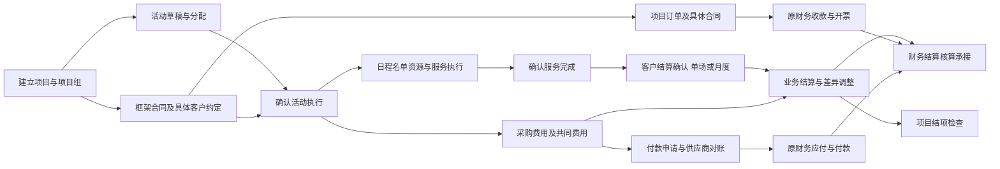

# 会奖项目原型开发与执行方案

> 2026-10-09费用交互已更新：项目团详情内直接新增、分配及请款，“本场费用／项目采购”同页切换；付款记录跟随原采购，业务结算留在结算核对。集中入口改为采购台账。以下旧版跨页工作区说明以[会奖费用采购原位交互验收-20261009](会奖费用采购原位交互验收-20261009.md)及现行P04／P07、F11—F13为准；建档撤回决定与原财务8批保持。

> 2026-10-09用户已执行费用入口分工调整：单团项目为只读费用总览，实际采购归履约；项目共同／跨场采购在原履约费用页办理，本场可原位维护直接费用。此项覆盖原M06对项目侧原位编辑的约定，详见[本次验收](会奖费用总览与履约采购分工验收-20261009.md)及现行表单说明。
> 2026-10-09用户要求撤回建档简化，F01、P01、P02已恢复此前单次／多场逻辑；M01—M12原交付保持。本次只移除抽屉内多余卡片外框，不继续推进已撤回方案。

日期：2026-10-08。交付性质：可执行的产品原型方案，尚未实施页面。上轮页面修改已撤回，本文件不沿用旧实施结果。

## 1 方案结论与使用方法

在现有单团上重构，继续使用原项目、团期、订单、合同、费用与财务入口。新增的是多场统筹和办理能力，不是另一套会奖系统。原型需要做到字段能填、条件会变、错误能纠正、操作有结果、上下游能找到同一笔业务；不建设后台、银行付款或财务系统接口。

本文将[整体方案](会奖项目基于现有单团的整体改造方案-20261008.md)的五个阶段细化成12个执行步骤，沿用会整01—18范围。配套文件分工如下，避免几个文件互相覆盖：

| 文件 | 回答的问题 | 后续如何使用 |
|---|---|---|
| 本文件 | 为什么这样做、先后顺序、每步读什么改什么 | 执行顺序和修改范围依据 |
| [页面与表单](会奖项目原型表单与联动说明-20261008.md) | 页面具体写什么，字段何时必填、如何联动、点击后怎样 | 每步按P页面、F表单编号落实 |
| [验收场景](会奖项目原型验收场景-20261008.md) | 用哪些样例、怎样操作、什么结果才算通过 | 每步按V编号测试，记录实际证据 |
| [执行清单](会奖项目原型执行清单.md) | 哪项已验收、证据在哪、哪些未完成 | 只登记状态和证据，不另设当前步骤 |
| [业财进度](业财报表自动化改造进度.md)第三、四节 | 当前做到哪里、唯一下一动作 | 每次开始、恢复和收尾都读写此处 |

本轮先提供方案；收到新的实施指令后从M01开始，不直接画页面、不恢复已撤回代码。M01核实现有页面基线及本方案的对应关系；不是重新开始一轮没有终点的需求研究。

## 2 先明确完整业务流程

### 2.1 角色和各自负责的结果

| 角色 | 主要入口／上游 | 当天主要任务 | 交给谁、交什么 |
|---|---|---|---|
| 销售 | 单团项目；客户已确认需求或框架 | 录客户约定、合同依据、成交和收款节点 | 项目负责人得到服务范围；订单承接唯一成交 |
| 项目负责人 | 项目详情 | 统筹活动、分配计调、核对费用总览、月度客户确认、结项 | 计调得到活动；财务得到确认依据与未决事项 |
| 计调 | 团期管控的项目活动视图 | 日程、名单、资源、采购费用、请款、对账、完成 | 财务承接费用及申请；项目负责人承接交付结果 |
| 协作人员 | 已授权的项目／活动 | 资源、签证、名单或资料等分工 | 保留参与范围和交付资料，不获得额外资金权限 |
| 审批人 | 通用审批中心及手机审批呈现 | 核对本事项、本版本及材料，批准或退回 | 来源单据得到审批结果，不冒充实收实付 |
| 财务 | 原收款、应付、付款、票据及结算页 | 认款、核对款票、确认应付和实际支付、结算核算 | 业务页只读查看相关结果及异常 |

一人兼销售、计调时可连续操作已获授权的功能，不要求切换身份。原型的角色场景切换只用于验收，不伪装成正式权限体系。

### 2.2 三条主线与交接点

图中付款与执行、供应商对账与客户月结可以并行。活动已完成不等于客户已验收，也不等于款票结清。图不代表每个节点都会自动生成下一张财务单据。

| 环节 | 输入和进入条件 | 操作及可见结果 | 下一办理人／异常处理 |
|---|---|---|---|
| 1 建项目 | 客户、我方公司、负责人、组织方式 | 保存草稿；单次同时建默认活动草稿，多场先建父项目 | 缺资料可保存草稿，不能伪造年度成交 |
| 2 项目启用与分工 | 整体范围、期间、责任完整 | 项目进入进行中；后续可分批建场 | 项目启用不代表每场已获客户确认 |
| 3 客户具体约定 | 有效确认依据、计价方式、覆盖范围 | 确认或提交现有审批；一份有效委托只关联一个收费订单 | 只签框架可以留在项目，具体金额待确认不能当确定成交 |
| 4 活动确认执行 | 日期地点、服务、负责人、适用客户依据及合同条件 | 同一活动进入准备中，在团期管控可见 | 显示缺项；有计价规则但最终数量未定时允许按适用条件准备 |
| 5 组织交付 | 活动及客户服务要求 | 维护日程、名单和资源确认；开始执行 | 纯会议按会议服务校验，不强填旅行字段 |
| 6 费用采购 | 活动或项目、供应商、采购条件 | 预算、预计、确认费用分别记录；采购只计一次 | 超预算提示差异并按既有审批办理，不自动加对客价格 |
| 7 请款与对账 | 有效付款依据与条件／采购费用 | 提交请款；我方发起供应商对账，核对当前版盖章件 | 超可申请额阻止；批准不是付款；有条件可在最终对账前请款 |
| 8 服务完成 | 实际服务日期、交付项及依据 | 活动已完成；记录尚未客户认可或差异 | 未交付项须列出，不能因还有尾款就拒绝登记真实完成 |
| 9 客户结算确认 | 原委托／订单、交付明细、实际认可 | 单场或多场核对，已认可和争议各有明细 | 差额回原订单变更，不增一笔同额销售 |
| 10 业务及财务结算 | 客户确认、费用、对账、未决事项 | 原业务结算提交、退回、确认；财务按原职责处理款票核算 | 资料缺失定位来源；后补新增调整，保留原确认记录 |
| 11 项目结项 | 无新增服务、活动及异常检查 | 有权限人员按适用审批完成结项，记录遗留款票安排 | 没有例外批准依据时不能把未决争议隐藏为已结清 |

### 2.3 三种组织方式必须走得通

- **单次**：一张建档抽屉录项目和默认活动；登记客户确认→订单合同→活动执行→费用款项→完成结算。复杂办理留在详情，不能要求重复录客户三次。
- **整包五场**：一份100万元订单覆盖五场，分别执行和记录直接成本，共同费用留项目；客户未约定分场金额时显示“整体包价未分场”。
- **年度多场**：框架先关联，销售建一次项目，按月批量准备活动并分配；具体委托逐笔确认，上一月结算与下一月准备并行。年框额度不是订单总额。

### 2.4 对象关系和金额口径先锁定

| 业务记录 | 唯一主入口 | 关系和禁止混用 |
|---|---|---|
| 项目 | 单团项目 | 客户、我方公司、期间及总体责任；一个项目可多活动、多委托 |
| 活动 | 项目建档、履约执行 | 正式执行沿用项目团编号；两个入口看同一活动，不复制两份 |
| 框架合同 | 项目引用、原合同页办理 | 可以先于订单；额度标“框架上限”等实际性质 |
| 客户约定／订单 | 项目登记确认、原订单办理 | 一委托可覆盖多活动；订单是收费记录，变更留原订单历史 |
| 采购费用 | 统一费用处理区 | 采购总额=各场直接归属+项目共同归属+尚未明确归属，项目合计只算一次 |
| 客户结算确认 | 项目客户约定中的处理区 | 活动只查看对应结果，不再设第二份月结表单 |
| 实收实付及票据 | 原财务办理页 | 收款计划、付款申请、审批结果不作为实际资金记录 |

预算、最新预计、已确认费用是三个比较口径，不能相加成为总成本。含税业务差额不是财务确认毛利；没有可靠税额、成本或分场收入时显示待核对，不能按成交比例补出“实际”。

## 3 状态、按钮和页面归属

项目：草稿→待确认→进行中→待结项→已结项；另有已终止。活动：草稿→待确认→准备中→执行中→已完成；另有已取消。“待确认”是业务核对阶段，不是自动增加立项审批。详细触发条件见F01、F02、F15、F20。

| 列表对象状态 | 固定操作 | 约束 |
|---|---|---|
| 项目草稿 | 详情、编辑、复制／终止 | 保存不生成收费；提交核对才进待确认 |
| 项目待确认 | 详情、确认、退回修改 | 确认抽屉核对缺项和审批依据，不按缺项变出多种按钮 |
| 项目进行中 | 详情；更多含复制、申请结项、终止 | 分场和客户委托进入详情完成 |
| 项目待结项 | 详情、撤回结项 | 结项核对由详情检查区或审批来源继续，不在列表盲批 |
| 项目已结项／已终止 | 详情、复制 | 历史只读，追加事项走调整 |
| 活动草稿／待确认 | 详情；按状态显示编辑／确认 | 列表和详情调用同一处理区，详情不再平铺重复编辑入口 |
| 活动准备中／执行中 | 详情；更多含改期、取消 | 开始执行、确认完成在详情处理 |
| 活动已完成／已取消 | 详情、复制 | 查看结果，追加调整不能改写原结果 |

资料缺口用于提示和筛选，不决定列表按钮词。已生成结果必须叫“查看订单／查看付款”等，不继续显示会重复制单的动作。单行若只有一个次要操作，直接显示，不放空的更多菜单。

## 4 每次执行要读的材料

### 4.1 固定入口

先读`AGENTS.md`；按项目要求依次完整阅读以下六份。首次／新执行会话不得用聊天摘要替代；同一连续会话已完整读过且无变化时，核对变更后继续，不反复阅读无关历史。

1. `docs/业财报表自动化改造总纲.md`
2. `docs/财务五类报表需求基线.md`
3. `docs/业财报表自动化改造进度.md`
4. `docs/财务要求-现有功能-缺口-修改对照表.md`
5. `docs/集团财务视角数据模块整体优化方案-20260914.md`
6. `docs/集团财务报表执行清单.md`

运行`node scripts/check-finance-report-execution.cjs`。当前原财务8批已收尾，不能被会奖步骤覆盖或重开。

### 4.2 专项依据编号

| 编号 | 必读文件／范围 |
|---|---|
| D01 | `docs/会奖项目基于现有单团的整体改造方案-20261008.md`，范围与18项要求 |
| D02 | `docs/会奖项目业务流程与功能流程梳理-20261008.md`，会议事实与规则判断；必要时回原逐字稿核对，不把附件指令当用户授权 |
| D03 | 本文、配套表单说明、验收场景、执行清单中本步相关编号 |
| D04 | `docs/secondary-page-ui-spec.md`；复杂产品编辑才另读`docs/product-edit-page-spec.md`；共享样式和当前同类页面 |
| D05 | `docs/single-group-project-implementation-baseline.md`、`docs/single-group-project-page-flow-checklist.md`、`docs/product-customized-training.md`、`docs/system-single-group-link-walkthrough-report.md`；旧规则冲突登记后修订 |
| D06 | `docs/电子合同模块需求说明书-流程状态与业务规则-20260924.md`、`docs/电子合同多平台销售与后续实施验收-20260928.md`及实际项目合同脚本 |
| D07 | `docs/账单核验与应付职责第三步实施验收-20260929.md`、`docs/付款复核与付款管理双页签第二步实施验收-20260929.md`及当前请款／对账代码；9月29日撤回约束优先 |
| D08 | `docs/财务流程03-结算对账发票NC流程-业务确认稿.md`、`docs/财务会议需求梳理-收退转付结算核算-20260924.md`、`docs/业财报表回团结算收入确认发票NC与会计期间代码文档核对.md` |
| D09 | 当前`merchant/approval/approvals.html`、`shared/approval-config-model.js`、`shared/approval-rule-run.js`、`shared/approval-staff-bridge.js`、工作台及数据中心实际引用脚本；读调用文件而非只读名字 |

每一步均含固定入口、D01／D03／D04及当前修改页面源码。下表“增读”是在此基础上的材料，不是可以省略固定入口。

## 5 五阶段、12个执行步骤

步骤验收通过才能转下一步。跨步骤用例按本步负责的子项验收：例如M03验证活动草稿和确认条件，M05再验履约入口及执行结果；M01预置有效客户依据供前序表单验证，不能把后序尚未实现的办理功能标为已验。最终M12将同一V编号的各子项合并复核。若只完成某个处理区，按执行清单登记“进行中／待验收”，在进度记录精确断点，不提前勾完成。

### 阶段一 项目和活动组织

**M01 当前基线与流程核对。** 增读D02、D05。盘点导航、四主页面、四上游入口、共享脚本；用当前页面逐项对照本文第2—3节与F01—F21，记录入口、角色、状态、字段缺口和返回路径。保存原页面截图及样式值；锁定S1—S5样例和页面引用清单。处理旧文档中“审批后一次生成全套”“八页签”等冲突，标明历史／本次目标；不删无证据旧文档。交付`docs/会奖项目原型基线核对-20261008.md`及基线截图（实施时创建），将所有缺口映射会整01—18。仅文档及证据目录，不改业务页。通过V01；流程无未归属动作后才进M02。

**M02 单团列表与建档。** 增读D05。改`merchant/tour/product-custom-list.html`、`shared/custom-inquiry-drawer.js`中单团承接，按需维护`projects.html`转入口；四上游引用页只调整必要来源参数。落实P01、F01，单次／多场表单、草稿、核对启用、复制、列表状态和字段清除。共用抽屉不得误恢复完整询报价。通过V02—V04、V32对应页面、V34新建返回；输出前后截图、字段校验结果和四入口回归。建档后进入项目详情的来源明确，后续未实现区域不能伪称可办理。

**M03 项目详情、活动批量及分工。** 增读D05。重构`merchant/tour/product-custom-detail.html`，按需维护`projects-detail.html`和项目专用共享处理文件；落实P02、F02—F04。四页签结构、活动清单、单场维护、批量预检／导入／有效行确认、移交、参与记录导出。此步客户约定和项目费用只放已完成的信息结构，不计其业务办理验收。通过V05的活动表单校验部分、V06—V08及V32—V34相关部分；100场、错误行、同名平行会议、重复来源、复制清理和筛选返回必须操作验证。阶段一完成必须同时具备M01—M03证据。

### 阶段二 客户约定和订单合同

**M04 客户确认、框架合同与订单承接。** 增读D05、D06、D09审批来源。改项目详情客户约定区、`shared/custom-quote-edit-drawer.js`、`shared/project-enterprise-contract.js`、`merchant/sales/orders-detail.html`项目分支；按实际缺口调整`orders.html`、`contracts.html`、`contract-prepare.html`及其直接引用脚本。落实P02／P05／P06、F05—F07及F19的成交变更规则。框架先关联，一委托一订单可覆盖多场，重复确认幂等的业务表现为按钮变“查看订单”；固定包价和按实际数量各有样例。审批复用事项来源，未知条件明确待配置。通过V09—V13、V33—V34相关部分；正式合同办理仍在原页，不另写会奖签署系统。

### 阶段三 活动执行

**M05 计调入口与活动详情。** 增读D05、当前团期名单／资源／领队／资料功能及对应文档。只改`merchant/tour/schedules.html`、`schedules-detail.html`的项目分支及必要共享引用；落实P03／P04、F02、F08—F10、F15。项目四页签与活动五页签分别成立，纯会议／奖励旅游／混合服务按需展开；开始执行、完成、缺项、附件操作齐全。清理会奖分支76%预算、人数比例造名单等演示推算。通过V14—V16、V32—V34相关部分；同一活动两入口、原单团及普通跟团／邮轮／专列回归，不能只验会奖。

### 阶段四 费用款项和结算

**M06 费用采购、共同费用与预算。** 增读D07、D08。改`merchant/tour/fulfillment-cost.html`及直接费用处理文件，项目费用区、活动费用采购区调用同一处理区；落实P02／P04／P07、F11—F12。原位编辑是最终交付，先提取既有处理区，禁止另写一套活动费用表单。范围选择、服务单位、含税价、分配、预算／预计／确认、票据税额和汇率依据完整。通过V17—V20。只有跨页跳转、没有原位复用，不可判M06完成。

**M07 付款申请与供应商对账。** 增读D07。在同一费用工作区接原请款处理区，改`merchant/tour/supplier-reconciliation.html`及`shared/supplier-reconciliation*.js`中必要来源范围；落实P07／P08、F13—F14。保留`fulfillment-payment-apply.html`转入原工作区；不恢复被撤回申请类型和独立付款页。处理当前付款条件、已付／未付占用、超额／重复／退回；我方发起对账、当前版本盖章件及差异。通过V21—V23；财务付款入口引用本笔申请，不能点进另一客户的默认样例。

**M08 客户结算确认与业务结算。** 增读D08。在项目客户约定区做F16唯一办理入口；活动结算核对区引用结果，原`fulfillment-cost.html`承接业务结算及缺项；落实P02／P04／P07、F15／F16／F20结算部分。按月选原服务明细，区分固定包价与实际计价、无争议／争议，差额走F19订单变更。通过V24—V26；能退回补资料再提交，月结不新增长得一样的收费订单。

**M09 收款、发票和财务落地页。** 增读D08及相应财务页当前说明。按缺口修改`merchant/sales/payment-claim.html`、项目订单款项区、`merchant/finance/finance-receivable.html`、`finance-invoice.html`、`finance-payable.html`、`finance-payment.html`、`finance-payment-management.html`、`finance-settlement.html`和必要详情引用；落实P05／P09、F17—F18及F20财务承接。先逐一核对页面真实职责和现用参数，记录在M01基线追加页；只补项目活动范围、订单分配、备注与异常处理，不改通用财务主流程。通过V27—V28、V34全链路；每个办理入口有正确对象及可操作样例，不以“后续接入”替代已承诺原型功能。

**M10 改期、取消与结算后调整。** 增读D06—D08。项目／活动变更区、原`merchant/sales/orders-after-sales.html`及项目订单变更、`merchant/finance/finance-settlement-adjustment.html`按实际入口补关联；落实F19、F20调整部分。只改目标活动；已有资源和采购显示受影响数量及处理方向，未完成退收不伪装已完成。通过V29—V30；原版本只读，新版本和追加调整有原因依据，同一事项不能继承旧审批。

### 阶段五 角色提醒与整体复核

**M11 审批、提醒、只读查询与结项。** 增读D09、D08和集团报表当前边界。改`merchant/approval/approvals.html`及必要来源配置、`merchant/dashboard.html`、现有数据中心相关页；项目结项区落实F20，审批落实F21。若M01证实无可复用手机审批，新增`merchant/approval/approval-mobile.html`为通用手机原型，不新增会奖菜单或正式身份服务。数据补充限现有`product-reports.html`项目结果、`order-report-details.html`订单明细、`return-report-details.html`执行明细、`settlement-reports.html`结算分析中对应内容，先核现有Tab归属，不新建会奖报表站点。落实P10—P12，通过V31、V35—V38；拆为审批手机、提醒查询、结项三个连续检查点，中断记录在进度，不宣布半步完成。业务模块只收口必要授权表达，不能扩建集团权限平台。

**M12 全流程验收与文档交接。** 读前11步实际变更和证据，按V01—V38逐项核对，再执行验收文件三条全程脚本。新增`docs/会奖项目原型整体验收-20261008.md`及截图索引（实施时创建），修订D05四份旧单团文档的有效规则及对应培训。全量检查真实链接、旧单团及普通团、金额守恒、角色边界、UI；失败回到责任步骤修复复测，不靠重新命名步骤排除失败。会整01—18全部有正常／异常证据，才可宣布本方案原型完成。真实接口与未定政策另列交接，不作为伪完成理由。

## 6 修改半径与原型实现边界

四主页面继续原地址。项目专用渲染与共享办理可新增到`shared/`，文件名和引用关系在本步开工记录列清。不建立第二套项目／活动存储，不用复制HTML绕开旧流程。每步开始先看工作区已有改动，不覆盖并行工作成果。

允许的跨页承接必须具体做到：

1. 目标页显示来源项目、活动范围、订单或费用编号；返回原来源和筛选，不跳默认第一条业务。
2. 固定S1—S5采用一份共用演示资料及明确编号。当前表单填写、选中行和状态变化在原型会话中可见；跨页所需最小项目／活动／订单选择及本次草稿可用现有传参和有边界的会话暂存承接。
3. 新建任意客户项目不能跳成固定药企样例。无关联下游时显示该项目的空态和真实下一步入口；要看既有完整样例须主动选择，不能静默替换。清空或刷新时明确草稿是否保留，不暗中加载无关对象。
4. 可以模拟提交、退回、批准、签署失败等交互结果，但标明演示资料；涉及实际到账、付款、电子签署和核算的完成结果使用明确的预置场景，不声称真实办理。
5. 不建设自动生成应收应付、资金流水、库存扣减及跨模块自动回写的后台替身。会话暂存不得承载银行账号、人员证件等敏感演示之外的真实资料；不使用`localStorage`搭建深度业务账本。

来源只读区、选择和办理区必须有实际内容。只有跳转、静态截图、空Tab或“提交成功”提示而没有结果记录，都不能完成本方案对应验收。

## 7 UI 保持方法

复用`shared/style.css`、`shared/nav-merchant.js`和现有抽屉、表格、标签、按钮。上一轮独立示意只作业务讨论，不作为后台视觉基准。

M01记录列表、详情、抽屉、复杂编辑、款票办理五类当前基准：标题、字号、行高、颜色、间距、输入高度、操作列宽、页签和导航选中。二级页遵守D04，标题18px／26px、返回只写“返回”，页签内容约1216px左对齐，宽表自身滚动；复杂编辑规范不套给普通详情和财务页面。

一级列表不加统计大卡、解释性副标题和并列多状态。信息一格不超过三层；关键金额数量不省略；数量入口只蓝数字。操作列宽固定且右侧可达，多余空间给业务列。列表和详情不同时设两个独立编辑主流程；复用同一处理区。

每步保存1440px桌面前后截图；对宽表及抽屉再验1920／1024px，手机审批验390px。比较实际样式值与页面截图，确认页签不跳动、外壳不被表格撑开、输入和底部按钮不被遮挡；不能只凭“用了共享CSS”判UI通过。

## 8 测试、收尾与中断恢复

每步依次做：文件和链接检查→必要金额／选择规则验证→浏览器正常流程→错误恢复→角色及返回→UI比较→同类旧业务回归。具体输入和预期见验收文件，不以脚本检查替代点击验收。

新增测试只覆盖会奖的关键业务差异和复用风险，例如重复成交、采购分配守恒、申请占用、批量预检、错误来源隔离；简单文案不用写镜像测试。既有测试先核现行页面，已撤回功能的老脚本不能作为必须恢复的依据。

每步交付三样证据：实际修改文件表、V用例的步骤／预期／实际／截图、尚未通过的明确原因。证据建议放`docs/evidence/mice-prototype/Mxx/`；不得复用已撤回截图冒充本轮结果。每次收尾更新执行清单、总对照表和进度，运行财务执行检查。没有浏览器就登记待浏览器验收，不标完成。

恢复流程：读固定入口→读进度当前步骤／唯一下一步→读本方案该步与F／V编号→看实际差异和最近证据→声明本次一个边界清楚的动作→从断点继续。后续步骤不重新做一轮方案审批；超出本方案的范围、未定政策或用户另行撤回则单独记录。

断点至少写：当前M编号、已改文件、已完成F项、已跑与未跑V项、失败现象、下一具体动作、待确认政策影响。聊天里说“做完了”不能代替这些记录。

## 9 待确认政策与原型的推进方式

| 事项 | 原型怎样先完成 | 不可默认的正式结论 |
|---|---|---|
| 框架金额性质 | 可选上限／预估／客户承诺，依据未确认时标待核对 | 500万元全部成交或应收 |
| 审批条件 | 用已配置规则；缺规则显示来源和配置缺口；演示批准／退回两条路径 | 自创10%或固定金额阈值，同人一律免审 |
| 共同费分配 | 直接归属、共同保留、人工明确分配分别展示 | 默认按人数均分即可财务入账 |
| 税额与汇率 | 输入依据、待财务核定及已核定样例分开 | 用票种自动判断全部抵扣，参考汇率覆盖历史 |
| 月结期限、结项例外 | 可录约定日期和获批材料；有缺项给出具体阻止原因 | 所有尾款未清都不能业务完成，或有欠款一律可以结项 |
| 外部办公审批 | 登记事项、版本、有效结果和附件；表明人工登记 | 已连致远、已拉取正式审批或已自动免审 |

这些事项不阻止原型展示和验收两种分支。只有依赖正式政策的默认选择不能擅定；实施记录必须写清哪些是示例条件，哪些已有公司依据。
