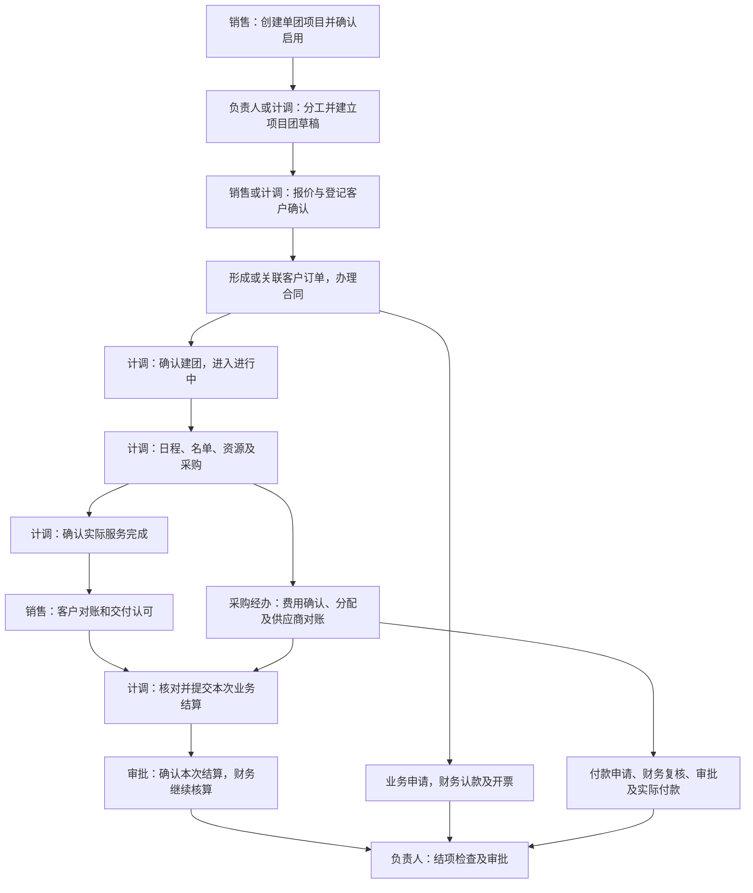

# 单团会奖业务与系统主流程——开发入门说明

> 新版PRD已按页面标明“沿用”和“调整／补充”；其中待补改要求不代表当前原型已经实现。开发实施与验收分别见新版第12、13节。

> **当前开发阅读入口已更新（2026-10-24）：** 请以[《单团会奖全流程产品需求文档》](单团会奖全流程产品需求文档-开发版-20261024.md)理解当前页面、状态、预算、订单、采购、收付与结算规则。本文保留历次讨论和实施记录，下文包含相互替代的历史方案；其中“最新／当前有效”仅表示记录当时的判断，不能覆盖新版需求文档。

> **2026-10-24 最新主流程（已实施）：** 立项与大项目→费用额度及子团筹备→线下成交登记并创建原订单→执行与采购→原开票收款→团期结算。客户已谈妥时建团和建单可以在同一抽屉完成；未谈妥只保存子团。报价资料可选，不要求报价确认后才能建单。按实际数量订单先记约定单价，后在同一单确认最终数量与金额；整包多团一单，批量逐团各一单。执行资料与单据金额仍由两类详情分别承载。最新页面入口、边界和验收见[当前操作顺序](单团会奖主线原型补充实施-20261024.md#当前操作顺序)。下方“报价不改”及报价必经内容保留为此前决策历史。

> **2026-10-24当前主线补充已实施：** 项目详情现为项目总览、项目团、报价与合同、开票收款、费用总览、项目资料六页签；执行八页签／结算十页签及独立采购保留。父子团、操作额度、OA合同、采购成本及款票的最新操作与验收见[本轮实施记录](单团会奖主线原型补充实施-20261024.md)。下方旧步骤与全量待办需按该记录区分，报价流程保持原样。

> **2026-10-24最新操作规则：** 团期结算不再并列显示“查看结算”和“详情”；审批中及已结算的项目团仅保留详情。26个预置项目团已统一调整到服务完成、结算可办理的示例阶段，分别使用结算／继续结算／修改结算。此更新只执行一次，后续办理结果保留；原金额、税额及待核对缺项不改。已结算团的差额办理从“详情 → 结算记录 → 二次结算”进入。

> **2026-10-24 结算办理已补齐：** 在“履约中心 → 团期结算”选择项目团，搜索“华东渠道伙伴交流项目”：杭州场点“结算”、苏州场点“继续结算”、南京场点“修改结算”。原十页签核对金额，在“附件依据”保存本次依据、未结事项和附件；提交后在“结算记录”查编号、办理记录并进入原审批。详情仍只读，执行与采购分工保持。见[操作及验收](项目团执行详情与结算详情边界方案-20261024.md#2026-10-24-结算办理与可操作示例补充已完成当前有效)。

> **2026-10-24 项目采购入口恢复（当前有效）：** 履约中心 → 项目团 → 项目采购恢复独立列表，集中办理未排团项目、项目公共及跨团采购，沿用原费用、分配与付款申请资料；团期结算继续按本团维护成本并核对本次承担、税额及结算。项目团执行八页签与结算十页签保持分开。此前“项目采购菜单合并”的记录由本次修正覆盖。

> **2026-10-24 报名名单交互调整：** 项目团详情现为六个页签，“报名名单”紧接“执行安排”。新增／编辑维护个人资料，分组、到离批次、房间及车辆在集中安排抽屉维护；签证按本团要求、个人办理方式、原办理进度分别表达。导入与导出范围均在名单页办理。见[操作逻辑与实施](项目团报名名单交互梳理与实施-20261024.md)。

> **2026-10-24 项目团详情已统一：** 项目团控、单团项目、订单和团期结算的项目团查看入口共用原五页签详情，返回各自来源。执行安排补名单分组分房分车、适用签证准备、资源确认资料及领队；资料记录补执行文件生成、预览和下载。成本维护与最终结算仍在团期结算原抽屉，报价流程不变。旧欧洲80人团独立保留，日期、名单与22万元成本差额待核。见[实施说明与验收](项目团详情统一实施验收-20261024.md)。

> **2026-10-24 成本办理边界历史（采购合并已由上方恢复决定覆盖）：** 项目团控与普通团期管控一致，维护执行资料和服务完成，成本摘要只读。新增／编辑费用、调整预计、确认费用、跨团分配、管理分摊、票据资料统一在“团期结算 → 维护成本”办理；项目公共及集中采购从同页“项目费用”进入原成本维护抽屉。原项目采购菜单合并，旧链接仍可定位原费用。最终结算沿用原十页签抽屉。报价流程与订单款票原承接保持。见[功能边界与验收](项目团控与团期结算功能边界调整-20261024.md)。

核对日期：2026年10月23日。适用范围：merchant 商户端现有单团会奖业务原型。读者：首次接触会奖业务的开发、测试及实施人员。

**会奖这条链路，是把客户的一项整体委托，拆成可执行的项目团，分别确认客户成交和供应商支出，再核对交付、款票及业务结算，最后结束整个项目。**产品中心管整体项目，履约中心管具体服务和采购，销售中心管客户订单与合同，财务承接收付、税票与核算。

本文是理解现有系统的主入口。依据当前导航、页面实际加载的共享脚本，以及10月21日状态和结算修订整理。正文先讲业务，再讲操作，代码位置集中放在附录。原型中的成功结果用于演示，不表示真实银行、电子合同、开票或财务核算接口已接通。

> **报价流程维持原状（2026-10-23，用户最新决定）：** 用户要求撤回本轮修改，报价流程不改。报价、批量报价、审批和订单四份共享脚本已恢复执行前版本；下文关于新增“销售确认报价”的方案仅保留讨论历史，已撤回，不作为开发或后续实施要求。当前操作仍以原“登记客户确认”及适用审批承接订单为准。

## 一、会奖业务在这里具体做什么

本系统覆盖的会奖场景包括企业会议、奖励旅游，以及会议加旅游的组合服务。例如客户委托凯撒承办一次经销商大会、组织五条奖励旅游线路，或在全年多个城市分批举办会议。

客户通常买的是一组约定服务：会场、设备、住宿、交通、餐饮、行程、现场服务等。客户如何付费与凯撒如何采购并不相同：客户可能只认一个整包总价，凯撒却需要分别向酒店、车队、设备商等采购；也可能同一客户每场分别确认价格、月底集中核账付款。

| 与普通旅游产品比较 | 单团会奖的业务特点 | 系统怎样承接 |
|---|---|---|
| 常规线路通常先有标准产品，再开放团期销售 | 通常先有某个客户的委托，再组织具体服务 | 在“单团项目”建立客户专属项目；不要求先发布一条面向所有客户销售的标准线路 |
| 一个团期一般对应一次出行 | 同一委托可能包含多场会议、多条线路或全年多批服务 | 一个项目下建立多个“项目团”，各团独立排期、指定主责、确认完成 |
| 游客人数与订单价格往往关联较直接 | 可整包、按确定数量报价，也可执行后按实际数量结算 | 报价保存计价方式；计划人数、名单人数、实际人数和最终计价数量分别理解 |
| 费用通常围绕本团发生 | 一笔策划、设备或交通采购可能服务多个团 | 原采购只记一次，再记录各团承担、项目承担和未分配金额 |
| 一次履约结束后统一收尾 | 一部分团已完成结算，其他团仍继续执行 | 允许分批业务结算；最后才办理整个项目的结项 |

“单团项目”是现有菜单名称，**不表示一个项目只能有一个团**；创建时可选单个或多个项目团。“项目团”也不一定是旅游团：一场按人数交付的会议同样可以是一个项目团，不必虚构游客证件和旅游行程。

## 二、先分清七类业务记录

| 名称 | 业务上是什么 | 由谁建立或维护 | 与其他记录怎样关联 |
|---|---|---|---|
| 单团项目 | 客户的一项整体委托，共享客户、我方公司、服务期间、负责人等资料 | 销售、项目负责人 | 一个项目可有多个项目团、报价、订单、采购和结算；项目本身不是收费单 |
| 项目团 | 一次可以单独安排、交付和确认完成的服务 | 计调、项目负责人 | 只属于一个项目；有自己的日期、地点、主责、日程、名单、资源及完成记录 |
| 框架合同 | 一段期间内合作范围、计价和金额性质等约定 | 销售、合同经办 | 可供多次报价引用；签了500万元框架，不代表已经成交500万元 |
| 报价单 | 这一次向客户提供什么、如何计价、覆盖哪些团 | 销售或承担报价职责的计调 | 客户有效确认并完成适用内部审批后，形成或关联原订单 |
| 客户订单 | 一份实际成交，是对客价款、收款计划和后续改价的依据 | 报价确认承接，销售继续办理 | 可覆盖一团或多团；合同、客户对账、收款、开票都引用原订单 |
| 采购费用 | 我方向供应商买的一笔服务及其费用依据 | 计调、采购经办 | 可由资源安排转入，也可直接新增；可由一团、多团或项目承担 |
| 业务结算单 | 本次确认哪些已完成或需取消收尾的团、哪些费用，以及对应业务金额 | 计调提交、审批人核准 | 保存本次范围、来源和确认结果；可以一个项目分多次结算 |

补充三个容易混淆的名称：

- **客户对账**：问客户“这些服务和金额是否认可”。不是再销售一次。
- **供应商对账**：问供应商“这些采购与应付依据是否一致”。不是再新增一次成本。
- **项目结项**：确认整项委托不再新增服务，业务已收尾，允许保留的款票有责任安排。不是确认银行资金已全部结清。

关系示意：

```text
客户的一项委托
└─ 单团项目
   ├─ 项目团甲：日期、主责、日程、名单、资源、实际完成
   ├─ 项目团乙：日期、主责、日程、名单、资源、实际完成
   ├─ 报价 → 客户订单 → 合同、分期收款、开票、客户对账
   │          一份订单可以覆盖甲、乙两团，也可以每团各一份
   ├─ 原采购 → 甲承担／乙承担／项目承担 → 付款、供应商对账
   └─ 分批业务结算 → 项目结项
```

同一个团可以有关联不同服务范围的订单，不能据此重复收费；订单覆盖某团，也不代表已经给这个团分配了独立收入。采购服务了哪些团与各团承担多少钱同样是两件事。

## 三、整条主流程和岗位交接

下图表示现有功能的串联关系。用户已要求报价流程保持原状；第五节第3步同时保留现行操作与已撤回建议，阅读时请区分。



图表示业务依赖和资料交接。合同、订金、采购、付款、开票可按约定穿插，不要求全部排成一条串行流程。供应商对账也不是当前每笔付款或业务结算的统一强制前置；客户认可和费用依据是否齐备，要按本次处理范围判断。

| 岗位 | 每天主要处理什么 | 把什么交给下一岗位 |
|---|---|---|
| 销售 | 接客户需求、报价、客户确认、合同、收款认领和开票申请、客户对账 | 把有效服务与价款交计调；把客户款票依据交财务 |
| 项目负责人 | 项目启用、分工、分配和移交、整体费用、跨团协调、结项 | 让每团有主责、共同费用有归属、未结事项有接手人 |
| 计调 | 建团、准备和交付、采购请款、实际完成、业务结算 | 把服务结果、采购及本团承担交审批与财务 |
| 采购经办 | 供应商采购、跨团费用分配、付款条件、供应商对账 | 交出原采购和核对依据，不以付款申请冒充已付款 |
| 审批人 | 核本次事项的范围、金额、依据和版本 | 批准或退回当前版本，结果回来源单据 |
| 收款财务 | 核到账、订单及收款阶段归属 | 确认认款结果，业务查看实收与余额 |
| 应付财务、出纳 | 核采购、付款条件、账户和批准依据，登记支付结果 | 交出实付和未付结果，失败或待查继续原申请 |
| 开票及核算财务 | 核发票资料、税额和结果，承接业务结算 | 确认票据和适用核算结果，不由业务按钮代为记账 |

**当前原型默认超级管理员。**同一用户可以连续申请、复核、审批和登记结果，不需要切换演示岗位；旧链接里的角色参数不应限制功能。以上岗位用于解释责任，不能照抄旧说明中的“切换某身份才能操作”“申请人不能演示审批”等限制。单据状态、办理顺序、有效范围和重复处理保护仍然有效。正式系统的任职及岗位权限需另行设计确认。

## 四、先找到三个主要工作入口

| 当前入口 | 一行或一个详情代表什么 | 主要用途 |
|---|---|---|
| 产品中心 → 自营产品 → 单团项目 | 一项整体委托 | 建项目、统筹项目团、报价合同、费用总览、结项 |
| 履约中心 → 项目团 → 项目团控 | 一次具体服务 | 计调日常查团、建团、确认建团、执行和确认完成 |
| 履约中心 → 项目团 → 项目采购 | 一笔原采购 | 在原列表及费用抽屉集中维护项目公共／跨团／未排团采购，反查付款及供应商核对；团期结算引用同一记录 |
| 销售中心 → 订单管理 → 项目订单 | 一份客户成交 | 查看报价来源、合同、应收收款和原订单改价 |
| 财务 → 收款应收 → 认款复核／应收管理 | 收款归属或应收依据 | 核收款和收入税额；会奖办理应从原单关联进入相应视图 |
| 财务 → 成本应付 → 应付管理／付款复核／付款管理 | 原费用、申请及付款结果 | 核税额、账户、付款条件、审批后付款 |
| 财务 → 资金票据 → 发票管理 | 开票申请及结果 | 业务申请、财务审核开具、查询及结果登记 |
| 履约中心 → 团期结算 | 团期及项目团 | 维护成本和预计、核费用承担；服务完成后核结算范围、收入税额和成本抵扣，保存草稿或提交审批 |
| 财务 → 结算对账 → 业务结算 | 已提交或确认的业务结算 | 查看业务依据并承接后续核算 |
| 审批 → 待我审批 → 项目事项 | 某份来源单据的本次版本 | 报价、付款、结算、变更、结项的审批 |

项目详情与团控的“新增项目团”是两个工作场景下的同一建团功能：负责人从项目统筹，计调从团控日常操作。不能在两处各建一份同名团，也不要在普通团期管控重新创建一份会奖团。

### 4.1 单团项目详情的四个页签

| 页签 | 这里做什么 | 为什么放在项目层 |
|---|---|---|
| 项目团 | 分工、单个或批量建团、分配移交、查询各团进展 | 统一组织同一委托下的多次服务 |
| 报价与合同 | 框架合同、客户报价、客户对账及原订单入口 | 客户可能整包报价或按月集中核账，需要跨团处理 |
| 费用总览 | 比较预算、最新预计、确认费用及业务毛利，查看原采购 | 看项目整体结果，公共采购和分团承担不能重复相加；实际采购仍回履约办理 |
| 项目资料 | 共同资料、参与成员、办理记录、结算期限、附件、结项情况 | 保存跨团共同依据；参与记录用于说明谁做过什么，不直接计算奖金 |

### 4.2 项目团详情的五个页签

| 页签 | 这里做什么 | 完成后的交接 |
|---|---|---|
| 执行安排 | 会议日程或旅游行程、名单或人数、资源安排与确认 | 给实际交付、客户认可和费用核对提供依据 |
| 成本摘要 | 只读查看预算、最新预计、本团承担及原费用详情 | 需修改时通过“查看成本结算”进入团期结算维护成本 |
| 客户款项 | 查看本团报价和订单、收款认领、开票申请、适用订单改价 | 把客户成交及申请交给销售、财务；整包改价回完整原订单 |
| 完成与结算记录 | 业务毛利测算、本团客户对账及结算结果 | 查看服务完成和已有结算；结算办理统一在团期结算 |
| 资料记录 | 本团附件、变更和办理记录 | 保存可核对的服务及调整依据 |

项目团控已把部分高频原表单放到行操作及“更多”中，点击直接办理，原详情五个页签仍保留。实际显示哪些动作由主状态决定，不能把“名单缺几人”等提醒当另一套状态。

## 五、按业务顺序走通一个项目

### 第1步：创建并启用整体项目

销售收到客户委托后，在“单团项目”查重，再点“新建项目”。填写客户、我方公司、负责部门、业务分类、组织方式、整体服务期间、销售、负责人和服务范围。

操作顺序是“保存草稿／提交核对”，待确认项目从“核对”进入“确认启用”。启用后项目进入进行中，由负责人组织后续工作。创建项目不会自动创建第一个项目团，也不会生成订单、应收或成本。

同一年度项目的下月会议继续建在原项目下。复制项目用于复用计划资料，新副本仍为草稿，不能带入原成交、收付或结项结果。

### 第2步：分工，并建立具体项目团草稿

负责人在项目详情“项目团”登记分工、负责期间和服务范围，安排主责计调；需要时分配或移交未完团。项目分工描述谁负责什么，项目成员记录描述谁实际参与了什么，两者用途不同。当前超级管理员演示不以切换分工身份作为前提。

在项目详情或团控点“新增项目团”，确认所属项目、团名、服务类型、计划日期、城市地点、计划人数或人数待定、主责计调及客户委托编号等，保存草稿。服务类型可为会议、旅游、会议加旅游。

多场会议可批量建团：手动添加、按日期生成、导入表格后逐行核对。当前会奖批量表格读取支持逗号或制表符分隔资料，不应把它写成已经支持任意Excel工作簿。草稿可批量维护，逐团独立成交可批量报价；整包价仍在项目“报价与合同”办理。

输出是多条独立项目团草稿，不是已经成交或已经完成的服务。

### 第3步：报价、销售确认与生成订单（现状及待补环节）

> 本节新增销售确认环节的建议已撤回。现行功能按下方“当前页面实际怎样办理”理解；其余建议仅为讨论历史，不再列为待补任务。

**业务上要区分三件事：**报价是提出服务和价格；客户在线下接受报价是成交依据；销售在系统中确认最终报价，才是把这次成交交给订单、合同和收款继续办理的业务动作。内部审批用于审核适用事项，不能替代销售确认，也不表示客户在线上完成了确认。

#### 当前页面实际怎样办理

销售或承担报价职责的计调从项目“报价与合同 → 新增报价”办理，也可从草稿团的报价入口办理。报价明确覆盖项目团、具体服务范围、币种、计价方式、收款阶段和客户确认依据。

| 计价方式 | 业务含义 | 开发应怎样理解金额 |
|---|---|---|
| 固定总价 | 客户接受这组服务一个确定总价 | 金额属于整份成交，不按团数或人数自动重算 |
| 数量单价 | 本次数量和单价均已确定 | 按本版确认数量与单价形成报价金额 |
| 按实际数量结算 | 先认可计价规则，完成后再确定实际数量和最终价款 | 当前订单可处于待结算确认；预计金额不能当最终应收或随意填零 |

当前“保存报价草稿”仅保存准备资料；“登记已报价”表示已向客户报价；“登记客户确认”记录客户在线下接受本版报价的依据。无需内部审批或已具备有效外部批准依据时，保存确认会同时生成或关联订单；需内部审批的，审批通过时生成或关联订单。

这三个动作集中在“报价与客户确认”抽屉，页面没有单独讲清销售如何接到待确认报价、如何确认最终成交，以及本次确认将形成什么订单。保存后关闭抽屉并刷新列表，已有订单可从“查看订单”进入，但没有将本次建单结果作为明确的下一步呈现。批量逐团报价也有同样问题。代码保留经办等资料，不等于已经表达了完整的销售办理环节。

生效报价形成一个订单；若这份成交已有订单，则在条件匹配时关联原订单。**客户确认五份独立报价，可形成五单；一份整包报价覆盖五团，则是一单覆盖五团。**不能因为跨五团而复制五份同额订单，也不能再把框架金额加到成交中。

订单已确认后，客户加减价从原订单办理；不能重新保存旧报价就覆盖已成交金额。按实际数量结算的最终定价仍需核最终订单金额和收款阶段，客户对账不会自动完成这一步，具体边界见第十节。

#### 此前讨论的流程建议（已撤回，不执行）

```text
产品／计调或销售准备报价 → 提交给销售核对
  → 销售与客户线下沟通，必要时修改并形成最终报价版本
  → 销售在系统内确认最终报价及客户接受依据
  → 无需审批：确认并生成订单
     需要审批：提交本版确认审批 → 审批通过后生成订单
  → 显示订单号、成交范围及“查看订单”，继续合同、收款和履约
```

“销售确认”和“生成订单”是两个业务含义清楚的环节，可以由一个明确的“确认并生成订单”操作连续完成，不要求销售重复录入一遍订单。客户线下接受不是系统按钮，登记一份客户附件也不应被理解为已经执行销售确认。

| 环节 | 主要使用人及任务 | 当前页应呈现什么 | 办理后的结果 |
|---|---|---|---|
| 准备并提交报价 | 产品／计调准备服务、计价和费用参考；销售也可直接编制 | 原报价的版本、覆盖项目团、服务范围、对客价格或计价规则、报价经办与销售负责人 | 销售可以识别并进入待确认报价；保存草稿或提交报价不生成订单 |
| 销售确认报价 | 销售核对最终成交内容，登记客户线下接受依据 | 本次版本、客户与我方公司、币种、服务范围、成交金额或计价规则、收款阶段；客户依据与内部审批分开 | 保存销售确认人、时间及本次确认内容，明确是否需要审批和是否将生成订单 |
| 适用内部审批 | 审批人审核销售提交的本次版本 | 审批事项、金额和依据；审批中、退回及通过结果可回到原报价查询 | 退回不生成订单；通过后承接同一版销售确认，不另造一份报价 |
| 生成或关联订单 | 系统承接已经完成的销售确认及适用批准 | 生成前可核订单内容；生成后显示订单号、报价来源、覆盖团、金额及原订单入口 | 新成交生成一单；已存在的同一成交按匹配条件关联原订单，不再新增 |

以下是此前讨论的原页补充范围，现已撤回，不安排实施。

| 现有区域 | 原来怎么用、为什么这样组织 | 缺什么、在哪里补 | 保留什么、怎样回归 |
|---|---|---|---|
| 项目详情“报价与合同”中的客户报价 | 在项目层维护报价，便于一份成交覆盖一团或多团 | 在原报价列表识别待销售确认对象及负责人，增加明确“销售确认”办理阶段；列表动作仍由报价主状态决定 | 保留框架合同、跨团范围、原报价入口和客户对账，不另建重复菜单 |
| 原报价抽屉 | 集中服务、价格、团范围、收款阶段及确认依据，避免重复录入 | 保留原业务分区，区分报价准备与销售确认；确认区核最终版本、客户线下依据和订单内容，明确“确认并生成订单”或“提交确认审批” | 保留三类计价、报价历史、客户附件、已有订单关联；不能只改按钮名称而不补办理结果 |
| 原审批与项目订单 | 审批通过可建单，项目订单承接合同和客户款项 | 原报价与审批结果均能看到同一订单号、处理结果及“查看订单”；订单可反查销售确认版本和经办 | 保留一份报价对应同一订单、重复办理保护；内部审批不代替销售确认 |
| 批量逐团报价 | 用一次操作准备多份独立报价 | 同步区分批量准备报价与逐份销售确认，逐行显示确认及订单结果 | 保留逐团独立成交；整包报价仍只生成一单，不能按覆盖团重复建单 |

此前建议的验收场景（随方案一并撤回）包括：草稿和仅提交报价均无订单；线下客户依据可登记但不能冒充销售确认；无需审批确认后可看订单；审批中和退回不建单；批准后可反查同一确认版本；报价改版后旧确认不批准新内容；重复操作不重复建单；关联已有订单保留原款票；整包多团只生成一单；按实际数量结算保留待结算确认和计价规则；批量逐团结果可逐单核对。当前仍按超级管理员演示完整流程，岗位用于说明责任，不新增切换身份前置。

### 第4步：合同办理与确认建团

销售从框架或订单“合同办理”进入合同流程，核签约双方、服务范围、金额及版本，按实际方式办理线下签署文件归档或适用在线签署原型。框架与具体服务合同分别按真实约定处理，内部批准、客户确认和合同签署不能互相替代。

计调在草稿团点击“确认建团”，核有效客户依据：覆盖本团的已确认报价或有效订单、客户委托凭据、服务范围、日期地点、人数口径及主责；引用框架时还要核适用期间和签署依据。满足条件后直接进入“进行中”。

“进行中”包含服务准备和实际交付，**不再有“开始执行”步骤**，也不表示实际服务已经开始。已确认按实际数量计价规则的团，不应仅因最终收入尚未确定就被解释为不能建团。实际开始和完成事实在确认完成时登记。

### 第5步：准备并交付服务，建立采购费用

计调在“执行安排”维护议程或行程、场地和人员安排、名单及资源。会议按实际服务要求决定实名还是人数交付；酒店、车辆、交通、会场设备等分别记录日期、数量、供应商和确认依据。

资源安排回答“服务有没有落实”，采购费用回答“向谁买、买什么、金额及付款条件是什么”。团控只维护资源安排；在团期结算的“维护成本”中可以引用执行资源新增费用，也可以直接新增费用；已引用的资源继续原采购，不再建第二笔。

经办核实际采购依据和费用，记录供应商、币种、服务期间、确认金额、付款条件、税费依据等；预算和最新预计另行维护，不直接替代已确认费用。共同采购还要说明承担范围：

| 费用归属 | 例子 | 统计和结算方式 |
|---|---|---|
| 本团直接费用 | 甲团专用会场 | 全额由甲团承担 |
| 跨团采购 | 一份设备租赁服务甲、乙两场 | 原采购一笔，分别记录甲、乙承担金额 |
| 项目公共费用 | 整体策划或项目统筹费用 | 可保留项目承担，或有依据后分配给各团；未分配单独识别 |

项目层合计原采购一次；团层只取本团承担。把费用分给各团是明确归属，不是又发生一次支出。供应商对账从原采购继续，保留双方金额、差异和确认依据，不以对账金额直接覆盖采购。

### 第6步：按约定穿插办理收款、付款和开票

这三条支线可以在服务开始前、进行中或完成后发生，时间由有效业务条件决定。它们分别记录实际资金和票据，不通过项目团主状态替代。

| 支线 | 发起入口和主要过程 | 什么时点才算产生结果 |
|---|---|---|
| 客户收款 | 项目团“客户款项”或原订单“应收收款”发起认领 → 选择已登记到账 → 分配到订单及收款阶段 → 财务认款 | 财务确认归属后才增加已认款；提交申请只是占用可认金额 |
| 供应商付款 | 原采购申请付款 → 财务核采购条件和收款账户 → 适用审批 → 出纳登记付款结果 | 成功付款才增加实付；批准不等于银行已付，可分次办理 |
| 对客开票 | 项目团或订单发起开票申请 → 填购买方、税号、项目、金额及备注 → 财务审核开具／登记结果 | 开具成功才增加已开金额；开票中或结果待查继续查询原申请 |

同公司、同客户、同币种的相容订单可按集中入口提供的范围分配款项或申请合并开票；每个订单只记本单分配金额。若申请跨项目，归属也要沿各订单分别计算，不能全计到申请起始项目。

付款申请须看满足条件的本次额度，扣除已付、有效申请未付占用及适用冲抵，不是采购总额有多少就能立刻申请多少。付款或开票结果未知时先查原记录，不能直接再办一笔。业务认领退回后修原申请；财务核定与实际执行继续使用原单关系。

**应收**是客户应付给我方的钱；**应付**是我方应付供应商的钱；**认款**是核实到账并确认属于哪个订单；**核销**是将已确认款项抵到对应应收或应付。提前收到或付出的款项可能需要财务按预收、预付等性质处理，不能为方便演示虚构最终成交或最终成本。

### 第7步：确认实际完成，再取得客户认可

服务交付后，计调从“确认完成”登记实际起止、实际人数、完成依据和交付材料，团进入已完成，原执行资料受保护。计划结束日期到了，不会自动证明服务已完成。

随后销售在项目“报价与合同 → 客户对账”选期间和原订单，核客户认可、争议及凭据。

- 独立成交或整包已全部交付：按“结算金额与服务确认”核服务及价款。
- 整包只交付一部分：按“整包交付进度确认”核已完成范围，不给每团平均拆收入。
- 客户只认可部分金额：保留认可、争议和原因，按原订单办理有效改价或继续处理争议。

客户月度对账仍引用原订单，不再新建一张同额“月结订单”。我方完成与客户认可分别留证；有按实际数量计价的，还要继续核最终订单价款，不能以对账完成代替定价完成。

### 第8步：核对本次业务结算并提交审批

从“履约中心 → 团期结算”筛选“项目团”，点击对应团的“结算”，进入现有十页签抽屉。项目团控不再提供结算办理入口，详情保留完成及结算结果查看。取消团若仍有关联订单或费用，也要按实际情况结算收尾。

总览核结算范围及含税、预计扣税后、核定扣税后三套金额；收入明细核销项税，成本明细核可扣税额、直接费用、跨团分配、管理分摊、项目承担及未分配费用；附件依据核缺项、结算依据和未结事项；结算记录反查审批及导出、打印。原有优惠、订单、收款、付款和变更页签继续使用。

1. 选择本次团范围；按需勾选“同时核对项目承担费用”。只结项目承担费用时可不选团，但仍要明确本次范围。
2. 核服务完成、客户认可、采购费用确认和承担依据。无费用应有说明；金额未知和明确为零不能混用。
3. 核本次收入、成本、税额、业务毛利及毛利率，按币种分别看。范围变化后核对应来源，不复制整项目合计。
4. 保存草稿继续整理，或“提交结算”交审批；退回后从原记录补正重提。
5. 审批通过后查看已确认版本，下载“导出结算单”或打开“打印预览”；财务从业务结算查看原依据并继续核算。

同一团或项目承担范围不能重复进入有效普通结算。已确认结算保留确认时范围和金额，后续补费或减费另走调整，不把历史结算随当前采购金额一起改掉。

### 第9步：全部业务收尾后，再结整个项目

负责人在单团项目详情点击“结项检查”，处理未完成服务、未认可服务、争议、费用、业务结算及未完变更。确认无新增服务，填写结项说明后申请，审批通过才进入已结项。

若制度允许部分款票未清时业务结项，必须留下适用批准、金额、责任人及处理安排；业务缺项不能用款票例外绕过。年度项目某个月已结算，下个月仍有服务时，整个项目继续进行中。

结项结果在“项目资料”查看，款票仍需按原单继续处理。当前结束项目后新发起认领或开票的完整承接另有边界，见第十节；不能把结项按钮解释为自动完成退款、核销或财务关账。

## 六、状态分别属于谁，不能用一个“完成”包办

| 记录 | 当前主要状态或结果 | 代表什么 |
|---|---|---|
| 项目 | 草稿 → 待确认 → 进行中 → 待结项 → 已结项；另有已终止 | 整体委托是否启用、是否结束 |
| 项目团 | 草稿 → 进行中 → 已完成；另有已取消 | 本次服务有没有正式建团、是否完成交付 |
| 报价 | 草稿、已报价、待审批、已确认等 | 本版商业条件有没有生效 |
| 订单 | 金额明确的已确认；按实际结算可为待结算确认 | 对客成交及最终价款是否明确 |
| 业务结算 | 草稿 → 审批中 → 已确认；退回为已退回并继续原单 | 本次范围的业务依据是否被批准 |
| 认款、付款、开票 | 各自申请、审核、办理和结果状态 | 钱或票实际处理到了哪里，与团是否完成分开 |

项目团列表的现行动作：

| 团主状态 | 主处理方向 | 其他动作的边界 |
|---|---|---|
| 草稿 | 确认建团 | 编辑、新增报价；不提前展示费用、款票和结算为本阶段处理 |
| 进行中 | 确认完成 | 准备交付、费用、预计调整、收款开票、适用改价及团变更 |
| 已完成 | 核对结算，或查看审批中／已确认结算 | 尚未锁定的费用可补，客户款票可继续；原日程名单资源不再按进行中随意编辑 |
| 已取消 | 核对取消后仍需处理的订单、费用和结算 | 保留结果与反查，不继续执行或恢复原建团流程 |

取消通过适用项目团变更办理。新增、编辑和复制保存不等于确认建团；确认建团也不会再生成一份订单。已结项、已终止项目对新增办理的限制继续生效。资料缺口、下游款票状态、结算状态可以补充判断，但不取代团主状态。

## 七、结算金额怎么理解

### 7.1 四个金额来源各管一件事

```text
客户成交金额：来自有效订单及批准改价
实际收款金额：来自财务已确认的到账分配
确认采购费用：来自原采购及有效费用调整
实际付款金额：来自成功付款结果
```

未收不代表没有成交；付了订金不代表已经形成全部最终成本；开了发票不代表客户已付款。业务结算确认的是本次业务范围，财务确认收入、成本和记账期间还要按适用规则处理。

### 7.2 当前结算单已具备三套金额

10月21日已在结算办理、详情和审批中补齐以下内容，不能继续沿用早期资料中“结算单没有收入和毛利”的结论。

| 口径 | 收入 | 成本 | 毛利 |
|---|---|---|---|
| 含税 | 本次范围内可明确的订单金额 | 本次范围内已确认承担费用 | 含税收入－含税成本 |
| 预计扣税后 | 含税收入－预计销项税额 | 含税成本－预计可扣税额 | 预计扣税后收入－预计扣税后成本 |
| 核定扣税后 | 含税收入－财务核定销项税额 | 含税成本－财务核定可扣税额 | 核定扣税后收入－核定扣税后成本 |

销项税额是对客业务相关税额；可扣税额是财务按适用规则确认可扣除的采购税额。票面税额不天然等于可扣税额。预计数据服务报价与经营测算，核定数据由财务确认；税额未明确时显示待核，不能自动按零。

毛利率按同一口径的毛利除以收入；收入未知或不大于零时不硬算比率。“核定扣税后业务毛利”不是企业所得税后净利润，也不包含公司全部管理费用。

### 7.3 结算范围必须同时管住收入和成本

- 一份整包订单覆盖五团，本次只结其中一团时不拆整包收入、不虚构本团毛利；全覆盖时整包订单只计一次。
- 跨团采购在本团结算中只取本团承担，不能把采购全额放入每张结算。
- 仅核项目承担费用时，只展示适用费用，不凭空生成收入或毛利。
- 不同币种分别列示；没有已确认汇率依据，不相加成一个总数。
- 提交保存提交时资料；批准时重核来源，确认后保留确认结果；退回重提保留旧版本。导出和打印预览使用所查看版本的金额。

结算单已有CSV导出和页内打印预览。它们不等于完整项目档案输出，也不等于已验证正式打印分页或已生成正式PDF。

## 八、用两个案例把业务和金额串起来

### 案例一：同一客户的两场独立报价会议

以下是教学假设，均为人民币含税金额，不是公司定价或税务政策，也不表示原型已有同名样例。

客户委托凯撒承办北京、上海两场会议，分别确认8万元、12万元。北京直接采购6万元，上海直接采购9万元，共同设备采购1万元，按明确依据分给北京4,000元、上海6,000元；另有3,000元策划费由项目承担。

| 按顺序办理 | 系统留下的结果 | 开发核对点 |
|---|---|---|
| 建立“客户双城会议项目”并启用 | 一个项目 | 不生成20万元应收或两个订单 |
| 新增北京团、上海团，保存草稿 | 两个项目团，各有主责、日期和地点 | 两团同属一项委托 |
| 两团分别报价、客户确认，完成适用审批 | 两份报价、两个订单，金额8万及12万 | 项目成交20万元，框架、合同和客户对账不再另加 |
| 分别确认建团、安排并交付 | 两团进入进行中，后来各自确认完成 | 北京先完成不使上海自动完成 |
| 建立四笔采购并确认承担 | 6万、9万、1万、3,000元四笔原采购 | 北京承担6.4万、上海9.6万、项目承担3,000元 |
| 客户一笔付来6万元订金 | 认领分给北京2.4万、上海3.6万，财务复核确认 | 待复核时只是占用；确认后实收6万，待收合计14万 |
| 向供应商付款 | 从对应采购分次申请、复核审批并记录实际付款 | 实付不再次增加采购成本 |
| 北京完成、客户认可并先结算 | 北京本次收入8万、承担6.4万，含税毛利1.6万 | 上海和项目承担费用未被顺带结完 |
| 上海完成并结算；项目费用单独或随该次核对 | 上海本团含税毛利2.4万；项目承担费用3,000元得到收尾 | 若同一结算包含项目费用，本张单收入12万、成本9.9万、毛利2.1万 |
| 项目最终核对 | 收入20万、原采购16.3万、含税毛利3.7万 | 不能在16.3万原采购之上再加1万元分配额 |
| 业务问题解决，款票清理或有适用安排 | 申请结项并核批准结果 | 业务结算、付款成功、结项各保留自己的证据 |

复算：

```text
项目成本 = 60,000 + 90,000 + 10,000 + 3,000 = 163,000
按承担核对 = 64,000 + 96,000 + 3,000 = 163,000
项目含税毛利 = 200,000 - 163,000 = 37,000
订金分配 = 24,000 + 36,000 = 60,000
财务确认订金后待收 = 56,000 + 84,000 = 140,000
```

若实际是“一份20万元整包报价覆盖两团”，则只形成一单。北京先结时可核已完成服务及6.4万元承担，不能自动认定北京收入10万元；全部服务及费用最终明确后，才在相应完整范围核20万元收入。

### 案例二：500万元年度框架，每月多场会议

假设框架明确500万元是年度上限，当月100场会议分别确认2.5万元，每场确认采购2万元，暂不考虑额外费用。

1. 建一个年度项目，登记框架和分工，计调在原项目下分批建团，不按月份重复建年度项目。
2. 100场分别确认成交，则累计订单金额250万元；不能把500万元框架再加一次，得出750万元成交。
3. 当月100场费用合计200万元；若全部完成、认可且金额确认，含税业务差额50万元。共同费用如另有发生，应按真实采购另核。
4. 月度客户对账勾选原100个订单。客户合并付款时按订单分配，不新建一张250万元月结订单。
5. 已完成并认可的场次可以先结；未完成、有争议的场次留在原记录处理。下月继续新增服务，年度项目继续进行中。

100场用于说明业务量，不是当前默认样例数，也不是系统上限；原型已把默认样例精简，不能把少量演示记录当作最多只能建这些团。

## 九、常见异常应回哪份原记录

| 发生什么 | 谁从哪里处理 | 哪些结果不能顺手覆盖 |
|---|---|---|
| 客户改期或取消某一团 | 计调在项目团变更办理，按适用审批生效 | 重新核日程、资源和损失；不自动取消其他团，不按团数机械减少整包价 |
| 客户追加或减少收费 | 销售从原订单“售后变更 → 申请改价” | 原报价历史、已收款和原发票保留，补退资金及票据更正分别处理 |
| 客户只认可部分服务或金额 | 销售从原客户对账查看争议，继续原订单变更或交付处理 | 不直接改掉原成交，也不能认为任何改价都会清空争议 |
| 采购增加或减少费用 | 原采购办理费用调整；已结算后走结算费用调整 | 保留原采购、原结算，增加本次调整依据；负费用不等于供应商退款到账 |
| 认领被退回 | 从原认领“修正”后重提；合并申请核完整分配 | 不重复登记到账，不只改单个团所见的一部分分配 |
| 付款被退回或付款失败 | 回原申请查看原因，由经办及财务继续办理 | 申请退回、银行失败、结果待查是三种情形；成功已付不因重提而消失 |
| 开票失败或结果待查 | 财务查询原申请；明确失败后按原因重试 | 结果未知先查清，成功票据不重复开具 |
| 结算被退回、审批时来源已变 | 回原结算补依据、重新提交当前版本 | 旧批准不能批准新金额；旧提交内容保留可核对 |
| 计调离岗 | 负责人分配或移交未完团 | 保留历史经办、报价、采购和原单，不通过复制业务迁移责任 |

## 十、当前原型与正式开发的交接边界

主流程的页面和业务办理说明以本文为入口。以下内容需要在开发交接时明确，并不要求为了读懂或演示当前原型先接真实接口。

| 分类 | 本次可确认的范围 | 开发不能直接假设的内容 |
|---|---|---|
| 当前已表达的主流程 | 项目、分工建团、报价订单合同、执行采购、款票申请与结果、客户／供应商核对、分批业务结算、结项均有功能承接 | 菜单和建单代码齐全不代表正式后台完成；本次报价流程按用户要求维持原状 |
| 本次已撤回的流程建议 | 当前“登记客户确认”及适用审批通过可自动生成或关联订单 | 用户要求报价流程不改；新增销售确认环节的建议和本轮代码修改均已撤回，不作为待实施事项 |
| 本次同步的最新规则 | 项目团四状态、确认建团直接进行中、团控直接表单、超级管理员、结算三套金额及版本输出 | 旧五状态、必须切身份、结算单无金额等旧说明不继续作为现状 |
| 已有文档记录的待专项复核分支 | 按实际数量的最终订单定价；部分争议处置；付款退回后业务修订；已结项后新认领／开票；费用调整精确关联原结算 | 不能只因为存在“改价／财务／调整”入口就认定每个异常分支已完整跑通。本次未重跑这些浏览器场景 |
| 正式系统的交接责任 | 订单、采购、收付、票据、结算各自有来源及范围 | 不能直接照搬浏览器会话存储、固定演示人员、累计数字或演示审批实现生产系统 |
| 仍需业务／财务确认的政策 | 框架金额性质、先执行后定价条件、税费抵扣、汇率、付款条件、收入成本确认及结项例外 | 示例税率、额度、天数和批准人不是集团统一政策 |

原执行记录保留的“任职、汇率及完整项目输出”事项，不因本次说明交付而自动勾完；结算单CSV及打印预览已经补齐，不能再与“完整项目档案输出”混作一个未完项。

**财务后段的分工：**业务交出客户订单、交付结果、采购承担、审批与本次结算确认；财务按规则处理应收应付、预收预付、核销、退款、更正及收入成本确认，并决定会计期间（记账月份或期间）。NC是财务核算系统，推送和回执属于财务后续处理。当前会奖视图没有完整实现这些真实接口和统一取数，不由项目结算按钮直接生成正式会计结果。

## 十一、开发和测试先按这张表讲通，再拆任务

以下是交接演练清单，不是本次新做过的全流程浏览器验收结论。

| 顺序 | 用案例一核对 | 应能说明的结果 |
|---|---|---|
| 1 | 项目和两团分别创建在哪里 | 两入口建的是同一类团；创建项目不自动生成团和成交 |
| 2 | 报价何时承接订单 | 按当前草稿、已报价、登记客户确认及适用审批解释建单时点；一份成交不重复建单，新增销售确认步骤已撤回 |
| 3 | 团如何进入进行中 | 保存仍草稿；有效客户依据下确认建团，没有开始执行步骤 |
| 4 | 客户与实际执行如何对应 | 原订单的覆盖范围可以核到日程、名单、资源和实际完成 |
| 5 | 一笔共同采购怎样算两团成本 | 采购总额、各团承担、项目承担和未分配能核平 |
| 6 | 6万元订金什么时候变实收 | 提交占用和财务确认分开；订单、阶段分配各自合计一致 |
| 7 | 付款与开票何时算成功 | 审批不计实付，申请不计已开，待查继续原记录 |
| 8 | 北京先结算时上海怎么办 | 只结北京范围；上海继续进行中，项目费用有明确后续归属 |
| 9 | 三套结算金额是否缺数 | 预计与核定分开；整包未分价、税额未核、承担未明不补零 |
| 10 | 退回、改价和后补费用如何处理 | 回原记录、保留旧版本、形成有效调整，款票后果分别办理 |
| 11 | 整个项目何时结项 | 服务、客户认可、费用、结算及未完变更已核，款票遗留有适用安排 |
| 12 | 管理者如何看结果 | 项目、团、订单、采购按各自粒度汇总，金额不因对账或分配重复 |

工作台用于核到期未收、服务完成和结算期限事项；数据中心在产品分析／业务毛利看项目结果，在订单明细看项目订单，在回团明细看项目团。当前会奖报表月份筛选按项目团计划开始月份，不等于财务记账期间；报表只读，不能在报表直接改成交和成本。

## 附录一：现有文档怎样读，避免从历史计划开始找

项目目录中原来已经有三份可直接使用的说明，本次保留并加阅读入口，不删除历史设计和验收材料。

| 阅读顺序 | 文档 | 适合解决的问题 |
|---|---|---|
| 1 | 本文 | 会奖业务是什么、系统主流程为何这样走、岗位怎样交接 |
| 2 | [会奖项目按页面顺序操作说明](会奖项目按页面顺序操作说明-20261009.md) | 对着每个页面、页签和抽屉寻找详细操作 |
| 3 | [会奖项目业财流程规则与数据关系开发说明](会奖项目业财流程规则与数据关系开发说明-20261009.md) | 深入对象关系、金额、规则、正式开发一致性及待确认项 |
| 补充 | [会奖项目全流程页面使用说明](会奖项目全流程页面使用说明-20261009.md) | 从各岗位任务顺序阅读更完整的使用说明 |
| 查证 | [会奖项目原型执行清单](会奖项目原型执行清单.md)、[总对照表](财务要求-现有功能-缺口-修改对照表.md) | 查具体功能的实施范围、历史验收证据与替代记录 |

旧文件名仍带10月9日，部分正文已追加10月21日修订。阅读时以已实施的最新规则为准，不能把历史方案、撤回记录、建议和待确认政策都当成当前功能；本次只更新说明和文档记录。

## 附录二：给开发的页面与脚本定位

以下路径用于开发定位。会奖复用页面需要来源编号及会奖参数；仅打开同名HTML可能显示普通业务页面。业务人员应优先从上文菜单和原单入口进入。

| 业务范围 | 当前页面 | 主要脚本及核对位置 |
|---|---|---|
| 导航与页面归属 | merchant 共享导航 | [nav-merchant.js](../shared/nav-merchant.js)：单团项目、项目团控、团期结算及详情归属 |
| 项目建档与详情 | [product-custom-list.html](../merchant/tour/product-custom-list.html)、[product-custom-detail.html](../merchant/tour/product-custom-detail.html) | [mice-projects.js](../shared/mice-projects.js)、[mice-project-detail.js](../shared/mice-project-detail.js)：项目状态、建团、四页签、复制和移交 |
| 项目团执行及行操作 | [schedules.html](../merchant/tour/schedules.html)、[schedules-detail.html](../merchant/tour/schedules-detail.html) | [mice-activities.js](../shared/mice-activities.js)、[mice-activity-actions.js](../shared/mice-activity-actions.js)、[mice-prototype-model.js](../shared/mice-prototype-model.js)：四状态、确认建团、完成及动作范围 |
| 报价、订单和合同 | [orders.html](../merchant/sales/orders.html)、[orders-detail.html](../merchant/sales/orders-detail.html)、[contracts.html](../merchant/sales/contracts.html) | [mice-agreements.js](../shared/mice-agreements.js)的 `ensureOrder`、[mice-orders.js](../shared/mice-orders.js)、[mice-contract-bridge.js](../shared/mice-contract-bridge.js) |
| 采购、付款申请及供应商对账 | [fulfillment-cost.html](../merchant/tour/fulfillment-cost.html)、[supplier-reconciliation.html](../merchant/tour/supplier-reconciliation.html) | [fulfillment-cost-editor.js](../shared/fulfillment-cost-editor.js)、[mice-payments.js](../shared/mice-payments.js)、[mice-reconciliation.js](../shared/mice-reconciliation.js) |
| 收付款、开票及税额 | 财务认款、应收、应付、付款及发票页面 | [mice-finance.js](../shared/mice-finance.js)、[mice-billing.js](../shared/mice-billing.js)、[mice-einvoice.js](../shared/mice-einvoice.js)、[mice-tax-model.js](../shared/mice-tax-model.js) |
| 客户对账与业务结算 | 项目“报价与合同”、履约“团期结算”、财务业务结算 | [mice-settlement-host.js](../shared/mice-settlement-host.js)、[mice-settlement.js](../shared/mice-settlement.js)、[mice-tax-summary.js](../shared/mice-tax-summary.js)；结算金额以 `settlementEvidence` 及保存的提交／确认结果为准 |
| 变更、审批及结项 | 原单变更、项目事项审批、结项检查 | [mice-changes.js](../shared/mice-changes.js)、[mice-approval.js](../shared/mice-approval.js)、[mice-closeout.js](../shared/mice-closeout.js) |
| 当前权限及经营查询 | 会奖各页、工作台及数据中心 | [mice-access.js](../shared/mice-access.js)、[mice-insights.js](../shared/mice-insights.js) |

常用页面参数为 `mice=1`，项目用 `projectId` 或页面对应的 `id`，团详情用团 `id`，订单用 `orderNo`，本团成本用 `type=project&work=costs` 进入团期结算，项目采购独立列表保留 `fulfillment-cost.html?mice=1`，原采购用 `costId` 定位，付款用 `requestId`。具体参数组合应沿来源脚本生成的链接核对，返回地址只负责导航，不代表业务已经处理成功。旧 `projects.html` 和 `projects-detail.html` 不是本次推荐的主操作入口。

内部集合 `activities` 在当前业务页面叫“项目团”；`commitments` 对应报价及客户确认。正式数据结构要保留业务关系，不能因内部旧变量名而把业务名称改回另一套叫法。生产接口、数据库、并发和防重复要求继续见原开发说明的技术附录。

初版核对证据见[文档检查记录](evidence/mice-prototype/developer-intro-20261023/checks.json)，本次销售确认环节复核见[补充检查记录](evidence/mice-prototype/developer-intro-20261023/sales-confirmation-review.json)。用户随后要求撤回报价流程修改；本轮四份脚本已恢复执行前版本。下一步仅按现行流程使用本文讲解和走读，不继续新增销售确认步骤。
