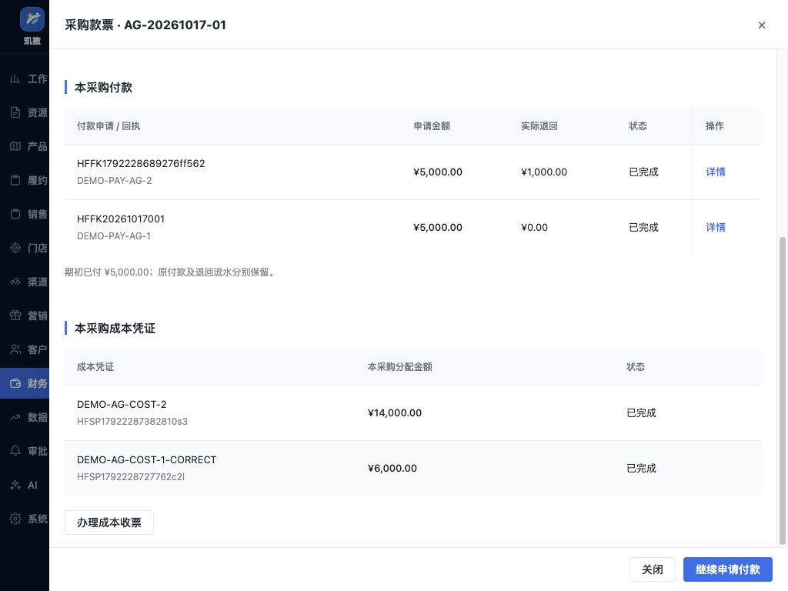

# 航服开票付款与采购收票修正验收

> 2026-10-17后续第三组完成：修05、修06、补06现行口径及证据见[本批报表修正验收](航服报表有效范围与BSP日报修正验收-20261017.md)。日报已覆盖未对账的已应用BSP导入，毛利与未提结算按有效范围查询。本文验收时点及旧下一步保留为历史；当前唯一下一步见进度第三、四节。

日期：2026-10-17。对应[附件差异复核](航服附件与原型差异复核-20261017.md)的修04、修07、补04；承接进度文档第二组。三项已实施并完成本批复验，原财务8批、36项、6场景及其他工作线不变。

## 一 角色、入口和交付

| 业务要求 | 原型原有缺口 | 本次页面和流程 | 操作后的交接 |
|---|---|---|---|
| 修04／G1、G2：当前订单申请开票 | 从HF20261017007进入只显示空结果，申请只能选固定样例 | 订单详情“收付票据→本单开收票”带入本单客户、币种、销售价与服务费；本单金额及开票依据未齐时说明具体缺口 | 票据财务核对本单演示约定，票务申请，审批主管独立审批，票据财务登记开票结果；保留原订单查询与返回入口 |
| 修07／E6、E7、J3：包机付款账户核对后续办 | 新包机节点账户待审，正确拦截后没有继续路径 | 付款申请内“核对收款账户”显示本供应商、公司和币种的财务账户资料；财务明确选择已审账户并填写本次核对依据 | 返回原付款申请，金额、日期、依据和申请岗位保留，再经原审批及出纳办理；没有自动批准账户或付款 |
| 补04／E5、G4：同一采购的付款和成本收票对应 | 付款与收票各有独立样例，无法核对同笔采购 | 原付款详情“查看本采购款票”汇集本采购付款、实际退回、成本票和分配金额；直接进入本采购登记收票，再返回采购 | 财务逐张核验，部分收票保留余款；票据退回补正保留原记录，补正后重新核验；款项与票据分别计算 |

高频付款申请留在航服资金，票据申请与收票留在原发票管理的航服工作区。没有新增菜单或HTML页面。集团供应商业务端目前只读，集团维护端可保存待审资料；本次采用其开户名称、银行、币种、审核状态及审核依据的业务含义，在当前付款节点提供脱敏已审账户引用，不扩建集团账户审批或自动回写主数据。

## 二 本批规则和边界

### 当前订单开票

1. 按明确进入的订单建立票据来源，重复进入不重复建来源。本单默认勾选，购买方、币种及可申请金额带入；仍可合并同公司、同购买方、同币种单据，但不能取消本单后提交别单。
2. 订单销售价与服务费相加，不以成本或实收替代开票申请金额。未全部出票时的可开票范围待财务确认，当前保留待核，不据此认定正式系统一律禁止提前开票。缺价、客户或币种缺失显示具体缺口；订单不存在或无权查看不会回退到其他样例。
3. 外部订单的本单开票依据先由财务明确核对并留痕。内部供票政策、预收开票时点、税额和收入确认仍待确认，不能借本单核对放行内部政策。
4. 原订单客户、币种或公司变化不覆盖原票据归属；金额或状态变化使原开票放行失效。审批和开票前重新检查当前票据来源及可用金额。正式多用户并发、实时订单变更订阅不在本批范围。
5. 查询按发票分配中的订单号匹配，页签切换、重置、审批返回保留本单范围。已收齐开票金额时查看原申请，不再提交零金额申请。旧“后续票据步骤承接”文案移除，本单入口不重复。

### 供应商账户和付款

1. 票务只能查看账户资料；收付会计可以引用匹配的财务已审账户，须填写依据。待审账户可查看但不可选，不通过将原待审账户自动置为已审来解除拦截。
2. 已选账户资料或审核版本变化，原申请、审批和执行重新拦截。审批中可退回后重提；已批准或结果待查时不能直接换账户。
3. 没有匹配已审账户时说明缺口，由财务完成账户资料审核后再办理。当前账户为脱敏演示档案，不代表真实财务审核结果。
4. 若协议要求先取得成本凭证，按同采购当前已核收票金额检查；部分收票或退回补正仍阻止申请或执行。允许后补的协议不会因未收票而误阻付。

### 同采购款票核对

1. 采购对应以原付款依据为准，同时校验公司、供应商、币种和采购金额；同供应商的其他采购、旧独立收票样例不会混入本采购。
2. 已付净额＝期初已付＋成功付款－已到账退回；在途申请单独列示。已核收票与未收票金额按成本票分配另算，不要求两者相等。
3. 多笔付款和多张成本票在同一采购下对应核查，保留各笔付款回执及各张票据分配。不虚构某一张发票与某一笔付款必须一一匹配，也不把业务关联视为税额抵扣或会计核销。
4. 成本票部分收回后，下一次默认剩余可收金额；同供应商重复号码和超额收票阻断。退回补正期间不计已核收票，原号码、金额及分配保留；补正后保留前后值及财务办理人。供应商实际退款通过原付款办理，不自动减少原采购金额或成本票金额。

## 三 验收结果与证据

全部航服规则测试 **273项通过、0失败**，其中本批新增20项反例及恢复测试，见[运行结果](evidence/air-payment-invoice-fixes-20261017/regression.tap)和 `tests/air-payment-invoice-fixes.test.cjs`。规则测试包含跨公司／币种／供应商、未审及变更账户、未定政策、超额重复、成本票补正后付款条件失效等保护。

| 实际浏览器场景 | 观察结果 | 证据 |
|---|---|---|
| HF007本单缺口→财务核对→票务申请→审批→开票 | 本单1,550元，未核不能申请；完成号码DEMO-HF007-1550，按订单号查询、重置后仍只有本单记录 | [缺口](evidence/air-payment-invoice-fixes-20261017/order-invoice-blocked.txt)、[完成](evidence/air-payment-invoice-fixes-20261017/order-invoice-completed.txt) |
| 内部供票及不存在订单 | 显示未出票和内部政策待确认；不存在的订单不会列出或默认选择其他样例 | [内部缺口](evidence/air-payment-invoice-fixes-20261017/internal-invoice-blocked.txt)、[不存在订单](evidence/air-payment-invoice-fixes-20261017/missing-order-no-fallback.txt) |
| 新包机二押128,000 | 未审账户阻断；待审7788不可选，选已审9012后原金额、日期及依据保留，提交审批不增加实付 | [拦截](evidence/air-payment-invoice-fixes-20261017/charter-account-blocked.txt)、[账户](evidence/air-payment-invoice-fixes-20261017/approved-account-options.txt)、[续办](evidence/air-payment-invoice-fixes-20261017/charter-resumed.txt)、[提交](evidence/air-payment-invoice-fixes-20261017/charter-submitted.txt) |
| 票务申请交财务核对后返回 | 票务看不到引用表单，切换财务明确核对后回原票务岗位，1,000元及申请依据保持 | [票务只读](evidence/air-payment-invoice-fixes-20261017/ticket-account-readonly.txt)、[返回原岗位](evidence/air-payment-invoice-fixes-20261017/ticket-resumed-original-role.txt) |
| 同采购两笔付款 | 采购20,000；期初5,000＋两笔各5,000＝已付15,000；收票仍为0 | [已付未收票](evidence/air-payment-invoice-fixes-20261017/procurement-paid-no-invoice.txt) |
| 部分收票、续收和重复号 | 收6,000后剩14,000带入下一张；重复成本票号阻断，改为新号码后可继续 | [剩余预填](evidence/air-payment-invoice-fixes-20261017/partial-receipt-remaining.txt)、[重复拦截](evidence/air-payment-invoice-fixes-20261017/duplicate-invoice-blocked.txt) |
| 退回补正及恢复 | 原6,000成本票退回补正时已核收票14,000、未收6,000；补正核验后已收20,000，两笔付款保持 | [补正期间](evidence/air-payment-invoice-fixes-20261017/receipt-returned-balance.txt)、[收齐](evidence/air-payment-invoice-fixes-20261017/procurement-receipts-complete.txt) |
| 供应商实际退回 | 原第二笔付款退回1,000，已付净额14,000；成本票20,000及原付款回执保留 | [款票对应](evidence/air-payment-invoice-fixes-20261017/procurement-returned.txt) |
| 1024宽布局 | 页面不外溢；一级表1180宽在756容器内滚动；一级表及采购详情操作列均88像素，底部按钮可见 | [列表](evidence/air-payment-invoice-fixes-20261017/layout-funds-list-1024.json)、[详情](evidence/air-payment-invoice-fixes-20261017/layout-procurement-1024.json) |

实际浏览器在独立演示标签页、HTTP本地预览完成；[页面脚本错误](evidence/air-payment-invoice-fixes-20261017/browser-errors.json)为空。这里的观察行数不充当自动断言数量，未声称每个规则反例均在浏览器重复操作。

## 四 修改范围与唯一下一步

修改5份共享脚本：订单界面、航服资金模型与界面、票据模型与界面；共享样式仅增加航服详情操作列规则。19个直接消费者更新脚本引用，资金界面在需要处补载票据模型，发票入口补载订单和资金模型。没有修改原订单数据、集团供应商维护页面或普通财务办理逻辑。5份脚本语法、19页253处本地脚本引用及无重复引用检查通过，见[静态检查](evidence/air-payment-invoice-fixes-20261017/static-checks.json)。

**唯一下一步：修05、修06、补06，修正报表有效范围并补齐完整BSP日报。** 核对已作废结算不影响未提结算范围、不混入有效毛利，缺期间不虚构月份；日报覆盖尚未进入对账的已导入交易。其余补01、补02、补03、补05与完善01保持原顺序待办。

航实02实际浏览器上传、file://跨页两项仍待用户补验，沿用“跳过验证继续”的授权，不计通过。内部开票、税额、正式核算政策、真实账号及接口继续待确认／接入，不能把本批原型验收作为政策批准或真实付款开票。
