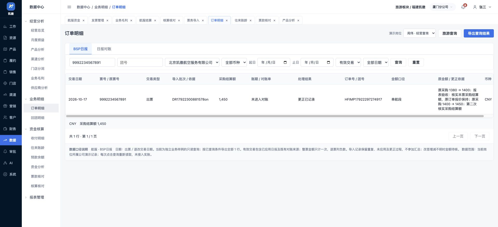

# 航服报表有效范围与BSP日报修正验收

日期：2026-10-17。本批为附件差异复核第六节第三组：修05、修06、补06。依据[附件差异复核](航服附件与原型差异复核-20261017.md)及进度第三、四节，三项已实施并复验。本批没有进入补01、补02、补03、补05或航司模板配置，不据此宣布附件全部完成。

## 一 使用角色、业务位置与要求对照

票务经办导入出票、退改日报，结算人员提交业务结算，财务确认结算结果；经营查询及核算人员在数据中心检查已出未提结算、团组毛利和日报范围。报表读取上游业务事实，保持只读，不在报表内审批、付款、修改订单或办理核算。异常回原业务办理，本批不新增报表下钻。

| 财务／业务要求 | 原有功能 | 已证实缺口 | 修改页面／流程 | 验收结果 |
|---|---|---|---|---|
| 修05：已出未提结算不得漏单 | 核算核对的未提结算视图 | 作废结算也被认作已提交，导致两单消失 | 按同公司、同币种的有效原结算判断；区分草稿、退回、作废、审核中及已确认版本 | 原草稿两单→作废后仍两单→重新建单提交后零单；规则补验退回、撤回和修订保护 |
| 修06：有效毛利及期间准确 | 业务毛利的团组查询 | 作废81,000／80,000／1,000仍计合计，缺期间被固定放入十月 | 有效、待确认、已确认与作废历史分开；测算毛利与确认毛利分列，缺期间单列，调整按自身期间计增减 | 作废后有效查询零行，历史可查且不汇总；缺期间不进十月，补十一月后进十一月；批准版本与调整规则通过 |
| 补06：日报独立于对账范围 | 订单明细的BSP日报及日报对账 | 日报只取已建立对账单的系统侧记录 | 日报纳入已应用导入交易；有效交易与导入记录可切换，列原票、批次、金额口径、处理结果及对账关系 | 未对账票可查；重复不增加，错误不入有效额；1380→1400→1450逐次更正可查，对账视图仍按对账单范围 |

## 二 本批口径

### 已出未提结算

未提交草稿、退回、撤回及作废记录不能替代有效提交；列表说明相应原因。审核中、已结算或保留已批准版本的修订记录，按有效原结算处理。补充调整不能替代首次结算；公司、币种不同的单据不能把本订单排除。取消订单及无已出票记录的订单继续不进入该视图。

本视图沿用航服结算的订单来源，本批没有把全部机票订单跨页自动同步成结算来源。导入后批次核单仍是补02的待办，不用报表修正代替该流程。

### 团组毛利

- 默认“全部有效”排除已作废及来源无效的调整；作废历史可筛选查看，不参加合计。
- “测算毛利”是当前业务销售净额减采购净额；“确认毛利”取已批准结算版本。仅成本行已确认，不代表财务已确认结算。修订中可同时看到本次测算和原批准金额。
- 已结算记录以批准版本金额及期间为准。补充调整列自身增减金额及所属期间，不把调整回填原月后再重复相加。
- 普通团组、包机项目及包机调整均不使用固定月份或项目结束日期补齐期间。缺失、非法期间显示“期间待核”；按起止日期查询时排除，并提示日期缺口，可清除日期后筛“日期待核”。
- 包机调整来源目前未提供明确期间时继续待核，不擅自增加一个月份；正式收入确认、税费及内部供票政策仍按航待01—12确认。本次业务毛利不等于正式财务损益。

### BSP日报与对账

“有效交易”包含当前原型已应用的BSP日报交易，以及尚无对应导入记录的既有对账来源。只取日报，不把票号回填或非BSP供票混入。公司、账户、币种、交易类型、票号、原票及交易日期用于核对对应关系；已有对应记录只计一次，更正日期也核对旧版关系。对账引用与当前日报金额、日期不同时明确提示，原对账不被静默修改。

同票多段明确为整票且金额一致时计一次，明确为分段时相加；金额冲突或无法判断时为待核。退票采购结算额列负数；当前改签导入没有可靠的净增减定义，保持金额待核，不拿原始正数冒充新增采购。

“导入记录”展示原始行、未应用原因、重复跳过和更正批次，保留原票及原采购金额，不参加汇总。连续更正按1380→1400、1400→1450记录，不伪造成每次都从1380更正。旧批次未保存原金额时写“见原记录”，不猜测历史。导入记录不是正式有效交易，也不等于财务确认。

交易日期取出票／退改日期，不取出行日期。报表支持公司、币种、票号／关键词、团号、日期和记录范围查询。导出采用已经查询的条件和全部结果，未点击查询的输入不改变导出范围。

## 三 实际页面验收

使用本地HTTP预览及独立演示标签，通过页面按钮、表单和下拉框完成；未直接注入页面业务状态。以下文字证据均在[本批证据目录](evidence/air-report-fixes-20261017/)。

| 场景 | 观察结果 | 证据 |
|---|---|---|
| 缺期间与恢复 | 清空原结算期间后，十月查询不含该单；日期待核可查；补2026-11后十一月可查 | [十月排除](evidence/air-report-fixes-20261017/missing-period-excluded.txt)、[日期待核](evidence/air-report-fixes-20261017/missing-period-visible.txt)、[恢复](evidence/air-report-fixes-20261017/period-restored.txt) |
| 作废及重新提交 | EU20261014001两单作废前后均在未提结算；新结算有效提交后移出 | [作废前](evidence/air-report-fixes-20261017/unsettled-before.txt)、[作废后](evidence/air-report-fixes-20261017/unsettled-after-void.txt)、[重提后](evidence/air-report-fixes-20261017/unsettled-after-resubmit.txt) |
| 作废毛利 | 81,000销售、80,000采购、1,000毛利不再进入有效结果；作废历史可见，无合计 | [有效查询](evidence/air-report-fixes-20261017/void-excluded-profit.txt)、[作废历史](evidence/air-report-fixes-20261017/void-history-profit.txt) |
| 导入先于对账 | 9992234567891应用后日报有1行1380，对账查询无对应行，交易日期为10月17日而非11月出行日 | [日报](evidence/air-report-fixes-20261017/daily-before-reconciliation.txt)、[对账](evidence/air-report-fixes-20261017/daily-not-in-reconciliation.txt) |
| 重复、错误、原票缺失 | 同文件再次导入有效交易不增加；错误票号及未匹配原票行保留原因；导入记录无合计 | [重复结果](evidence/air-report-fixes-20261017/daily-duplicate-import.txt)、[前三批9行](evidence/air-report-fixes-20261017/daily-all-import-records.txt) |
| 两次金额更正 | 1380→1400→1450，有效查询仍1行1450；四次导入的原始、重复、两次更正分别可查，第二次原额1400准确 | [最终日报](evidence/air-report-fixes-20261017/daily-second-corrected.txt)、[更正历史](evidence/air-report-fixes-20261017/daily-second-history.txt) |
| 岗位范围 | 销售岗位无采购日报结果，经营查询岗位恢复可见 | [销售限制](evidence/air-report-fixes-20261017/sales-report-restricted.txt) |
| 实际导出 | 在第一次更正1400后导出，实际CSV为已查询票号1行1400；未查询的新输入不影响结果 | [下载内容](evidence/air-report-fixes-20261017/BSP日报-实际下载.csv)、[文件核对](evidence/air-report-fixes-20261017/download-check.json) |
| 桌面及1024窄屏 | 修复日报交易类型列被压成零宽的问题；六个报表页面外壳不横溢，表格内横向滚动，只读表格无办理按钮或下钻链接 | [日报列宽](evidence/air-report-fixes-20261017/layout-daily-1024.json)、[六页记录](evidence/air-report-fixes-20261017/report-pages-1024.json)、[右侧滚动截图](evidence/air-report-fixes-20261017/daily-1024-right.png) |

桌面最终结果：

## 四 规则与文件检查

新增[26项报表规则测试](../tests/air-report-fixes.test.cjs)，全部航服规则299项通过，见[运行记录](evidence/air-report-fixes-20261017/regression.tap)。覆盖草稿／作废／重提／退回／撤回、批准后修订、期间缺失与恢复、调整独立期间、包机无结束月回填、多段整票与分段、负向退票、改签待核、重复与错误、两次更正、对账对应与日期更正、账户币种隔离及完整导出。

本批修改3份共享脚本：报表计算、报表界面及导入交易来源记录；18个直接消费者更新脚本引用，其中6个报表页面增加订单日报来源依赖。没有新增HTML、导航或样式文件。代码清单见[入口记录](evidence/air-report-fixes-20261017/entrypoints.json)；3份脚本语法、18页305处本地脚本引用及依赖顺序通过，见[静态检查](evidence/air-report-fixes-20261017/static-checks.json)。页面错误日志见[浏览器记录](evidence/air-report-fixes-20261017/browser-errors.json)。进度及执行清单检查见[收尾检查](evidence/air-report-fixes-20261017/finance-check.json)。

计算测试包含构造的异常数据，不能替代实际浏览器流程；浏览器证据只涵盖上表，不声称299项均以浏览器执行。实际CSV为第一次更正时的1400，最终截图为第二次更正后的1450，二者是不同验收时点。

## 五 遗留与唯一下一步

修01—08及补04、补06已完成修正；仍有补01、补02、补03、补05及完善01。实际浏览器文件上传、file://跨页两项继续待人工补验，沿用用户跳过前置验证的授权，不标通过、不阻断本批。实账全量取数、真实接口、航司正式模板和未定政策不因本批测试通过而视为完成。

唯一下一步：进入原第四组，先实施补01“来源供票需求变更及一源多单核对”。核对同一旅游订单多张供票单的团号、日期、人数及金额变化，明确受影响单据和航段；旅游成交价与航服供票价分开，已确认价及已出票结果不静默覆盖。范围限来源交接、计调核对、票务接收及直接入口。之后保持补02批次核单、补03内部费用接收、补05新结算核算准备、完善01的原顺序。原集团财务8批／36项／6场景和其他工作线保持。
