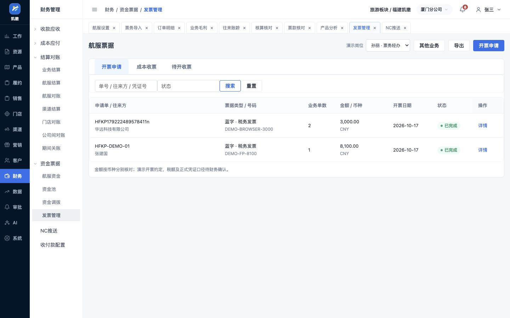
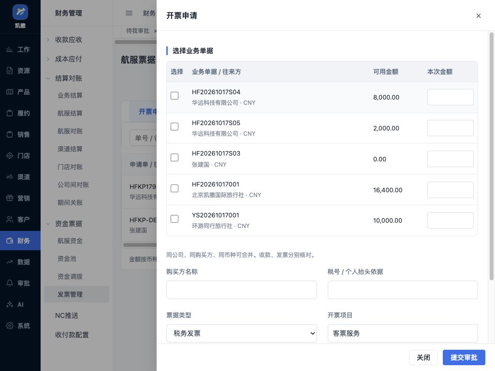
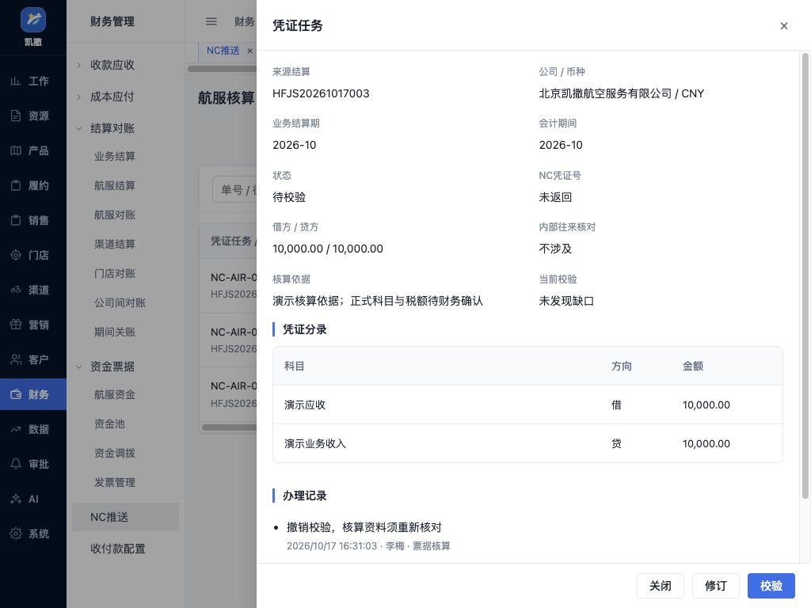

# 航服票据核算与整体收尾实施验收

> 2026-10-17航服完善01已完成：18列中文和14列英文演示格式、列名与顺序、姓名日期、允许值、实际预览下载及订单配置往返已复验，见[模板差异配置与导出验收](航服航司模板差异配置与导出实施验收-20261017.md)。修01—08、补01—06、完善01均已完成，计划内待实施0步；唯一下一步为用户业务试用复核。正式模板、航待政策、真实接入及两项文件环境待补保持；原财务8批／36项／6场景和并行线不变。下方旧“下一步”为历史。

> 2026-10-17后续补05已完成：新完成结算、包机及调整可进入本次核算准备，详见[新结算核算准备验收](航服新结算核算准备实施验收-20261017.md)。原三个凭证为独立演示样例，不能代替当前来源；当前唯一下一步为完善01。

> 2026-10-17后续第三组完成：修05、修06、补06现行口径及证据见[本批报表修正验收](航服报表有效范围与BSP日报修正验收-20261017.md)。日报已覆盖未对账的已应用BSP导入，毛利与未提结算按有效范围查询。本文验收时点及旧下一步保留为历史；当前唯一下一步见进度第三、四节。

> 2026-10-17后续修正：修04、修07、补04已按[本批款票修正验收](航服开票付款与采购收票修正验收-20261017.md)补齐当前订单开票、已审账户引用后续办、同采购付款与成本收票对应。本文原样例和验收数量保留为历史范围；当前及唯一下一步以进度第三、四节为准，不沿用本文旧下一步。

日期：2026-10-17。步骤：航实07；范围：航验29—34、航联01—08。依据用户原始功能清单、整体设计航页11—12、87项需求对照及进度第三、四节。用户已授权跳过航实02两项文件环境验收继续，本步不重开该限制。

本步已完成可操作原型及下述验收。七步主体原型均已交付；航实02实际浏览器文件上传和本地文件跨页办理仍待补验，因此不宣布全部环境验收通过。真实航司、银行、税务和财务核算系统均未接入。

## 一 角色、业务位置与入口

上游为航服订单、原结算、供应商成本凭证和已确认收付。票务核对购买方及本次开票金额，主管审批，财务办理开收票和凭证核算；配置人员维护名单版本与连接规则，经营人员在数据中心查询。开票不替代收款，批准不等于开具成功，业务结算期与财务记账所属月份分别保留。

| 使用场景 | 主入口及工作区 | 本步可操作结果 |
|---|---|---|
| 票务申请／财务开收票 | 财务管理→发票管理→航服票据；订单“收付票据→开收票查询” | 单／多单申请、审批、开票回执、红冲、部分收票、待开收金额 |
| 主管审核 | 原审批中心→航服开票 | 通过／退回、申请来源及返回入口 |
| 财务核算 | 财务管理→NC推送→航服核算 | 校验、修订、撤销校验、演示推送、结果待查／失败／成功 |
| 配置人员维护 | 系统设置→航服设置 | 12家航司24版本、必填资料、停用、连接测试、导入字段对应、年度账期入口 |
| 票务辅助建单 | 票务导入→辅助建单 | 指定订座文本／截图样例预览、人工复核、建立草稿；保留手工路径 |
| 销售源头资料 | 原销售订单→游客信息→编辑张建国资料 | 护照指定样例，失败／缺字纠正／复核／保存，再显式提交供票名单 |
| 财务及经营查询 | 原数据中心六个主题页→航服查询 | 七类结果、八个视图；查询、分页与全结果导出，表格只读无下钻 |

订单返回保留销售或本团计调身份，不升级为票务。该身份选择器是原型演示，不是生产权限验证。页面按实际业务状态显示稳定操作，开票申请与审批、财务执行各自独立。

## 二 功能和金额验收

| 编号 | 正常结果 | 异常与保护 | 证据方式 |
|---|---|---|---|
| 航验29 | 同客户两单分配2000与1000，合并申请3000；收款仍分别10000和0。财务成功回填演示号码。成本票可部分收取并续收 | 跨购方／公司／币种、逐单超额、重复号码拦截。业务退改红字减少业务上限；信息更正整票红冲后允许重开。预收与内部打包未定政策明确待确认 | 39项本步规则中的票据分支；实际浏览器申请→审批→待查→重复号拒绝→成功路径 |
| 航验30 | 8100借方／8000贷方不能推；修订贷方8100可校验。业务期间2026-09可按已开放会计期2026-10办理，原业务期间保留 | 未校验、关账、内部未核、校验后资料改变均拦截。尚未推送可撤销校验；推送中／未知／成功不可覆盖。未知先查，失败可修复，成功号唯一 | 规则及NC实际失败恢复；1024凭证任务截图 |
| 航验31 | 连接成功／失败／待查可选演示；订座转换经人工复核建立订单草稿；指定截图和账单样例可预览修订 | 未复核不能建单；价格、票号、证件生日和有效期不臆造。相同PNR改用截图入口不重复建单。BSP缺页／无法识别不残留可应用行 | 模型规则及浏览器连接、订座草稿、截图预览、账单完整／缺页；护照源头纠错保存 |
| 航验32 | 六个既有页面提供七类查询；BSP日报与对账分开。团组81000−80000＝1000；包机670000−640000＝30000；131承运、29空置、18.13%空置率 | 未知成本不填零；未飞不算最终空置；包机采购不重复列入普通切位；公司币种岗位过滤；导出全部查询而非当前页 | 报表规则、44组布局中的六页只读检查、实际往来CSV两行核验 |
| 航验33 | 87个编号逐一记录已交付行为、对应步骤和边界；原文需求保留 | 两项环境待补、12项政策待确认、真实接入和正式模板分别列示，不混为功能缺失或生产通过 | [87项收尾核对](航服87项需求收尾覆盖核对-20261017.md)、覆盖检查文件 |
| 航验34 | 22个主入口×1440／1024共44组布局：页面外壳未横溢；操作列右固定；开票及凭证抽屉金额控件可见；返回身份保留 | 修复通用表格运行时样式撑宽操作列；普通原发票、NC和毛利入口保留；本次未记录脚本错误 | 布局记录、原页面回归、截图及静态引用／语法检查 |

红冲金额是业务原型额度，不替财务确定税率、税额或抵扣。成本凭证四类区分电子客票凭证、税务发票、境外费用凭证和包机协议凭据；登记收票不表示已完成税务认证或付款核销。

## 三 七类报表与日期口径

| 类别 | 原数据中心页面 | 查询内容及边界 |
|---|---|---|
| BSP日报与对账 | 订单明细 | 日报展示账单核对所用的原交易；对账展示对方、系统及差异。按交易日筛选，账期另列，非所有来源票务流水全集 |
| 团组毛利 | 业务毛利 | 按业务结算期间，含团组及包机项目；预计和确认分别列，负毛利可筛 |
| 应收应付 | 往来账龄→往来明细 | 按当前业务净额与已确认收付计算；可按客户供应商或团号汇总，方向和币种分开。起止日是业务出行日筛选，不是期间发生额 |
| 未提结算 | 核算核对 | 已出票且未提交有效结算的订单范围；已取消排除，缺成本待核 |
| 逾期账款 | 往来账龄→逾期明细 | 按各自约定日期分别查应收／应付；已逾期、当日、未来及日期待核。当前已确认收付用于余额，截止日只计算天数，不重算历史余额 |
| 开收票 | 票款核对 | 业务金额、已开收净额、申请占用、未开收及款票差异；已开收按最后开收日，未开收按业务日 |
| 机位使用与空置 | 产品分析 | 按出发日；切位使用率为占用／有效座位，包机为实际承运／有效座位；出票量单列。尚未飞行显示待承运 |

报表数据口径说明置于底部，标明独立演示记录、当前岗位所属公司和每次查询重新读取。无认款／付款／出票操作，无表格金额或单号下钻。查询条件与已查询结果区分，页签分别保留条件，导出使用已查询的完整结果。正式历史余额、期间发生额、生产全量数据仍须按资金日期及核算规则取数，不能从当前演示记录推算为实账。

## 四 八组岗位连续联验

本轮以连续规则测试验证各模块承接，并结合前六步浏览器流程和本轮关键路径操作。不是八套完整浏览器端到端自动测试，也不是跨系统生产联调。

| 编号 | 连续场景及结果 |
|---|---|
| 航联01 | 散客报价→过期支付重新申请→收款→出票待查查询→日报回填与重复→对账→结算，毛利170 |
| 航联02 | 企业信用→两单6000／4000合并收8000→分配后余2000→逾期→10000开票，开票和到账分别处理 |
| 航联03 | 部门机位再分团不重复扣量→名单认领接收→法航导出→分批出票→同法人／跨法人对账→81000／80000结算 |
| 航联04 | 票代供应确认→付款申请审批→出纳实付5000→部分成本收票→供应商按原付款退回2000，净实付8000 |
| 航联05 | 已结后部分人段退票→其余客票再改签和航司补收；客户与供应商资金分别推进，补充调整销售-7100、成本-6400，原结算与凭证保留 |
| 航联06 | 平台期初10000＋充值50000−扣款32000＋退余额2000−退银行5000＝25000并对账 |
| 航联07 | 包机意向→协议640000及航次160座→启动→内部／同行／散卖131座→承运完成→空置29、毛利30000→主管财务确认 |
| 航联08 | 导入重复、更正、单边差异、权限受限、关账阻断、NC失败→修复开放期间→成功，原业务期不变 |

## 五 实际检查与证据

- 全部航服测试运行器：230项通过、0失败，其中本步39项规则及8组岗位连续场景。记录见[运行结果](evidence/air-close-step7-20261017/node-tests.tap)。前序测试包含独立机位断言，计数以运行器实际输出为准。
- 28组归并的实际浏览器操作观察，见[页面观察](evidence/air-close-step7-20261017/browser-observations.json)；22个主入口双尺寸共44组，见[布局记录](evidence/air-close-step7-20261017/browser-layouts.json)。观察分组数量不充当自动断言数。
- 浏览器真实下载的[往来按团汇总CSV](evidence/air-close-step7-20261017/往来按团汇总.csv)：2行；EU团81000／50000／31000，与页面一致。[法航名单ZIP](evidence/air-close-step7-20261017/法航演示名单.zip)：1文件、1人、1明细行、18列含国籍；[内容核验](evidence/air-close-step7-20261017/download-checks.json)。
- 13页262处本地引用、93份外部脚本及测试、3段内联脚本语法检查通过；BSP五个表头更改后的实际CSV解析通过。文档链接及集团财务检查见同目录检查记录；原财务8批、36项、6场景保持原状态，不因本工作线重开或替换。

页面证据：

## 六 遗留与唯一下一步

1. 按用户“跳过验证继续”授权，航实02实际文件上传与本地file://跨页办理仍由用户手工补验，未在本步重复访问受限环境，也未伪记通过。
2. 航待01—12继续待业务／财务确认，包括实际法人、信用、押款及损耗、年度日历、正式航司模板、审批与提前结算、税务总净额、承运凭据、连接能力、银行确认和正式科目。方案批准不代替这些政策批准。
3. 白屏、航司平台、银行、税务和NC仅脱敏配置及演示结果；识别仅指定样例。真实接入、任意PDF或图片识别、实账取数及生产权限另行验收。

唯一下一步：用户按八组岗位场景试用原型，结合具体反馈修订对应页面，并手工补记航实02两项环境结果。七步主体原型不重做，不自动增加“航实08”，不转入生产接口开发。

## 开发附录 修改位置

新增：`merchant/system/air-settings.html`，`shared/air-close-model.js`、`air-close-ui.js`、`air-reports-model.js`、`air-reports-ui.js`、`air-ticket-sample.svg`，`tests/air-close.test.cjs`、`air-role-journeys.test.cjs`。

直接修改：原发票、NC、审批及数据中心六页；票务导入、机票订单编辑／详情的脚本引用；订单模板与导出、导入字段对应；对账指定账单样例；销售游客资料组件；导航和局部航服样式。机位、订单、资金、退改、对账和包机原记录没有为了报表被跨模块自动改写。

访问参数：发票／NC／审批为 `business=airclose`，辅助建单为 `assist=1`，六个数据主题为 `business=air`。订单上下文带订单号和演示岗位，返回沿用原订单的 `role` 参数。新增报表查询保存于当前页面，不构建全系统数据同步服务。
